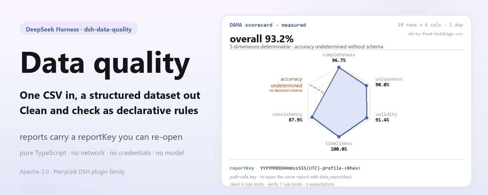
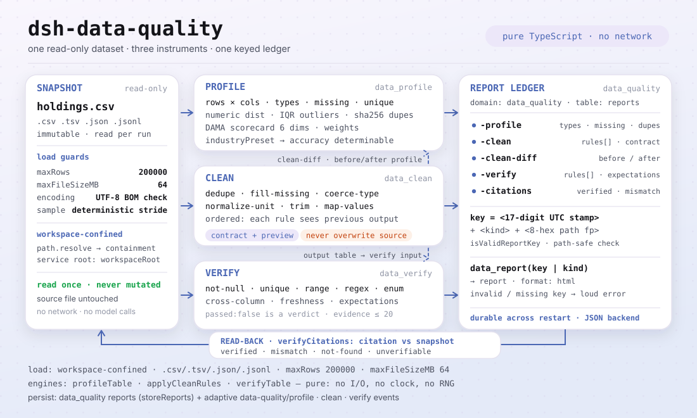
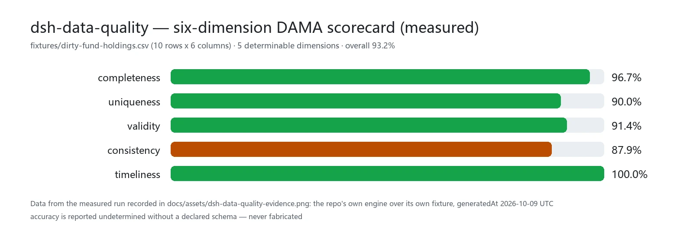

<div align="center">

<picture>
  <source media="(prefers-color-scheme: dark)" srcset="docs/assets/dsh-data-quality-hero-en-dark.webp">
  
</picture>

# dsh-data-quality

**Stop making the model do the math — hand it a CSV and get back a profile, a clean dataset, and a report you can re-open.**

A deterministic data-quality plugin for DeepSeek Harness: row and column counts, missing rates, duplicate rows, inferred types, a six-dimension DAMA scorecard, and seven verification rule kinds — all computed in pure TypeScript inside the harness process, with reports persisted to the `data_quality` storage domain.

[Install](#three-step-setup) · [Configuration](#configuration) · [FAQ](#faq) · [简体中文](README.md) · [English](README.en.md) · [Español](README.es.md) · [Português](README.pt.md) · [हिन्दी](README.hi.md)

[](LICENSE)
[](#compatibility)
[](https://www.npmjs.com/package/dsh-data-quality)
[](https://github.com/PerryLink/dsh-data-quality/actions/workflows/ci.yml)
[](#compatibility)

[](https://github.com/PerryLink/dsh-data-quality/stargazers)
[](https://www.npmjs.com/package/dsh-data-quality)
[](https://dshfind.com/plugins/PerryLink/dsh-data-quality?ref=badge)
[](https://securityscorecards.dev/viewer/?uri=github.com/PerryLink/dsh-data-quality)
[](https://dsh.market/)
[](https://gitee.com/perrylink/dsh-data-quality)

```sh
dsh plugin --profile <name> add dsh-data-quality
```

</div>

<sub>Community plugin, not affiliated with DeepSeek. Canonical repository: <https://github.com/PerryLink/dsh-data-quality> (Gitee is a mirror).</sub>

## What it is

Give the model a CSV and `dsh-data-quality` reads it into a structured dataset, then computes everything you should know with pure functions: rows and columns, which columns are mixed-type, what is missing, what is duplicated, what the numeric distributions and IQR outliers look like — and finally a six-dimension DAMA scorecard. Cleaning and verification are expressed as declarative rules; every run persists its report to the `data_quality` storage domain and returns a `reportKey`, so every number the model shows you can be re-opened rather than "felt". All computation is TypeScript inside the harness process: no network, no credentials, no external processes, no model calls.

<picture>
  <source media="(prefers-color-scheme: dark)" srcset="docs/assets/dsh-data-quality-flow-v5-dark.svg">
  
</picture>

## Three-step setup

1. **Install** (pick one channel):

   ```sh
   # git channel (latest main; equivalent to git+https://github.com/PerryLink/dsh-data-quality.git)
   dsh plugin --profile web add github:PerryLink/dsh-data-quality
   # npm channel (published releases)
   dsh plugin --profile web add dsh-data-quality
   # tarball channel: pnpm pack in this repo, then
   dsh plugin --profile web add ./dsh-data-quality-<version>.tgz
   ```

   The first `add` on the git channel fails because pnpm blocks the package's `prepare` build. Copy the exact key pnpm prints into the profile's `pnpm-workspace.yaml` and re-run:

   ```yaml
   allowBuilds:
     'dsh-data-quality': true
   ```

   Restart the profile after installing (bundles activate on restart).

2. **Minimal config** (sane defaults; raise the guards as needed):

   ```yaml
   - insert:
       - id: dsh-data-quality
         name: dsh-data-quality
         config:
           maxRows: 200000
           maxFileSizeMB: 64
   ```

3. **Verify it mounts**:

   ```sh
   dsh --profile web --dump-config | grep -A2 'id: dsh-data-quality'
   ```

   Then, in a workspace containing a CSV, ask the agent:

   > Profile `holdings.csv`, then clean it by trimming whitespace, deduplicating on `fund_code`, and normalizing the `holding_value` column's unit suffixes to base units; finally verify `fund_code` is unique and not null.

**Uninstall**: `dsh plugin --profile web remove dsh-data-quality` (or remove the row from the profile patch).

## Core capabilities

- **`ctx.dataQuality` service** — a Cordis service other plugins may optionally consume (`inject = ['dataQuality']`). Besides the three dataset operations behind the tools, it implements the frozen `verifyCitations(request)` contract: verify that numbers/strings cited in a document match a dataset snapshot, with relative-tolerance numeric comparison and `verified` / `mismatch` / `not-found` / `unverifiable` statuses.
- **`data_profile` tool** — row/column counts, inferred column types (number/date/boolean/string/empty/mixed), missing rates, unique counts, numeric distributions (min/max/mean/median/p25/p75), IQR outlier counts, mixed-type suspicion notes, and full-table sha256 content-hash duplicate detection (duplicate rate plus a bounded sample of duplicate row indexes). Adds a deterministic DAMA six-dimension scorecard (completeness, uniqueness, validity, consistency, timeliness, accuracy — accuracy is reported undetermined without a declared schema, never fabricated). Optional deterministic systematic sampling for large files.
- **`data_clean` tool** — ordered declarative cleaning rules: `dedupe` (by column group), `fill-missing` (constant/mean/median/forward), `coerce-type` (number/date/boolean; failures counted and set to missing), `normalize-unit` (Chinese ten-thousand/hundred-million suffixes to base units, see the factors example below), `trim`, `map-values` (enum mapping). Returns a per-rule audit log, a pre-delivery contract validation summary (dedupe before/after, uniqueness, non-null and type regressions), and a bounded preview; writes the cleaned dataset only when `outputPath` is given, and never overwrites the source.
- **`data_verify` tool** — declarative verification rules: `not-null`, `unique`, `range`, `regex`, `enum`, `cross-column` (e.g. `startDate < endDate`), `freshness` (date column within N days of a reference date). Per-rule pass/fail with capped failing-row evidence; an overall failure is a normal `passed: false` result, not a tool error.
- **`data_report` tool** — read persisted reports back from the `data_quality` storage domain: by exact `reportKey` (path-safe validation, missing keys fail loud) or by `kind` (chronological listing). `format: html` renders one profile/clean report as a self-contained offline HTML document (inline CSS/JS, no external requests) with the DAMA six-dimension scorecard and the profile/cleaning summary tables.
- **Durable reports** — every profile/clean/verify/citation run persists to the `data_quality` storage domain (JSON backend), keyed by run timestamp plus a dataset-path fingerprint; the key is returned as `reportKey` in tool results. Clean reports also persist the bounded preview and the contract summary, so every model-visible result is reconstructable from its `reportKey`; each clean run additionally persists a `clean-diff` before/after profile report.
- **Session events** — on hosts that can carry them safely, runs append `data-quality/profile` / `data-quality/clean` / `data-quality/verify` events (with the `ignorable` marker where supported). On the published `0.1.7-rc.2` line (as on earlier rc lines) the append is skipped by design — the storage-domain report is always the durable copy (see "Known limitations").

```text
holdings.csv ──data_profile──▶ report ──data_clean──▶ outputPath
                   │                                  │
                   └──── data_quality domain · reportKey ──┴──data_verify──▶ passed / evidence rows
```

### Tools & surfaces

#### `data_profile({ path, sample?, industryPreset? })`

Profiles a workspace dataset. `path` is workspace-relative (`.csv`/`.tsv`/`.json`/`.jsonl`; JSON must be an array of flat objects). `sample` takes every `ceil(N/sample)`-th row for the column cards (deterministic; row counts stay exact). `industryPreset` (`retail`/`saas`/`fund`/`real-estate`/`e-commerce`/`healthcare`/`logistics`/`manufacturing`/`energy`) injects that industry's expected columns so the scorecard `accuracy` dimension becomes determinable; unknown ids fail loud. Returns the structured report — the duplicate rate, bounded duplicate-row indexes, numeric `count`/`distinct` distributions, file `encoding` (UTF-8 BOM + validity), and the weighted six-dimension DAMA scorecard — and renders a human-readable per-column summary plus scorecard.

#### `data_clean({ path, rules, outputPath?, dryRun? })`

Applies `rules` in array order, each seeing the previous rule's output. Rule reference:

| Rule | Extra fields | Semantics |
|---|---|---|
| `dedupe` | `columns?` | Remove rows whose key-column values duplicate an earlier row (first kept; all columns when omitted). |
| `fill-missing` | `column`, `strategy`, `value?` | Fill missing cells: `constant` (needs `value`), `mean`/`median` (numeric columns), `forward` (previous non-missing). |
| `coerce-type` | `column`, `to` | Coerce to `number`/`date` (ISO)/`boolean`; failures become missing and are counted in the log. |
| `normalize-unit` | `column`, `factors` | Strip a unit suffix and multiply by the matching factor; plain numerics convert too. |
| `trim` | `columns?` | Trim whitespace of string cells (all columns when omitted). |
| `map-values` | `column`, `map`, `else?` | Exact-match mapping; unmapped values stay (`keep`, default) or become `missing`. |

The unit map is a plain suffix-to-multiplier object — the fixture's example:

```json
{"万": 10000, "亿": 100000000}
```

The source file is **never** overwritten. With `outputPath` the cleaned dataset is written there (workspace-confined, format by extension); without it the run is preview-only. With `dryRun: true` no file is written and nothing is persisted — the result returns the per-column cleaning plan and the expected `contract`/`diffPreview`. The result also carries a pre-delivery `contract` summary (dedupe before/after rows, uniqueness over the dedupe key or full rows, non-null regression for `fill-missing` columns, type regression for `coerce-type` columns, and the per-column decision trace), and a `clean-diff` before/after profile report is persisted to the storage domain.

#### `data_report({ key?, kind?, format? })`

Reads persisted reports back from the storage domain. Pass `key` (the exact `reportKey` a prior run returned) to fetch one report, or `kind` (`profile`/`clean`/`clean-diff`/`verify`/`citations`) to list every report of that kind chronologically; exactly one of `key`/`kind` is required. Malformed or missing keys fail loud. `format: html` (with `key`) renders the report as a self-contained offline HTML document — inline CSS/JS, no external requests, the DAMA six-dimension scorecard, and the profile/cleaning summary tables (profile/clean reports only).

#### `data_verify({ path, rules, expectations? })`

Evaluates verification rules. Rule reference:

| Rule | Extra fields | Semantics |
|---|---|---|
| `not-null` | `column` | Fail missing cells (null/empty/whitespace). |
| `unique` | `columns` | Fail every row whose key combination repeats (missing participates). |
| `range` | `column`, `min?`, `max?` | Fail missing/unparseable cells and values outside the inclusive bounds (at least one bound required). |
| `regex` | `column`, `pattern`, `flags?` | Fail missing or non-matching cells (full JS regex). |
| `enum` | `column`, `values` | Fail cells whose trimmed text is not listed. |
| `cross-column` | `left`, `op`, `rightColumn?`, `value?` | Compare per row: numeric when both sides parse, dates compare as epochs, strings only for `==`/`!=` (exactly one of `rightColumn`/`value`). |
| `freshness` | `column`, `maxAgeDays`, `asOf?` | Fail dates older than `maxAgeDays` before `asOf` (default: now); unparseable/missing fails. |

`expectations` reconciles deterministic metrics against expected values: `rowCount`, `columnSum`, `columnMean`, `uniqueCount`, `nullCount` (each with `column` except `rowCount`, plus `expected` and an optional relative `tolerance` in [0, 1]). Each expectation yields `passed` plus `actual`/`expected`/`tolerance`; a mismatch is a normal `passed: false` verdict, never a tool error. Invalid metrics, missing columns, and out-of-range tolerances fail loud.

A missing cell fails every rule that reads it. Evidence is capped at `evidenceRowLimit` failing rows per rule.

#### `ctx.dataQuality` (for other plugins)

```ts
const result = await ctx.dataQuality.verifyCitations({
  dataset: 'holdings.csv',          // resolved against workspaceRoot
  citations: [
    { id: 'c1', path: 'rows[3].nav', value: 1.234, tolerance: 0.01 },
    { id: 'c2', path: 'summary.annualReturn', value: '12.34%' },
  ],
})
// result.results[i] = { id, status: 'verified' | 'mismatch' | 'not-found' | 'unverifiable', actual?, note? }
```

Locators walk the dataset document: CSV/TSV load as `{ columns, rows }` (so `rows[3].nav` resolves), JSON is the parsed value, JSONL the array of parsed lines. Numbers compare with relative tolerance (`|a-b| <= tolerance * max(|a|, |b|)`); a CSV string cell that parses numerically compares as a number; strings compare exactly; incomparable type pairs are `unverifiable`. The service also exposes `profileDataset` / `cleanDataset` / `verifyDataset` (the same operations the tools call).

### Examples

These are the plugin's real entry points; install once, then call one.

**Detailed example** — command `data_profile`, input:

```sh
data_profile({ path: "dirty-fund-holdings.csv" })
```

Output:

```text
Profile of dirty-fund-holdings.csv: 10 rows x 6 columns
Duplicate rows: 1 (10.0%); sample row indexes: 8
- nav: mixed; missing 1 (10.0%); unique 7; note: mixed types among 9 present values: 8 numeric, 1 string
Scorecard (overall 93.2%, weighted 93.2%):
```

*Observed from `README.md:147-149; test/profile.spec.ts:130-132; test/loader.spec.ts:98-99; src/profile.ts:311-315`*

**Failure branch** — input:

```text
{"path":"dirty-fund-holdings.csv","rules":[{"rule":"dedupe","columns":["nope"]}]}
```

Output:

```text
isError=true; error.message=rule 0: unknown column "nope" (columns: fund_code, fund_name, nav, nav_date, holding_value, currency)
```

*Observed from `plugins/dsh-data-quality/src/clean.ts:66-68; plugins/dsh-data-quality/fixtures/dirty-fund-holdings.csv; exercised through plugins/dsh-data-quality/test/harness.ts`*

**Brief examples**: `data_clean` · `data_verify`

## Measured data

<picture>
  <source media="(prefers-color-scheme: dark)" srcset="docs/assets/dsh-data-quality-evidence-en-dark.webp">
  
</picture>

Measured on the repo's own fixture `fixtures/dirty-fund-holdings.csv` (10 rows x 6 columns): completeness 96.7% · uniqueness 90.0% · validity 91.4% · consistency 87.9% · timeliness 100.0%, weighted overall 93.2%; the sixth dimension, accuracy, is reported undetermined without a declared schema (it becomes determinable only with an `industryPreset`). This is not an accuracy benchmark — it is a deterministic, recomputable reading on the same dirty data. The data comes from the measured run recorded in `docs/assets/dsh-data-quality-evidence.png` (the repo's own engine over its own fixture, generatedAt 2026-10-09 UTC) and can be reproduced with `node scripts/loader-runner.mjs` (no API key required).

## Configuration

All keys are optional (defaults shown); invalid values fail loudly at load. Every key is settable from `cordis.yml` (the bundle ships `cordis.patch.yml` with the same defaults). An id-targeted override replaces the whole row — restate every key you need.

Most-used keys:

| Key | Default | Description |
|---|---|---|
| `enabled` | `true` | Master switch; `false` mounts nothing at all. |
| `maxRows` | `200000` | Hard row cap per dataset load; larger inputs reject loudly (use the tool's `sample` parameter). |
| `maxFileSizeMB` | `64` | Hard file-size cap in MiB per dataset load. |
| `evidenceRowLimit` | `20` | Cap on failing-row evidence (verify) and preview rows (clean) in one result. |
| `allowedExtensions` | `['.csv', '.tsv', '.json', '.jsonl']` | Extensions accepted as datasets. |
| `workspaceRoot` | `""` | Absolute root for SERVICE-level calls (e.g. `verifyCitations`) that carry no session workspace; empty = the harness process launch directory. Tool calls always use the session's workspace cwd. |
| `storeReports` | `true` | Persist run reports to the `data_quality` storage domain and return `reportKey`. |

<details>
<summary>Full configuration table (9 keys)</summary>

| Key | Default | Description |
|---|---|---|
| `enabled` | `true` | Master switch; `false` mounts nothing at all. |
| `maxRows` | `200000` | Hard row cap per dataset load; larger inputs reject loudly (use the tool's `sample` parameter). |
| `maxFileSizeMB` | `64` | Hard file-size cap in MiB per dataset load. |
| `defaultTolerance` | `1e-9` | Default relative tolerance for numeric citation comparison when a citation omits `tolerance`. |
| `evidenceRowLimit` | `20` | Cap on failing-row evidence (verify) and preview rows (clean) in one result. |
| `allowedExtensions` | `['.csv', '.tsv', '.json', '.jsonl']` | Extensions accepted as datasets. |
| `workspaceRoot` | `""` | Absolute root for SERVICE-level calls (e.g. `verifyCitations`) that carry no session workspace; empty = the harness process launch directory. Tool calls always use the session's workspace cwd. |
| `storeReports` | `true` | Persist run reports to the `data_quality` storage domain and return `reportKey`. |
| `scorecardWeights` | all 1 (equal) | Per-dimension weights (completeness/uniqueness/validity/consistency/timeliness/accuracy) for the scorecard's weighted overall total; each weight must be a non-negative number. |

</details>

Example override in your profile patch:

```yaml
- insert:
    - id: dsh-data-quality
      name: dsh-data-quality
      config:
        maxRows: 50000
        evidenceRowLimit: 10
        scorecardWeights:
          completeness: 2
          uniqueness: 1
```

## FAQ

<details>
<summary>Where does the data live? Can it leave the machine?</summary>

It reads workspace dataset files (allowlisted extensions only) and writes exactly two things: the `data_clean` output file when an explicit `outputPath` is given (workspace-confined, never the input), and reports in the `data_quality` storage domain under the harness data directory. **No network, no credentials, no external processes** — all parsing and statistics are in-process TypeScript. Reports may contain sample cell values from your datasets (bounded by `evidenceRowLimit` and display truncation); the session log records tool arguments and results as usual.

</details>

<details>
<summary>What happens on a bare profile or a host without session events?</summary>

The plugin hard-injects `tools` and `storageDomain`: the shipped profiles (web/headless/sdk/acp) compose the storage stack (`dsh-storage` + `dsh-storage-json` + `dsh-storage-domain`) through `dsh-base`, so a bare profile must compose it itself or the plugin will not mount. Session events are adaptive — when the host does not know the `data-quality/*` vocabulary and `Session.append` cannot stamp `ignorable`, the append is skipped (it never corrupts the session log), and the `data_quality` storage-domain report remains the durable copy.

</details>

<details>
<summary>Does it fight other plugins over service keys, tool names, or slots?</summary>

No. It registers no waterfall listener, publishes a single namespaced service key (`dataQuality`), names all four tools with a `data_` prefix, registers no client slot and no `webServer` prefix, and mutates no globals; the bundle patch only `insert`s its own row. The point-by-point argument is in "Interoperability with other DSH plugins".

</details>

<details>
<summary>How big is the performance overhead? What about large files?</summary>

Parsing and statistics are zero-dependency in-process TypeScript — no inference, no network, no model calls, so a typical CSV costs one file read plus one linear scan. The guards are hard: `maxRows` (default 200000) and `maxFileSizeMB` (default 64) reject oversized inputs loudly, `data_profile`'s `sample` parameter provides deterministic systematic sampling, and abort signals cancel long loads mid-stream.

</details>

<details>
<summary>Can the model get the arithmetic wrong?</summary>

No — the model does not do arithmetic here. Row counts, missing rates, quantiles, IQR outliers, duplicate rates, the scorecard, and verification verdicts are all produced by deterministic functions; same input, same output, and the only clock is the one injected for `freshness` defaults and report timestamps. The model chooses the tool and the rules, and narrates the result.

</details>

## Security boundaries

- **Path confinement** — dataset and output paths must resolve inside the session workspace (`verifyCitations` uses `workspaceRoot`); `..` escapes and outside absolute paths reject, and both sides are normalized before comparison (Windows slash-safe).
- **Bounded work** — `maxRows` / `maxFileSizeMB` guards reject oversized inputs loudly; abort signals cancel long loads mid-stream.
- **No overwrite** — `data_clean` refuses an `outputPath` equal to the input path.
- **Deterministic computation** — same input, same output; the only clock is the one injected for `freshness` defaults and report timestamps.
- **Registrations are effects** — tool registration and the storage-domain close are Cordis effects, removed on stop/hot-reload.

## Permissions & data

- **Reads** workspace dataset files (allowlisted extensions only).
- **Writes** only: the `data_clean` output file (explicit `outputPath`, workspace-confined, never the input) and reports in the `data_quality` storage domain under the harness data directory.
- **No network, no credentials, no external processes** — all parsing and statistics are in-process TypeScript.
- Reports may contain sample cell values from your datasets (bounded by `evidenceRowLimit` and display truncation); the session log records tool arguments and results as usual.

## Known limitations

- **Session events are adaptive.** The published `0.1.7-rc.2` line (like the earlier rc lines) has no plugin session-event registration surface and its `Session.append` cannot stamp the `ignorable` marker, so appending an unknown `data-quality/*` type would make the session log unreadable on restore. The plugin therefore appends only when the host knows the vocabulary or supports the `ignorable` append flag; on the published line the storage-domain report is the durable record.
- **CSV dialect** — comma/tab with RFC-4180 quoting, header row required, blank lines skipped, no delimiter auto-detection or comment lines.
- **Type parsing is strict** — numbers have no thousands separators; dates are `YYYY-MM-DD` / `YYYY/MM/DD` / ISO-like datetimes (UTC); booleans are `true/false/yes/no/1/0`. Everything else profiles as `string`/`mixed` — clean it with `coerce-type` when intended.
- **JSON must be tabular for the tools** (array of flat objects); `verifyCitations` walks arbitrary JSON documents.
- **No ML anomaly detection, no PII masking, no databases, no SQL** — rule-based suspicion notes only.

## Interoperability with other DSH plugins

Verified against the host corridor this repository declares (`>=0.2.1-0 <0.3.0`) and the plugin contract in `dsh-plugin-guide`.

This plugin **does not interfere** with other plugins:

- **No listener contention.** It registers no waterfall listener at all (neither `agent/pre-step` nor `tools/post-execute`), so it can neither starve nor short-circuit another plugin's chain.
- **Namespaced service key.** It publishes exactly one service key, `dataQuality`, and occupies no built-in or third-party key; consumers declare the dependency explicitly with `inject = ['dataQuality']`.
- **No tool-name collision.** The four tool names `data_profile` / `data_clean` / `data_verify` / `data_report` all carry the `data_` prefix and take no bare name owned by a shipped tool or another plugin.
- **No slot / HTTP route collision.** It is a pure host plugin (no browser half): it registers no client slot key and no `webServer` prefix.
- **No patch-layer collision.** The bundle patch only `insert`s its own row; it never overrides a built-in row's `config`.
- **Storage-domain isolation.** It writes only its own `data_quality` domain (JSON backend) and touches no other plugin's domain.
- **No global mutation.** It does not patch prototypes, rewrite `process.env`, or replace the global fetch dispatcher; no network requests, no external processes.

Static evidence: this repository's historical `dsh-plugin-doctor` verification badge ([report](https://github.com/PerryLink/dsh-plugin-doctor#verified-徽章)).

## Compatibility

| Surface | Status |
|---|---|
| Harness | DeepSeek Harness `dsh-v0.2.1-alpha.1` (adapted 2026-10-04): the peer range now admits the alpha.2 line; there `Session.append`'s third parameter exists only for surface-eligible types and is a `SurfaceIntent`, so the audit gate still skips and the storage-domain report stays the durable copy. Verified 2026-09-24 (three typecheck rulers + full test suite green). |
| Node | `^22.19.0 \|\| >=24.9.0` |
| Package manager | `pnpm@11.7.0` |
| Platform | Windows / macOS / Linux (host-only plugin) |
| Model | Text models fully supported; no extra model capability required |

## Ecosystem & quality

- [Gitee mirror](https://gitee.com/perrylink/dsh-data-quality) (sync mirror; GitHub is canonical)
- [dshfind plugin page](https://dshfind.com/plugins/PerryLink/dsh-data-quality) (installs and ranking)
- [OpenSSF Scorecard report](https://securityscorecards.dev/viewer/?uri=github.com/PerryLink/dsh-data-quality) (driven by [.github/workflows/scorecard.yml](.github/workflows/scorecard.yml))
- [dsh-plugin-doctor verification badge](https://github.com/PerryLink/dsh-plugin-doctor#verified-徽章) (historical)
- [DSH Market](https://dsh.market/) (listed)
- **1024 store channel**: `npm i -g dsh1024` once, then `dsh1024 plugin --profile web add dsh-data-quality` (counts toward the [deepseek1024.com](https://deepseek1024.com) install ranking)
- [Ecosystem knowledge base](https://perrylink.github.io/dsh-plugin-guide/) — measured data, not marketing: plugin development guide · plugin-selection data · maintenance criteria

## Development

```sh
pnpm install                                                     # node ^22.19 || >=24.9
pnpm run typecheck && pnpm run typecheck:ci && pnpm run typecheck:checkout
pnpm test                                                        # vitest
pnpm run build                                                   # tsdown output + d.ts fixups
pnpm run verify:self-contained && pnpm run verify:artifacts     # dependency specs + shipped files
node scripts/check-readme-sync.mjs                               # five-language README consistency
pnpm pack
```

- Tests run vitest against the REAL `Context`/`Session`/`ToolRuntime`/storage domain (no hand-written service mocks) plus pure engine specs; every clean/verify rule has positive and negative cases, and `verifyCitations` covers all four statuses.
- `scripts/loader-runner.mjs` boots the real Loader composition and executes the profile → clean → verify chain against `fixtures/` without an API key.
- Release: `node scripts/release.mjs <x.y.z>` (never pushes; the tag triggers `release.yml`).
- The README images are generated programmatically by [`scripts/gen-readme-assets.py`](scripts/gen-readme-assets.py) (Python + Pillow): light/dark webp heroes (the six-axis DAMA radar), a hand-written two-skin SVG structure diagram, and light/dark webp for the measured chart; safe to re-run.

Topics: `dsh`, `dsh-plugin`, `deepseek-harness`, `cordis`, `data-quality`, `data-cleaning`, `data-profiling`, `data-verification`

## Family & thanks

This project is part of the DeepSeek Harness plugin family from [PerryLink](https://github.com/PerryLink) (all Apache-2.0). If it is useful, **a star helps the next person find it** — nothing is gated behind it.

- [@PerryLink](https://github.com/PerryLink) — maintenance and releases (`0.1.2`/`0.1.3`), peer-dependency upgrades, the npm version/downloads/CI badges, and recent fixes.
- **dsh-data-quality contributors** — the initial scaffold, the `ctx.dataQuality` seam and frozen `verifyCitations` contract, the deterministic dataset layer and pure engines, the `data_quality` storage-domain reports, the real-service vitest suite, the CI/compat/release workflows, and the five-language READMEs.

<details>
<summary>Expand all plugins</summary>

| Plugin | Status |
|---|---|
| **[dsh-aqua-input-check](https://github.com/PerryLink/dsh-aqua-input-check)** |  |
| **[dsh-archive-check](https://github.com/PerryLink/dsh-archive-check)** |  |
| **[dsh-auto-review](https://github.com/PerryLink/dsh-auto-review)** |  |
| **[dsh-autotier](https://github.com/PerryLink/dsh-autotier)** | 🧊 FROZEN — see the repo README |
| **[dsh-bid-ca-precheck](https://github.com/PerryLink/dsh-bid-ca-precheck)** |  |
| **[dsh-bid-qual-check](https://github.com/PerryLink/dsh-bid-qual-check)** |  |
| **[dsh-cert-mcp](https://github.com/PerryLink/dsh-cert-mcp)** | 🧊 FROZEN — see the repo README |
| **[dsh-checkpoint-rewind](https://github.com/PerryLink/dsh-checkpoint-rewind)** |  |
| **[dsh-click](https://github.com/PerryLink/dsh-click)** |  |
| **[dsh-composer-history](https://github.com/PerryLink/dsh-composer-history)** |  |
| **[dsh-contract-stance](https://github.com/PerryLink/dsh-contract-stance)** |  |
| **[dsh-customs-doc-check](https://github.com/PerryLink/dsh-customs-doc-check)** |  |
| **[dsh-data-quality](https://github.com/PerryLink/dsh-data-quality)** | 🧊 FROZEN — see the repo README |
| **[dsh-demurrage-ledger](https://github.com/PerryLink/dsh-demurrage-ledger)** |  |
| **[dsh-doublecheck](https://github.com/PerryLink/dsh-doublecheck)** |  |
| **[dsh-drill-script-check](https://github.com/PerryLink/dsh-drill-script-check)** |  |
| **[dsh-eia-guide-check](https://github.com/PerryLink/dsh-eia-guide-check)** |  |
| **[dsh-emergency-plan](https://github.com/PerryLink/dsh-emergency-plan)** |  |
| **[dsh-essay-rubric-check](https://github.com/PerryLink/dsh-essay-rubric-check)** |  |
| **[dsh-evidence-check](https://github.com/PerryLink/dsh-evidence-check)** |  |
| **[dsh-export-ctl-check](https://github.com/PerryLink/dsh-export-ctl-check)** |  |
| **[dsh-fast](https://github.com/PerryLink/dsh-fast)** |  |
| **[dsh-fmea-table-check](https://github.com/PerryLink/dsh-fmea-table-check)** |  |
| **[dsh-forecast-penalty](https://github.com/PerryLink/dsh-forecast-penalty)** |  |
| **[dsh-fund-research](https://github.com/PerryLink/dsh-fund-research)** |  |
| **[dsh-github](https://github.com/PerryLink/dsh-github)** |  |
| **[dsh-gongwen-flow-check](https://github.com/PerryLink/dsh-gongwen-flow-check)** |  |
| **[dsh-gongwen-word-check](https://github.com/PerryLink/dsh-gongwen-word-check)** |  |
| **[dsh-guard-plan-qc](https://github.com/PerryLink/dsh-guard-plan-qc)** |  |
| **[dsh-hazchem-check](https://github.com/PerryLink/dsh-hazchem-check)** |  |
| **[dsh-hazplan-check](https://github.com/PerryLink/dsh-hazplan-check)** |  |
| **[dsh-hidden-risk-map](https://github.com/PerryLink/dsh-hidden-risk-map)** |  |
| **[dsh-hs-classify](https://github.com/PerryLink/dsh-hs-classify)** |  |
| **[dsh-icd-rule-check](https://github.com/PerryLink/dsh-icd-rule-check)** |  |
| **[dsh-industry-research](https://github.com/PerryLink/dsh-industry-research)** |  |
| **[dsh-lawcite-adapter](https://github.com/PerryLink/dsh-lawcite-adapter)** |  |
| **[dsh-laya](https://github.com/PerryLink/dsh-laya)** |  |
| **[dsh-lc-doc-check](https://github.com/PerryLink/dsh-lc-doc-check)** |  |
| **[dsh-learning-gap-check](https://github.com/PerryLink/dsh-learning-gap-check)** |  |
| **[dsh-library](https://github.com/PerryLink/dsh-library)** |  |
| **[dsh-local-ai](https://github.com/PerryLink/dsh-local-ai)** |  |
| **[dsh-lsp-actions](https://github.com/PerryLink/dsh-lsp-actions)** |  |
| **[dsh-mask](https://github.com/PerryLink/dsh-mask)** |  |
| **[dsh-mcp-panel](https://github.com/PerryLink/dsh-mcp-panel)** |  |
| **[dsh-medrec-qc](https://github.com/PerryLink/dsh-medrec-qc)** |  |
| **[dsh-memento](https://github.com/PerryLink/dsh-memento)** | 🧊 FROZEN — see the repo README |
| **[dsh-nsfc-form-check](https://github.com/PerryLink/dsh-nsfc-form-check)** |  |
| **[dsh-nurse-record-check](https://github.com/PerryLink/dsh-nurse-record-check)** |  |
| **[dsh-observe](https://github.com/PerryLink/dsh-observe)** |  |
| **[dsh-origin-rvc-check](https://github.com/PerryLink/dsh-origin-rvc-check)** |  |
| **[dsh-ota-review-check](https://github.com/PerryLink/dsh-ota-review-check)** |  |
| **[dsh-output-styles](https://github.com/PerryLink/dsh-output-styles)** |  |
| **[dsh-paper-doc-adapter](https://github.com/PerryLink/dsh-paper-doc-adapter)** |  |
| **[dsh-permission-rules](https://github.com/PerryLink/dsh-permission-rules)** |  |
| **[dsh-permit-report-check](https://github.com/PerryLink/dsh-permit-report-check)** |  |
| **[dsh-pipeline-check](https://github.com/PerryLink/dsh-pipeline-check)** |  |
| **[dsh-pleading-draft](https://github.com/PerryLink/dsh-pleading-draft)** |  |
| **[dsh-plugin-doctor](https://github.com/PerryLink/dsh-plugin-doctor)** | 🚫 RETIRED (repo archived) |
| **[dsh-plugin-guide](https://github.com/PerryLink/dsh-plugin-guide)** |  |
| **[dsh-plugin-kit](https://github.com/PerryLink/dsh-plugin-kit)** | 🚫 RETIRED (repo archived) |
| **[dsh-plugin-upgrade](https://github.com/PerryLink/dsh-plugin-upgrade)** | 🚫 RETIRED (repo archived) |
| **[dsh-policy-brief-draft](https://github.com/PerryLink/dsh-policy-brief-draft)** |  |
| **[dsh-power-loss-split](https://github.com/PerryLink/dsh-power-loss-split)** |  |
| **[dsh-power-ticket-check](https://github.com/PerryLink/dsh-power-ticket-check)** |  |
| **[dsh-ppap-check](https://github.com/PerryLink/dsh-ppap-check)** |  |
| **[dsh-protest-deadline](https://github.com/PerryLink/dsh-protest-deadline)** |  |
| **[dsh-railway-window](https://github.com/PerryLink/dsh-railway-window)** |  |
| **[dsh-repair-order-qc](https://github.com/PerryLink/dsh-repair-order-qc)** |  |
| **[dsh-research-report](https://github.com/PerryLink/dsh-research-report)** |  |
| **[dsh-review-reply-check](https://github.com/PerryLink/dsh-review-reply-check)** |  |
| **[dsh-rulefile-check](https://github.com/PerryLink/dsh-rulefile-check)** |  |
| **[dsh-safety-brief-check](https://github.com/PerryLink/dsh-safety-brief-check)** |  |
| **[dsh-score](https://github.com/PerryLink/dsh-score)** | 🧊 FROZEN — see the repo README |
| **[dsh-session-sync](https://github.com/PerryLink/dsh-session-sync)** |  |
| **[dsh-site-log-check](https://github.com/PerryLink/dsh-site-log-check)** |  |
| **[dsh-skill-pack-security](https://github.com/PerryLink/dsh-skill-pack-security)** |  |
| **[dsh-soe-decision-check](https://github.com/PerryLink/dsh-soe-decision-check)** |  |
| **[dsh-soilwater-check](https://github.com/PerryLink/dsh-soilwater-check)** |  |
| **[dsh-sop-sync-check](https://github.com/PerryLink/dsh-sop-sync-check)** |  |
| **[dsh-spc-gbt-adapter](https://github.com/PerryLink/dsh-spc-gbt-adapter)** |  |
| **[dsh-talk](https://github.com/PerryLink/dsh-talk)** |  |
| **[dsh-tender-extract](https://github.com/PerryLink/dsh-tender-extract)** |  |
| **[dsh-tender-matrix](https://github.com/PerryLink/dsh-tender-matrix)** |  |
| **[dsh-test-drive](https://github.com/PerryLink/dsh-test-drive)** |  |
| **[dsh-ticktick](https://github.com/PerryLink/dsh-ticktick)** | 🚫 RETIRED (repo archived) |
| **[dsh-translate](https://github.com/PerryLink/dsh-translate)** |  |
| **[dsh-warranty-calc](https://github.com/PerryLink/dsh-warranty-calc)** |  |
| **[dsh-budget](https://github.com/PerryLink/dsh-budget)** | 🧊 FROZEN — see the repo README |
| **[dsh-claude-move](https://github.com/PerryLink/dsh-claude-move)** | 🧊 FROZEN — see the repo README |
| **[dsh-defend](https://github.com/PerryLink/dsh-defend)** | 🧊 FROZEN — see the repo README |
| **[dsh-draw](https://github.com/PerryLink/dsh-draw)** | 🧊 FROZEN — see the repo README |
| **[dsh-reach](https://github.com/PerryLink/dsh-reach)** | 🧊 FROZEN — see the repo README |
| **[dsh-background-agents](https://github.com/PerryLink/dsh-background-agents)** | 🚫 RETIRED (repo archived) |
| **[dsh-session-pin](https://github.com/PerryLink/dsh-session-pin)** | 🚫 RETIRED (repo archived) |
| **[dsh-team-rooms](https://github.com/PerryLink/dsh-team-rooms)** | 🚫 RETIRED (repo archived) |

</details>

## License

[LICENSE](LICENSE) (Apache License 2.0) © 2026 dsh-data-quality contributors

<p align="center"><sub>Apache-2.0 · Community plugin, not affiliated with DeepSeek.</sub></p>
