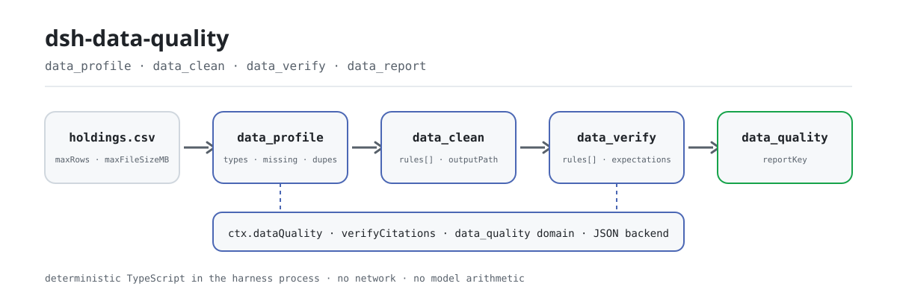
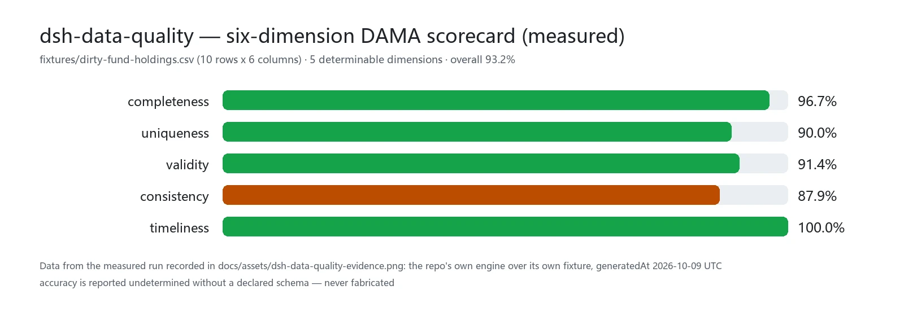

<div align="center">

<picture>
  <source media="(prefers-color-scheme: dark)" srcset="docs/assets/dsh-data-quality-flow-dark.svg">
  
</picture>

# dsh-data-quality

**Deja de hacer que el modelo calcule: dale un CSV y recibe un perfil, un dataset limpio y un informe que puedes reabrir.**

Un plugin determinista de calidad de datos para DeepSeek Harness: recuentos de filas y columnas, tasas de faltantes, filas duplicadas, tipos inferidos, un scorecard DAMA de seis dimensiones y siete tipos de reglas de verificación — todo calculado en TypeScript puro dentro del proceso del harness, con informes persistidos en el dominio de almacenamiento `data_quality`.

[Instalar](#instalación-en-tres-pasos) · [Configuración](#configuración) · [FAQ](#faq) · [简体中文](README.md) · [English](README.en.md) · [Español](README.es.md) · [Português](README.pt.md) · [हिन्दी](README.hi.md)

[](LICENSE)
[](#compatibilidad)
[](https://www.npmjs.com/package/dsh-data-quality)
[](https://github.com/PerryLink/dsh-data-quality/actions/workflows/ci.yml)
[](#compatibilidad)

[](https://github.com/PerryLink/dsh-data-quality/stargazers)
[](https://www.npmjs.com/package/dsh-data-quality)
[](https://dshfind.com/plugins/PerryLink/dsh-data-quality?ref=badge)
[](https://securityscorecards.dev/viewer/?uri=github.com/PerryLink/dsh-data-quality)
[](https://dsh.market/)
[](https://gitee.com/perrylink/dsh-data-quality)

```sh
dsh plugin --profile <name> add dsh-data-quality
```

</div>

<sub>Plugin comunitario, no afiliado a DeepSeek. Repositorio canónico: <https://github.com/PerryLink/dsh-data-quality> (Gitee es un espejo).</sub>

## Qué es

Dale un CSV al modelo y `dsh-data-quality` lo lee como un dataset estructurado y calcula con funciones puras todo lo que deberías saber: filas y columnas, qué columnas son de tipo mixto, cuánto falta, cuánto está duplicado, cómo son las distribuciones numéricas y los valores atípicos IQR — y al final un scorecard DAMA de seis dimensiones. La limpieza y la verificación se expresan como reglas declarativas; cada ejecución persiste su informe en el dominio de almacenamiento `data_quality` y devuelve un `reportKey`, así que cada número que muestra el modelo se puede reabrir en vez de "sentirse". Todo el cálculo es TypeScript dentro del proceso del harness: sin red, sin credenciales, sin procesos externos, sin llamadas al modelo.

## Instalación en tres pasos

1. **Instalar** (elige un canal):

   ```sh
   # canal git (main más reciente; equivale a git+https://github.com/PerryLink/dsh-data-quality.git)
   dsh plugin --profile web add github:PerryLink/dsh-data-quality
   # canal npm (versiones publicadas)
   dsh plugin --profile web add dsh-data-quality
   # canal tarball: pnpm pack en este repo y luego
   dsh plugin --profile web add ./dsh-data-quality-<version>.tgz
   ```

   El primer `add` por el canal git falla porque pnpm bloquea la compilación `prepare` del paquete. Copia la clave exacta que imprime pnpm en el `pnpm-workspace.yaml` del perfil y vuelve a ejecutar:

   ```yaml
   allowBuilds:
     'dsh-data-quality': true
   ```

   Reinicia el perfil tras instalar (los bundles se activan al reiniciar).

2. **Configuración mínima** (los valores por defecto ya corren; sube las protecciones si hace falta):

   ```yaml
   - insert:
       - id: dsh-data-quality
         name: dsh-data-quality
         config:
           maxRows: 200000
           maxFileSizeMB: 64
   ```

3. **Verificar que está montado**:

   ```sh
   dsh --profile web --dump-config | grep -A2 'id: dsh-data-quality'
   ```

   Luego, en un workspace que contenga un CSV, pide al agente:

   > Perfila `holdings.csv`, luego límpialo recortando espacios, deduplicando por `fund_code` y normalizando las unidades 万/亿 de la columna `holding_value`; finalmente verifica que `fund_code` sea único y no nulo.

**Desinstalar**: `dsh plugin --profile web remove dsh-data-quality` (o borra la fila del patch del perfil).

## Capacidades clave

- **Servicio `ctx.dataQuality`** — un servicio Cordis que otros plugins pueden consumir opcionalmente (`inject = ['dataQuality']`). Además de las tres operaciones sobre datasets detrás de las herramientas, implementa el contrato congelado `verifyCitations(request)`: verifica que los números/cadenas citados en un documento coincidan con una instantánea del dataset, con comparación numérica por tolerancia relativa y estados `verified` / `mismatch` / `not-found` / `unverifiable`.
- **Herramienta `data_profile`** — conteos de filas/columnas, tipos de columna inferidos (number/date/boolean/string/empty/mixed), tasas de faltantes, conteos de únicos, distribuciones numéricas (min/max/mean/median/p25/p75), conteo de atípicos IQR, notas de sospecha por tipos mixtos y detección de filas duplicadas por hash sha256 de contenido de la tabla completa (tasa de duplicados más una muestra acotada de índices de filas duplicadas). Añade un scorecard DAMA determinista de seis dimensiones (completeness, uniqueness, validity, consistency, timeliness, accuracy — accuracy se informa como undetermined si no hay schema declarado, nunca se inventa). Muestreo sistemático determinista opcional para archivos grandes.
- **Herramienta `data_clean`** — reglas declarativas de limpieza en orden: `dedupe` (por grupo de columnas), `fill-missing` (constant/mean/median/forward), `coerce-type` (number/date/boolean; los fallos se cuentan y quedan como faltantes), `normalize-unit` (p. ej. sufijos 万/亿 a unidades base), `trim`, `map-values` (mapeo de enumeraciones). Devuelve un registro de auditoría por regla, un resumen de validación de contrato previo a la entrega (dedupe antes/después, unicidad, regresiones de no nulos y de tipos) y una vista previa acotada; solo escribe el dataset limpio cuando se indica `outputPath` y nunca sobrescribe el origen.
- **Herramienta `data_verify`** — reglas declarativas de verificación: `not-null`, `unique`, `range`, `regex`, `enum`, `cross-column` (p. ej. `startDate < endDate`), `freshness` (columna de fecha dentro de N días de una fecha de referencia). pass/fail por regla con evidencia acotada de filas fallidas; un fallo global es un resultado normal `passed: false`, no un error de herramienta.
- **Herramienta `data_report`** — lee informes persistidos del dominio de almacenamiento `data_quality`: por `reportKey` exacto (validación segura de rutas; las claves ausentes fallan alto) o por `kind` (listado cronológico). `format: html` renderiza un informe de perfilado/limpieza como documento HTML offline autocontenido (CSS/JS en línea, sin peticiones externas) con el scorecard DAMA de seis dimensiones y las tablas de resumen.
- **Informes duraderos** — cada ejecución de perfilado/limpieza/verificación/citas persiste en el dominio de almacenamiento `data_quality` (backend JSON), con clave de marca de tiempo más huella de la ruta del dataset; la clave se devuelve como `reportKey` en los resultados. Los informes de limpieza también persisten la vista previa acotada y el resumen de contrato, de modo que todo resultado visible para el modelo es reconstruible a partir de su `reportKey`; cada limpieza persiste además un informe de perfil `clean-diff` antes/después.
- **Eventos de sesión** — en hosts que los soportan con seguridad, las ejecuciones añaden eventos `data-quality/profile` / `data-quality/clean` / `data-quality/verify` (con la marca `ignorable` donde se admite). En la línea publicada `0.1.7-rc.2` (como en las líneas rc anteriores) el append se omite por diseño — el informe del dominio de almacenamiento es siempre la copia duradera (véase «Limitaciones conocidas»).

```text
holdings.csv ──data_profile──▶ informe ──data_clean──▶ outputPath
                   │                                    │
                   └──── dominio data_quality · reportKey ──┴──data_verify──▶ passed / filas de evidencia
```

### Herramientas y superficies

#### `data_profile({ path, sample?, industryPreset? })`

Perfila un dataset del workspace. `path` es relativo al workspace (`.csv`/`.tsv`/`.json`/`.jsonl`; JSON debe ser un array de objetos planos). `sample` toma cada `ceil(N/sample)`-ésima fila para las tarjetas de columna (determinista; los conteos de filas siguen siendo exactos). `industryPreset` (`retail`/`saas`/`fund`/`real-estate`/`e-commerce`/`healthcare`/`logistics`/`manufacturing`/`energy`) inyecta las columnas esperadas de esa industria para que la dimensión `accuracy` del scorecard sea determinable; los ids desconocidos fallan alto. Devuelve el informe estructurado — tasa de duplicados, índices acotados de filas duplicadas, distribuciones numéricas `count`/`distinct`, `encoding` del archivo (BOM UTF-8 + validez) y el scorecard DAMA ponderado de seis dimensiones — y renderiza un resumen legible por columna más el scorecard.

#### `data_clean({ path, rules, outputPath?, dryRun? })`

Aplica `rules` en orden de array; cada regla ve la salida de la anterior. Referencia de reglas:

| Regla | Campos extra | Semántica |
|---|---|---|
| `dedupe` | `columns?` | Elimina filas cuya combinación de columnas clave duplica una fila anterior (se conserva la primera; todas las columnas si se omite). |
| `fill-missing` | `column`, `strategy`, `value?` | Rellena faltantes: `constant` (requiere `value`), `mean`/`median` (columnas numéricas), `forward` (valor anterior no faltante). |
| `coerce-type` | `column`, `to` | Convierte a `number`/`date` (ISO)/`boolean`; los fallos quedan como faltantes y se cuentan en el registro. |
| `normalize-unit` | `column`, `factors` | Quita el sufijo de unidad y multiplica (`{"万": 10000, "亿": 100000000}`); los numéricos planos también se convierten. |
| `trim` | `columns?` | Recorta espacios en celdas de texto (todas las columnas si se omite). |
| `map-values` | `column`, `map`, `else?` | Mapeo por coincidencia exacta; los valores no mapeados se conservan (`keep`, por defecto) o quedan `missing`. |

El archivo de origen **nunca** se sobrescribe. Con `outputPath` el dataset limpio se escribe allí (confinado al workspace, formato por extensión); sin él la ejecución es solo vista previa. Con `dryRun: true` no se escribe ningún archivo ni se persiste nada: el resultado devuelve el plan de limpieza por columna y el `contract`/`diffPreview` esperados. El resultado también lleva un resumen de `contract` previo a la entrega (filas antes/después del dedupe, unicidad sobre la clave de dedupe o las filas completas, regresión de no nulos en columnas `fill-missing`, regresión de tipos en columnas `coerce-type`, y la traza de decisión por columna), y un informe de perfil `clean-diff` antes/después se persiste en el dominio de almacenamiento.

#### `data_report({ key?, kind?, format? })`

Lee informes persistidos del dominio de almacenamiento. Pasa `key` (el `reportKey` exacto que devolvió una ejecución anterior) para obtener un informe, o `kind` (`profile`/`clean`/`clean-diff`/`verify`/`citations`) para listar cronológicamente todos los informes de ese tipo; se requiere exactamente uno de `key`/`kind`. Las claves malformadas o ausentes fallan alto. `format: html` (con `key`) renderiza el informe como un documento HTML offline autocontenido: CSS/JS en línea, sin peticiones externas, el scorecard DAMA de seis dimensiones y las tablas de resumen de perfilado/limpieza (solo informes profile/clean).

#### `data_verify({ path, rules, expectations? })`

Evalúa reglas de verificación. Referencia de reglas:

| Regla | Campos extra | Semántica |
|---|---|---|
| `not-null` | `column` | Fallan las celdas faltantes (null/vacío/solo espacios). |
| `unique` | `columns` | Falla cada fila cuya combinación clave se repite (los faltantes participan). |
| `range` | `column`, `min?`, `max?` | Fallan celdas faltantes/no parseables y valores fuera de los límites inclusivos (se requiere al menos un límite). |
| `regex` | `column`, `pattern`, `flags?` | Fallan celdas faltantes o que no coinciden (regex JS completa). |
| `enum` | `column`, `values` | Fallan celdas cuyo texto recortado no está en la lista. |
| `cross-column` | `left`, `op`, `rightColumn?`, `value?` | Compara por fila: numérico si ambos lados parsean, fechas como épocas, cadenas solo para `==`/`!=` (exactamente uno de `rightColumn`/`value`). |
| `freshness` | `column`, `maxAgeDays`, `asOf?` | Fallan fechas más viejas que `maxAgeDays` antes de `asOf` (por defecto: ahora); no parseable/faltante falla. |

`expectations` reconcilia métricas deterministas con valores esperados: `rowCount`, `columnSum`, `columnMean`, `uniqueCount`, `nullCount` (cada uno con `column` salvo `rowCount`, más `expected` y una `tolerance` relativa opcional en [0, 1]). Cada expectativa produce `passed` más `actual`/`expected`/`tolerance`; una discrepancia es un veredicto normal `passed: false`, nunca un error de herramienta. Métricas inválidas, columnas ausentes y tolerancias fuera de rango fallan alto.

Una celda faltante hace fallar toda regla que la lee. La evidencia se limita a `evidenceRowLimit` filas fallidas por regla.

#### `ctx.dataQuality` (para otros plugins)

```ts
const result = await ctx.dataQuality.verifyCitations({
  dataset: 'holdings.csv',          // se resuelve contra workspaceRoot
  citations: [
    { id: 'c1', path: 'rows[3].nav', value: 1.234, tolerance: 0.01 },
    { id: 'c2', path: 'summary.annualReturn', value: '12.34%' },
  ],
})
// result.results[i] = { id, status: 'verified' | 'mismatch' | 'not-found' | 'unverifiable', actual?, note? }
```

Los localizadores recorren el documento del dataset: CSV/TSV cargan como `{ columns, rows }` (así `rows[3].nav` resuelve), JSON es el valor parseado, JSONL el array de líneas parseadas. Los números comparan con tolerancia relativa (`|a-b| <= tolerance * max(|a|, |b|)`); una celda de texto CSV que parsea numéricamente compara como número; las cadenas comparan exactas; los pares de tipos incomparables son `unverifiable`. El servicio también expone `profileDataset` / `cleanDataset` / `verifyDataset` (las mismas operaciones que llaman las herramientas).

### Ejemplos

Son los puntos de entrada reales; instala y llama a uno.

**Ejemplo detallado** — comando `data_profile`, entrada:

```sh
data_profile({ path: "dirty-fund-holdings.csv" })
```

Salida:

```text
Profile of dirty-fund-holdings.csv: 10 rows x 6 columns
Duplicate rows: 1 (10.0%); sample row indexes: 8
- nav: mixed; missing 1 (10.0%); unique 7; note: mixed types among 9 present values: 8 numeric, 1 string
Scorecard (overall 93.2%, weighted 93.2%):
```

*Observado en `README.md:147-149; test/profile.spec.ts:130-132; test/loader.spec.ts:98-99; src/profile.ts:311-315`*

**Rama de fallo** — entrada:

```text
{"path":"dirty-fund-holdings.csv","rules":[{"rule":"dedupe","columns":["nope"]}]}
```

Salida:

```text
isError=true; error.message=rule 0: unknown column "nope" (columns: fund_code, fund_name, nav, nav_date, holding_value, currency)
```

*Observado en `plugins/dsh-data-quality/src/clean.ts:66-68; plugins/dsh-data-quality/fixtures/dirty-fund-holdings.csv; exercised through plugins/dsh-data-quality/test/harness.ts`*

**Ejemplos breves**: `data_clean` · `data_verify`

## Datos medidos

<picture>
  <source media="(prefers-color-scheme: dark)" srcset="docs/assets/dsh-data-quality-evidence-en-dark.webp">
  
</picture>

Medido sobre el fixture propio del repo, `fixtures/dirty-fund-holdings.csv` (10 filas x 6 columnas): completeness 96.7% · uniqueness 90.0% · validity 91.4% · consistency 87.9% · timeliness 100.0%, total ponderado 93.2%; la sexta dimensión, accuracy, se informa como undetermined sin un schema declarado (solo se vuelve determinable con un `industryPreset`). No es un benchmark de exactitud: es una lectura determinista y recalculable sobre los mismos datos sucios. Los datos provienen de la ejecución medida registrada en `docs/assets/dsh-data-quality-evidence.png` (el motor propio del repo sobre su propio fixture, generatedAt 2026-10-09 UTC) y se reproducen con `node scripts/loader-runner.mjs` (sin clave de API).

## Configuración

Todas las claves son opcionales (se muestran los valores por defecto); los valores inválidos fallan ruidosamente al cargar. Cada clave se puede cambiar desde `cordis.yml` (el bundle incluye `cordis.patch.yml` con los mismos valores). Una sobrescritura dirigida por id reemplaza la fila entera: repite todas las claves que necesites.

Claves más usadas:

| Clave | Por defecto | Descripción |
|---|---|---|
| `enabled` | `true` | Interruptor maestro; `false` no monta nada. |
| `maxRows` | `200000` | Tope duro de filas por carga; entradas mayores se rechazan ruidosamente (usa el parámetro `sample` de la herramienta). |
| `maxFileSizeMB` | `64` | Tope duro de tamaño de archivo en MiB por carga. |
| `evidenceRowLimit` | `20` | Tope de filas de evidencia (verify) y de vista previa (clean) en un resultado. |
| `allowedExtensions` | `['.csv', '.tsv', '.json', '.jsonl']` | Extensiones aceptadas como datasets. |
| `workspaceRoot` | `""` | Raíz absoluta para llamadas a nivel de SERVICIO (p. ej. `verifyCitations`) sin workspace de sesión; vacío = directorio de arranque del proceso del harness. Las herramientas siempre usan el cwd del workspace de la sesión. |
| `storeReports` | `true` | Persistir los informes en el dominio de almacenamiento `data_quality` y devolver `reportKey`. |

<details>
<summary>Tabla de configuración completa (9 claves)</summary>

| Clave | Por defecto | Descripción |
|---|---|---|
| `enabled` | `true` | Interruptor maestro; `false` no monta nada. |
| `maxRows` | `200000` | Tope duro de filas por carga; entradas mayores se rechazan ruidosamente (usa el parámetro `sample` de la herramienta). |
| `maxFileSizeMB` | `64` | Tope duro de tamaño de archivo en MiB por carga. |
| `defaultTolerance` | `1e-9` | Tolerancia relativa por defecto para la comparación numérica de citas cuando la cita omite `tolerance`. |
| `evidenceRowLimit` | `20` | Tope de filas de evidencia (verify) y de vista previa (clean) en un resultado. |
| `allowedExtensions` | `['.csv', '.tsv', '.json', '.jsonl']` | Extensiones aceptadas como datasets. |
| `workspaceRoot` | `""` | Raíz absoluta para llamadas a nivel de SERVICIO (p. ej. `verifyCitations`) sin workspace de sesión; vacío = directorio de arranque del proceso del harness. Las herramientas siempre usan el cwd del workspace de la sesión. |
| `storeReports` | `true` | Persistir los informes en el dominio de almacenamiento `data_quality` y devolver `reportKey`. |
| `scorecardWeights` | todo 1 (igual) | Ponderaciones por dimensión (completeness/uniqueness/validity/consistency/timeliness/accuracy) para el total ponderado del scorecard; cada peso debe ser un número no negativo. |

</details>

Ejemplo de sobrescritura en el patch del perfil:

```yaml
- insert:
    - id: dsh-data-quality
      name: dsh-data-quality
      config:
        maxRows: 50000
        evidenceRowLimit: 10
        scorecardWeights:
          completeness: 2
          uniqueness: 1
```

## FAQ

<details>
<summary>¿Dónde viven los datos? ¿Pueden salir de la máquina?</summary>

Lee archivos de dataset del workspace (solo extensiones permitidas) y escribe exactamente dos cosas: el archivo de salida de `data_clean` cuando se indica un `outputPath` explícito (confinado al workspace, nunca la entrada) y los informes del dominio de almacenamiento `data_quality` en el directorio de datos del harness. **Sin red, sin credenciales, sin procesos externos**: todo el parseo y la estadística son TypeScript en proceso. Los informes pueden contener valores de celda de muestra de tus datasets (acotados por `evidenceRowLimit` y el truncado de presentación); el registro de sesión registra argumentos y resultados de herramientas como siempre.

</details>

<details>
<summary>¿Qué pasa en un perfil desnudo o en un host sin eventos de sesión?</summary>

El plugin inyecta de forma dura `tools` y `storageDomain`: los perfiles oficiales (web/headless/sdk/acp) componen el stack de almacenamiento (`dsh-storage` + `dsh-storage-json` + `dsh-storage-domain`) mediante `dsh-base`, así que un perfil desnudo debe componerlo por su cuenta o el plugin no se monta. Los eventos de sesión son adaptativos: cuando el host no conoce el vocabulario `data-quality/*` y `Session.append` no puede estampar `ignorable`, el append se omite (nunca corrompe el registro de sesión) y el informe del dominio `data_quality` sigue siendo la copia duradera.

</details>

<details>
<summary>¿Compite con otros plugins por claves de servicio, nombres de herramienta o slots?</summary>

No. No registra ningún listener waterfall, publica una única clave de servicio con espacio de nombres (`dataQuality`), nombra las cuatro herramientas con el prefijo `data_`, no registra slots de cliente ni prefijos `webServer`, y no muta globales; el patch del bundle solo hace `insert` de su propia fila. La argumentación punto por punto está en «Interoperabilidad con otros plugins DSH».

</details>

<details>
<summary>¿Cuánto cuesta en rendimiento? ¿Y con archivos grandes?</summary>

El parseo y la estadística son TypeScript en proceso sin dependencias: sin inferencia, sin red, sin llamadas al modelo, así que un CSV típico cuesta una lectura de archivo más un escaneo lineal. Las protecciones son duras: `maxRows` (200000 por defecto) y `maxFileSizeMB` (64 por defecto) rechazan entradas sobredimensionadas ruidosamente, el parámetro `sample` de `data_profile` ofrece muestreo sistemático determinista, y las señales de aborto cancelan cargas largas a mitad de camino.

</details>

<details>
<summary>¿Puede el modelo equivocarse en las cuentas?</summary>

No: el modelo no hace aritmética aquí. Conteos de filas, tasas de faltantes, cuantiles, atípicos IQR, tasas de duplicados, el scorecard y los veredictos de verificación los producen funciones deterministas; misma entrada, misma salida, y el único reloj es el inyectado para los valores por defecto de `freshness` y las marcas de tiempo de informes. El modelo elige la herramienta y las reglas, y narra el resultado.

</details>

## Límites de seguridad

- **Confinamiento de rutas** — las rutas de dataset y salida deben resolverse dentro del workspace de sesión (`verifyCitations` usa `workspaceRoot`); se rechazan escapes `..` y rutas absolutas fuera de la raíz, y ambos lados se normalizan antes de comparar (seguro con barras de Windows).
- **Trabajo acotado** — las guardas `maxRows` / `maxFileSizeMB` rechazan entradas sobredimensionadas ruidosamente; las señales de aborto cancelan cargas largas a mitad de camino.
- **Sin sobrescritura** — `data_clean` rechaza un `outputPath` igual a la ruta de entrada.
- **Cálculo determinista** — misma entrada, misma salida; el único reloj es el inyectado para los valores por defecto de `freshness` y las marcas de tiempo de informes.
- **Registrar es un effect** — el registro de herramientas y el cierre del dominio de almacenamiento son effects de Cordis, y se retiran al parar o recargar en caliente.

## Permisos y datos

- **Lee** archivos de dataset del workspace (solo extensiones permitidas).
- **Escribe** solo: el archivo de salida de `data_clean` (`outputPath` explícito, confinado al workspace, nunca la entrada) y los informes del dominio de almacenamiento `data_quality` en el directorio de datos del harness.
- **Sin red, sin credenciales, sin procesos externos** — todo el parseo y la estadística son TypeScript en proceso.
- Los informes pueden contener valores de celda de muestra de tus datasets (acotados por `evidenceRowLimit` y el truncado de presentación); el registro de sesión registra argumentos y resultados de herramientas como siempre.

## Limitaciones conocidas

- **Los eventos de sesión son adaptativos.** La línea publicada `0.1.7-rc.2` (como las líneas rc anteriores) no tiene superficie de registro de eventos de sesión para plugins y su `Session.append` no puede estampar la marca `ignorable`, así que añadir un tipo `data-quality/*` desconocido haría ilegible el registro de sesión al restaurarlo. Por eso el plugin solo añade cuando el host conoce el vocabulario o soporta el flag `ignorable`; en la línea publicada el informe del dominio de almacenamiento es el registro duradero.
- **Dialecto CSV** — coma/tab con comillas RFC-4180, fila de cabecera obligatoria, líneas en blanco omitidas; sin autodetección de delimitador ni líneas de comentario.
- **El parseo de tipos es estricto** — los números no llevan separadores de miles; las fechas son `YYYY-MM-DD` / `YYYY/MM/DD` / datetimes estilo ISO (UTC); los booleanos son `true/false/yes/no/1/0`. Todo lo demás se perfila como `string`/`mixed` — límpialo con `coerce-type` si es intencionado.
- **JSON debe ser tabular para las herramientas** (array de objetos planos); `verifyCitations` recorre documentos JSON arbitrarios.
- **Sin detección de anomalías por ML, sin enmascarado de PII, sin bases de datos, sin SQL** — solo notas de sospecha basadas en reglas.

## Interoperabilidad con otros plugins DSH

Verificado contra el corredor de host que este repositorio declara (`>=0.2.1-0 <0.3.0`) y el contrato de plugins de `dsh-plugin-guide`.

Este plugin **no interfiere** con otros plugins:

- **Sin contención de listeners.** No registra ningún listener waterfall (ni `agent/pre-step` ni `tools/post-execute`), así que no puede ni matar de hambre ni cortocircuitar la cadena de otro plugin.
- **Clave de servicio con espacio de nombres.** Publica exactamente una clave de servicio, `dataQuality`, y no ocupa ninguna clave integrada ni de terceros; los consumidores declaran la dependencia con `inject = ['dataQuality']`.
- **Sin colisión de nombres de herramienta.** Los cuatro nombres `data_profile` / `data_clean` / `data_verify` / `data_report` llevan el prefijo `data_` y no toman ningún nombre desnudo de una herramienta incluida ni de otro plugin.
- **Sin colisión de slot ni de ruta HTTP.** Es un plugin solo de host (sin mitad de navegador): no registra slots de cliente ni prefijos `webServer`.
- **Sin colisión de capa de patch.** El patch del bundle solo hace `insert` de su propia fila; nunca sobrescribe el `config` de una fila integrada.
- **Aislamiento del dominio de almacenamiento.** Escribe solo su propio dominio `data_quality` (backend JSON) y no toca el de otros plugins.
- **Sin mutación global.** No parchea prototipos, no reescribe `process.env`, no reemplaza el dispatcher global de fetch; sin peticiones de red, sin procesos externos.

Evidencia estática: la insignia histórica de verificación de `dsh-plugin-doctor` en este repositorio ([informe](https://github.com/PerryLink/dsh-plugin-doctor#verified-徽章)).

## Compatibilidad

| Superficie | Estado |
|---|---|
| Harness | DeepSeek Harness `dsh-v0.2.1-alpha.1` (adaptado el 2026-10-04): el rango de peers admite la línea alpha.2; allí el tercer parámetro de `Session.append` existe solo para tipos de superficie y es un `SurfaceIntent`, así que la puerta de auditoría sigue omitiendo y el informe del dominio de almacenamiento sigue siendo la copia duradera. Verificado el 2026-09-24 (tres reglas de typecheck + suite completa en verde). |
| Node | `^22.19.0 \|\| >=24.9.0` |
| Gestor de paquetes | `pnpm@11.7.0` |
| Plataforma | Windows / macOS / Linux (plugin solo de host) |
| Modelo | Modelos de texto totalmente soportados; sin capacidad de modelo adicional |

## Ecosistema y calidad

- [Espejo en Gitee](https://gitee.com/perrylink/dsh-data-quality) (espejo sincronizado; GitHub es canónico)
- [Página de dshfind](https://dshfind.com/plugins/PerryLink/dsh-data-quality) (instalaciones y ranking)
- [Informe OpenSSF Scorecard](https://securityscorecards.dev/viewer/?uri=github.com/PerryLink/dsh-data-quality) (impulsado por [.github/workflows/scorecard.yml](.github/workflows/scorecard.yml))
- [Insignia de verificación de dsh-plugin-doctor](https://github.com/PerryLink/dsh-plugin-doctor#verified-徽章) (histórica)
- [DSH Market](https://dsh.market/) (listado)
- **Canal de la tienda 1024**: `npm i -g dsh1024` una vez y luego `dsh1024 plugin --profile web add dsh-data-quality` (cuenta para el ranking de instalaciones de [deepseek1024.com](https://deepseek1024.com))
- [Base de conocimiento del ecosistema](https://perrylink.github.io/dsh-plugin-guide/): datos medidos, no marketing — guía de desarrollo · datos de selección · criterios de mantenimiento

## Desarrollo

```sh
pnpm install                                                     # node ^22.19 || >=24.9
pnpm run typecheck && pnpm run typecheck:ci && pnpm run typecheck:checkout
pnpm test                                                        # vitest
pnpm run build                                                   # salida de tsdown + ajustes de d.ts
pnpm run verify:self-contained && pnpm run verify:artifacts     # specs de dependencias + archivos publicados
node scripts/check-readme-sync.mjs                               # consistencia de los README en cinco idiomas
pnpm pack
```

- Las pruebas ejecutan vitest contra los `Context`/`Session`/`ToolRuntime`/dominio de almacenamiento REALES (sin mocks de servicios escritos a mano) más specs de motor puros; cada regla de limpieza/verificación tiene casos positivos y negativos, y `verifyCitations` cubre los cuatro estados.
- `scripts/loader-runner.mjs` arranca la composición real del Loader y ejecuta la cadena perfilar → limpiar → verificar contra `fixtures/` sin clave de API.
- Release: `node scripts/release.mjs <x.y.z>` (nunca hace push; el tag dispara `release.yml`).
- Las imágenes del README se generan programáticamente con [`scripts/gen-readme-assets.py`](scripts/gen-readme-assets.py) (Python + Pillow): un SVG de pipeline escrito a mano en dos pieles para el hero y webp claro/oscuro para el gráfico medido; se puede volver a ejecutar.

Topics: `dsh`, `dsh-plugin`, `deepseek-harness`, `cordis`, `data-quality`, `data-cleaning`, `data-profiling`, `data-verification`

## Familia y agradecimientos

Este proyecto forma parte de la familia de plugins de DeepSeek Harness de [PerryLink](https://github.com/PerryLink) (todos Apache-2.0). Si te resulta útil, **una estrella ayuda a que la siguiente persona lo encuentre** — no desbloquea nada.

- [@PerryLink](https://github.com/PerryLink) — mantenimiento y releases (`0.1.2`/`0.1.3`), mejoras de peer-dependencies, las insignias de npm version/downloads/CI, y correcciones recientes.
- **dsh-data-quality contributors** — el scaffold inicial, el seam `ctx.dataQuality` y el contrato congelado `verifyCitations`, la capa de datasets determinista y los motores puros, los informes del dominio `data_quality`, la suite vitest con servicios reales, los flujos CI/compat/release, y los README en cinco idiomas.

<details>
<summary>Expandir todos los plugins</summary>

| Plugin | Estado |
|---|---|
| **[dsh-aqua-input-check](https://github.com/PerryLink/dsh-aqua-input-check)** |  |
| **[dsh-archive-check](https://github.com/PerryLink/dsh-archive-check)** |  |
| **[dsh-auto-review](https://github.com/PerryLink/dsh-auto-review)** |  |
| **[dsh-autotier](https://github.com/PerryLink/dsh-autotier)** | 🧊 CONGELADO — ver el README del repo |
| **[dsh-bid-ca-precheck](https://github.com/PerryLink/dsh-bid-ca-precheck)** |  |
| **[dsh-bid-qual-check](https://github.com/PerryLink/dsh-bid-qual-check)** |  |
| **[dsh-cert-mcp](https://github.com/PerryLink/dsh-cert-mcp)** | 🧊 CONGELADO — ver el README del repo |
| **[dsh-checkpoint-rewind](https://github.com/PerryLink/dsh-checkpoint-rewind)** |  |
| **[dsh-click](https://github.com/PerryLink/dsh-click)** |  |
| **[dsh-composer-history](https://github.com/PerryLink/dsh-composer-history)** |  |
| **[dsh-contract-stance](https://github.com/PerryLink/dsh-contract-stance)** |  |
| **[dsh-customs-doc-check](https://github.com/PerryLink/dsh-customs-doc-check)** |  |
| **[dsh-data-quality](https://github.com/PerryLink/dsh-data-quality)** | 🧊 CONGELADO — ver el README del repo |
| **[dsh-demurrage-ledger](https://github.com/PerryLink/dsh-demurrage-ledger)** |  |
| **[dsh-doublecheck](https://github.com/PerryLink/dsh-doublecheck)** |  |
| **[dsh-drill-script-check](https://github.com/PerryLink/dsh-drill-script-check)** |  |
| **[dsh-eia-guide-check](https://github.com/PerryLink/dsh-eia-guide-check)** |  |
| **[dsh-emergency-plan](https://github.com/PerryLink/dsh-emergency-plan)** |  |
| **[dsh-essay-rubric-check](https://github.com/PerryLink/dsh-essay-rubric-check)** |  |
| **[dsh-evidence-check](https://github.com/PerryLink/dsh-evidence-check)** |  |
| **[dsh-export-ctl-check](https://github.com/PerryLink/dsh-export-ctl-check)** |  |
| **[dsh-fast](https://github.com/PerryLink/dsh-fast)** |  |
| **[dsh-fmea-table-check](https://github.com/PerryLink/dsh-fmea-table-check)** |  |
| **[dsh-forecast-penalty](https://github.com/PerryLink/dsh-forecast-penalty)** |  |
| **[dsh-fund-research](https://github.com/PerryLink/dsh-fund-research)** |  |
| **[dsh-github](https://github.com/PerryLink/dsh-github)** |  |
| **[dsh-gongwen-flow-check](https://github.com/PerryLink/dsh-gongwen-flow-check)** |  |
| **[dsh-gongwen-word-check](https://github.com/PerryLink/dsh-gongwen-word-check)** |  |
| **[dsh-guard-plan-qc](https://github.com/PerryLink/dsh-guard-plan-qc)** |  |
| **[dsh-hazchem-check](https://github.com/PerryLink/dsh-hazchem-check)** |  |
| **[dsh-hazplan-check](https://github.com/PerryLink/dsh-hazplan-check)** |  |
| **[dsh-hidden-risk-map](https://github.com/PerryLink/dsh-hidden-risk-map)** |  |
| **[dsh-hs-classify](https://github.com/PerryLink/dsh-hs-classify)** |  |
| **[dsh-icd-rule-check](https://github.com/PerryLink/dsh-icd-rule-check)** |  |
| **[dsh-industry-research](https://github.com/PerryLink/dsh-industry-research)** |  |
| **[dsh-lawcite-adapter](https://github.com/PerryLink/dsh-lawcite-adapter)** |  |
| **[dsh-laya](https://github.com/PerryLink/dsh-laya)** |  |
| **[dsh-lc-doc-check](https://github.com/PerryLink/dsh-lc-doc-check)** |  |
| **[dsh-learning-gap-check](https://github.com/PerryLink/dsh-learning-gap-check)** |  |
| **[dsh-library](https://github.com/PerryLink/dsh-library)** |  |
| **[dsh-local-ai](https://github.com/PerryLink/dsh-local-ai)** |  |
| **[dsh-lsp-actions](https://github.com/PerryLink/dsh-lsp-actions)** |  |
| **[dsh-mask](https://github.com/PerryLink/dsh-mask)** |  |
| **[dsh-mcp-panel](https://github.com/PerryLink/dsh-mcp-panel)** |  |
| **[dsh-medrec-qc](https://github.com/PerryLink/dsh-medrec-qc)** |  |
| **[dsh-memento](https://github.com/PerryLink/dsh-memento)** | 🧊 CONGELADO — ver el README del repo |
| **[dsh-nsfc-form-check](https://github.com/PerryLink/dsh-nsfc-form-check)** |  |
| **[dsh-nurse-record-check](https://github.com/PerryLink/dsh-nurse-record-check)** |  |
| **[dsh-observe](https://github.com/PerryLink/dsh-observe)** |  |
| **[dsh-origin-rvc-check](https://github.com/PerryLink/dsh-origin-rvc-check)** |  |
| **[dsh-ota-review-check](https://github.com/PerryLink/dsh-ota-review-check)** |  |
| **[dsh-output-styles](https://github.com/PerryLink/dsh-output-styles)** |  |
| **[dsh-paper-doc-adapter](https://github.com/PerryLink/dsh-paper-doc-adapter)** |  |
| **[dsh-permission-rules](https://github.com/PerryLink/dsh-permission-rules)** |  |
| **[dsh-permit-report-check](https://github.com/PerryLink/dsh-permit-report-check)** |  |
| **[dsh-pipeline-check](https://github.com/PerryLink/dsh-pipeline-check)** |  |
| **[dsh-pleading-draft](https://github.com/PerryLink/dsh-pleading-draft)** |  |
| **[dsh-plugin-doctor](https://github.com/PerryLink/dsh-plugin-doctor)** | 🚫 RETIRADO (repo archivado) |
| **[dsh-plugin-guide](https://github.com/PerryLink/dsh-plugin-guide)** |  |
| **[dsh-plugin-kit](https://github.com/PerryLink/dsh-plugin-kit)** | 🚫 RETIRADO (repo archivado) |
| **[dsh-plugin-upgrade](https://github.com/PerryLink/dsh-plugin-upgrade)** | 🚫 RETIRADO (repo archivado) |
| **[dsh-policy-brief-draft](https://github.com/PerryLink/dsh-policy-brief-draft)** |  |
| **[dsh-power-loss-split](https://github.com/PerryLink/dsh-power-loss-split)** |  |
| **[dsh-power-ticket-check](https://github.com/PerryLink/dsh-power-ticket-check)** |  |
| **[dsh-ppap-check](https://github.com/PerryLink/dsh-ppap-check)** |  |
| **[dsh-protest-deadline](https://github.com/PerryLink/dsh-protest-deadline)** |  |
| **[dsh-railway-window](https://github.com/PerryLink/dsh-railway-window)** |  |
| **[dsh-repair-order-qc](https://github.com/PerryLink/dsh-repair-order-qc)** |  |
| **[dsh-research-report](https://github.com/PerryLink/dsh-research-report)** |  |
| **[dsh-review-reply-check](https://github.com/PerryLink/dsh-review-reply-check)** |  |
| **[dsh-rulefile-check](https://github.com/PerryLink/dsh-rulefile-check)** |  |
| **[dsh-safety-brief-check](https://github.com/PerryLink/dsh-safety-brief-check)** |  |
| **[dsh-score](https://github.com/PerryLink/dsh-score)** | 🧊 CONGELADO — ver el README del repo |
| **[dsh-session-sync](https://github.com/PerryLink/dsh-session-sync)** |  |
| **[dsh-site-log-check](https://github.com/PerryLink/dsh-site-log-check)** |  |
| **[dsh-skill-pack-security](https://github.com/PerryLink/dsh-skill-pack-security)** |  |
| **[dsh-soe-decision-check](https://github.com/PerryLink/dsh-soe-decision-check)** |  |
| **[dsh-soilwater-check](https://github.com/PerryLink/dsh-soilwater-check)** |  |
| **[dsh-sop-sync-check](https://github.com/PerryLink/dsh-sop-sync-check)** |  |
| **[dsh-spc-gbt-adapter](https://github.com/PerryLink/dsh-spc-gbt-adapter)** |  |
| **[dsh-talk](https://github.com/PerryLink/dsh-talk)** |  |
| **[dsh-tender-extract](https://github.com/PerryLink/dsh-tender-extract)** |  |
| **[dsh-tender-matrix](https://github.com/PerryLink/dsh-tender-matrix)** |  |
| **[dsh-test-drive](https://github.com/PerryLink/dsh-test-drive)** |  |
| **[dsh-ticktick](https://github.com/PerryLink/dsh-ticktick)** | 🚫 RETIRADO (repo archivado) |
| **[dsh-translate](https://github.com/PerryLink/dsh-translate)** |  |
| **[dsh-warranty-calc](https://github.com/PerryLink/dsh-warranty-calc)** |  |
| **[dsh-budget](https://github.com/PerryLink/dsh-budget)** | 🧊 CONGELADO — ver el README del repo |
| **[dsh-claude-move](https://github.com/PerryLink/dsh-claude-move)** | 🧊 CONGELADO — ver el README del repo |
| **[dsh-defend](https://github.com/PerryLink/dsh-defend)** | 🧊 CONGELADO — ver el README del repo |
| **[dsh-draw](https://github.com/PerryLink/dsh-draw)** | 🧊 CONGELADO — ver el README del repo |
| **[dsh-reach](https://github.com/PerryLink/dsh-reach)** | 🧊 CONGELADO — ver el README del repo |
| **[dsh-background-agents](https://github.com/PerryLink/dsh-background-agents)** | 🚫 RETIRADO (repo archivado) |
| **[dsh-session-pin](https://github.com/PerryLink/dsh-session-pin)** | 🚫 RETIRADO (repo archivado) |
| **[dsh-team-rooms](https://github.com/PerryLink/dsh-team-rooms)** | 🚫 RETIRADO (repo archivado) |

</details>

## Licencia

[LICENSE](LICENSE) (Apache License 2.0) © 2026 dsh-data-quality contributors

<p align="center"><sub>Apache-2.0 · Plugin comunitario, no afiliado a DeepSeek.</sub></p>
