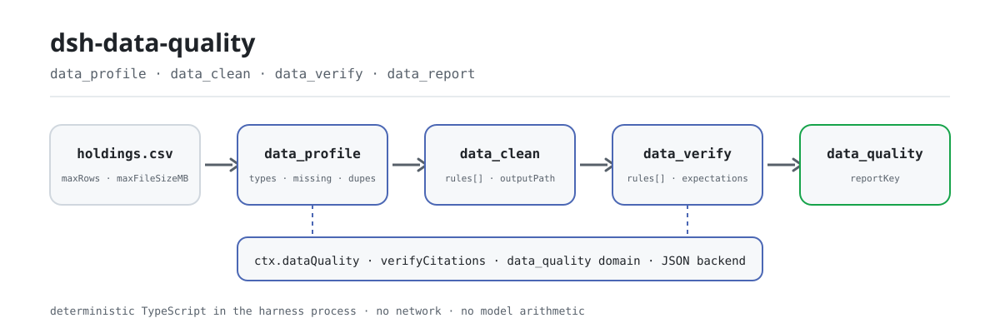
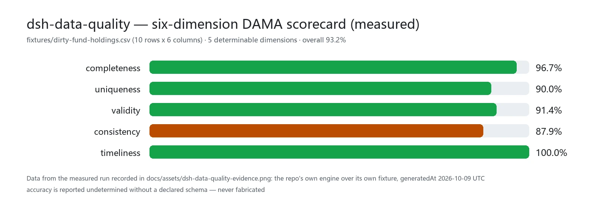

<div align="center">

<picture>
  <source media="(prefers-color-scheme: dark)" srcset="docs/assets/dsh-data-quality-flow-dark.svg">
  
</picture>

# dsh-data-quality

**मॉडल से हिसाब कराना बंद करें — एक CSV दें और ऐसा प्रोफ़ाइल, साफ़ डेटासेट व रिपोर्ट पाएँ जिसे आप दोबारा खोल सकें।**

DeepSeek Harness के लिए निर्धारणात्मक डेटा-गुणवत्ता प्लगइन: पंक्ति/स्तंभ गिनती, अनुपस्थिति दर, डुप्लिकेट पंक्तियाँ, अनुमानित प्रकार, छह-आयामी DAMA स्कोरकार्ड और सात प्रकार के सत्यापन नियम — सारी गणना harness प्रक्रिया के भीतर शुद्ध TypeScript में, रिपोर्ट `data_quality` स्टोरेज डोमेन में सहेजी जाती हैं।

[इंस्टॉल](#तीन-चरणों-में-शुरुआत) · [कॉन्फ़िगरेशन](#कॉन्फ़िगरेशन) · [FAQ](#faq) · [简体中文](README.md) · [English](README.en.md) · [Español](README.es.md) · [Português](README.pt.md) · [हिन्दी](README.hi.md)

[](LICENSE)
[](#संगतता)
[](https://www.npmjs.com/package/dsh-data-quality)
[](https://github.com/PerryLink/dsh-data-quality/actions/workflows/ci.yml)
[](#संगतता)

[](https://github.com/PerryLink/dsh-data-quality/stargazers)
[](https://www.npmjs.com/package/dsh-data-quality)
[](https://dshfind.com/plugins/PerryLink/dsh-data-quality?ref=badge)
[](https://securityscorecards.dev/viewer/?uri=github.com/PerryLink/dsh-data-quality)
[](https://dsh.market/)
[](https://gitee.com/perrylink/dsh-data-quality)

```sh
dsh plugin --profile <name> add dsh-data-quality
```

</div>

<sub>सामुदायिक प्लगइन, DeepSeek से संबद्ध नहीं। एकमात्र रेपो: <https://github.com/PerryLink/dsh-data-quality> (Gitee मिरर है)।</sub>

## यह क्या है

मॉडल को एक CSV दें — `dsh-data-quality` उसे संरचित डेटासेट के रूप में पढ़ता है और शुद्ध फ़ंक्शनों से वह सब निकालता है जो आपको जानना चाहिए: कितनी पंक्तियाँ-स्तंभ, कौन-से स्तंभ मिश्रित प्रकार के हैं, कितना अनुपस्थित है, कितना डुप्लिकेट है, संख्यात्मक वितरण और IQR आउटलायर कैसे हैं — और अंत में छह-आयामी DAMA स्कोरकार्ड। क्लीनिंग और सत्यापन घोषणात्मक नियमों के रूप में लिखे जाते हैं; हर रन रिपोर्ट को `data_quality` स्टोरेज डोमेन में सहेजता है और एक `reportKey` लौटाता है, इसलिए मॉडल जो भी संख्या दिखाए वह "अनुमान" नहीं बल्कि दोबारा खोली जा सकने वाली रिपोर्ट है। सारी गणना harness प्रक्रिया के भीतर TypeScript है: कोई नेटवर्क नहीं, कोई क्रेडेंशियल नहीं, कोई बाहरी प्रक्रिया नहीं, कोई मॉडल कॉल नहीं।

## तीन चरणों में शुरुआत

1. **इंस्टॉल** (तीन में से एक चैनल):

   ```sh
   # git चैनल (नवीनतम main; git+https://github.com/PerryLink/dsh-data-quality.git के समान)
   dsh plugin --profile web add github:PerryLink/dsh-data-quality
   # npm चैनल (प्रकाशित संस्करण)
   dsh plugin --profile web add dsh-data-quality
   # tarball चैनल: इस रेपो में pnpm pack के बाद
   dsh plugin --profile web add ./dsh-data-quality-<version>.tgz
   ```

   git चैनल पर पहला `add` विफल होगा क्योंकि pnpm पैकेज का `prepare` बिल्ड रोकता है। pnpm द्वारा छपी सटीक कुंजी को प्रोफ़ाइल की `pnpm-workspace.yaml` में कॉपी करके फिर चलाएँ:

   ```yaml
   allowBuilds:
     'dsh-data-quality': true
   ```

   इंस्टॉल के बाद प्रोफ़ाइल पुनः आरंभ करें (bundle पुनः आरंभ पर सक्रिय होते हैं)।

2. **न्यूनतम कॉन्फ़िगरेशन** (डिफ़ॉल्ट से ही चलता है; ज़रूरत पर सीमाएँ बढ़ाएँ):

   ```yaml
   - insert:
       - id: dsh-data-quality
         name: dsh-data-quality
         config:
           maxRows: 200000
           maxFileSizeMB: 64
   ```

3. **सत्यापित करें कि माउंट हुआ**:

   ```sh
   dsh --profile web --dump-config | grep -A2 'id: dsh-data-quality'
   ```

   फिर CSV वाले वर्कस्पेस में एजेंट से कहें:

   > `holdings.csv` को प्रोफ़ाइल करें, फिर व्हाइटस्पेस छाँटकर, `fund_code` पर डुप्लिकेट हटाकर और `holding_value` कॉलम की 万/亿 इकाइयाँ सामान्य करके क्लीन करें; अंत में सत्यापित करें कि `fund_code` अद्वितीय और गैर-रिक्त है।

**अनइंस्टॉल**: `dsh plugin --profile web remove dsh-data-quality` (या प्रोफ़ाइल patch से वह पंक्ति हटाएँ)।

## मुख्य क्षमताएँ

- **`ctx.dataQuality` सेवा** — एक Cordis सेवा जिसे अन्य प्लगिन वैकल्पिक रूप से उपभोग कर सकते हैं (`inject = ['dataQuality']`)। टूल्स के पीछे की तीन डेटासेट क्रियाओं के अलावा, यह जमा हुआ `verifyCitations(request)` अनुबंध लागू करती है: दस्तावेज़ में उद्धृत संख्याएँ/स्ट्रिंग डेटासेट स्नैपशॉट से मेल खाती हैं या नहीं — सापेक्ष सहिष्णुता संख्यात्मक तुलना और `verified` / `mismatch` / `not-found` / `unverifiable` स्थितियों के साथ।
- **`data_profile` टूल** — पंक्ति/स्तंभ गिनती, अनुमानित स्तंभ प्रकार (number/date/boolean/string/empty/mixed), अनुपस्थिति दर, अद्वितीय मान संख्या, संख्यात्मक वितरण (min/max/mean/median/p25/p75), IQR आउटलायर गिनती, मिश्रित-प्रकार संदेह टिप्पणियाँ, और पूरी तालिका के sha256 सामग्री-हैश से डुप्लिकेट पंक्ति पहचान (डुप्लिकेट दर + डुप्लिकेट पंक्ति सूचकांकों का सीमित नमूना)। साथ में निर्धारणात्मक DAMA छह-आयामी स्कोरकार्ड (completeness/uniqueness/validity/consistency/timeliness/accuracy — schema घोषित न हो तो accuracy undetermined रिपोर्ट होती है, कभी गढ़ी नहीं जाती)। बड़ी फ़ाइलों के लिए वैकल्पिक निर्धारणात्मक व्यवस्थित प्रतिचयन।
- **`data_clean` टूल** — क्रमबद्ध घोषणात्मक क्लीनिंग नियम: `dedupe` (स्तंभ समूह से), `fill-missing` (constant/mean/median/forward), `coerce-type` (number/date/boolean; विफलताएँ गिनी जाती हैं और अनुपस्थित बन जाती हैं), `normalize-unit` (जैसे 万/亿 प्रत्यय को आधार इकाई में), `trim`, `map-values` (एनुम मैपिंग)। प्रति-नियम ऑडिट लॉग, डिलीवरी-पूर्व अनुबंध सत्यापन सारांश (dedupe पहले/बाद, अद्वितीयता, गैर-रिक्त और प्रकार के रीग्रेशन) और सीमित पूर्वावलोकन लौटाता है; केवल `outputPath` दिए जाने पर साफ़ डेटासेट लिखता है और मूल फ़ाइल को कभी अधिलेखित नहीं करता।
- **`data_verify` टूल** — घोषणात्मक सत्यापन नियम: `not-null`, `unique`, `range`, `regex`, `enum`, `cross-column` (जैसे `startDate < endDate`), `freshness` (संदर्भ तिथि से N दिनों के भीतर तिथि स्तंभ)। प्रति-नियम pass/fail और सीमित असफल-पंक्ति साक्ष्य; समग्र असफलता सामान्य `passed: false` परिणाम है, टूल त्रुटि नहीं।
- **`data_report` टूल** — `data_quality` स्टोरेज डोमेन से सहेजी रिपोर्ट वापस पढ़ता है: सटीक `reportKey` से (पथ-सुरक्षित सत्यापन, अनुपस्थित कुंजी पर स्पष्ट विफलता) या `kind` से (कालानुक्रमिक सूची)। `format: html` एक प्रोफ़ाइल/क्लीन रिपोर्ट को स्व-निहित ऑफ़लाइन HTML दस्तावेज़ के रूप में प्रस्तुत करता है (इनलाइन CSS/JS, कोई बाहरी अनुरोध नहीं), DAMA छह-आयामी स्कोरकार्ड और प्रोफ़ाइल/क्लीनिंग सारांश तालिकाओं के साथ।
- **टिकाऊ रिपोर्ट** — हर प्रोफ़ाइल/क्लीन/सत्यापन/उद्धरण रन `data_quality` स्टोरेज डोमेन (JSON बैकएंड) में सहेजा जाता है, कुंजी = रन टाइमस्टैम्प + डेटासेट-पथ फ़िंगरप्रिंट; कुंजी टूल परिणामों में `reportKey` के रूप में लौटती है। क्लीन रिपोर्ट सीमित पूर्वावलोकन और अनुबंध सारांश भी सहेजती हैं, इसलिए हर मॉडल-दृश्य परिणाम केवल `reportKey` से पुनर्निर्मित किया जा सकता है; हर क्लीन रन एक `clean-diff` पहले/बाद प्रोफ़ाइल रिपोर्ट भी सहेजता है।
- **सत्र ईवेंट** — जिन होस्ट पर सुरक्षित रूप से संभव है, रन `data-quality/profile` / `data-quality/clean` / `data-quality/verify` ईवेंट जोड़ते हैं (जहाँ समर्थित हो वहाँ `ignorable` चिह्न सहित)। प्रकाशित `0.1.7-rc.2` लाइन पर (पहले की rc लाइनों की तरह) append जानबूझकर छोड़ा जाता है — स्टोरेज-डोमेन रिपोर्ट हमेशा टिकाऊ प्रति होती है (देखें «ज्ञात सीमाएँ»)।

```text
holdings.csv ──data_profile──▶ रिपोर्ट ──data_clean──▶ outputPath
                   │                                    │
                   └──── data_quality डोमेन · reportKey ──┴──data_verify──▶ passed / साक्ष्य पंक्तियाँ
```

### उपकरण और सतहें

#### `data_profile({ path, sample?, industryPreset? })`

वर्कस्पेस डेटासेट का प्रोफ़ाइल बनाता है। `path` वर्कस्पेस-सापेक्ष है (`.csv`/`.tsv`/`.json`/`.jsonl`; JSON फ़्लैट ऑब्जेक्ट का array होना चाहिए)। `sample` हर `ceil(N/sample)`-वीं पंक्ति लेकर कॉलम कार्ड बनाता है (निर्धारणात्मक; पंक्ति गिनती सटीक रहती है)। `industryPreset` (`retail`/`saas`/`fund`/`real-estate`/`e-commerce`/`healthcare`/`logistics`/`manufacturing`/`energy`) उस उद्योग के अपेक्षित स्तंभ जोड़ता है ताकि स्कोरकार्ड का `accuracy` आयाम निर्धारणीय हो जाए; अज्ञात id पर स्पष्ट विफलता। संरचित रिपोर्ट लौटाता है — डुप्लिकेट दर, सीमित डुप्लिकेट-पंक्ति सूचकांक, संख्यात्मक `count`/`distinct` वितरण, फ़ाइल `encoding` (UTF-8 BOM + वैधता) और भारित छह-आयामी DAMA स्कोरकार्ड — और मानव-पठनीय प्रति-स्तंभ सारांश व स्कोरकार्ड प्रस्तुत करता है।

#### `data_clean({ path, rules, outputPath?, dryRun? })`

`rules` को array क्रम में लागू करता है; हर नियम पिछले नियम का आउटपुट देखता है। नियम संदर्भ:

| नियम | अतिरिक्त फ़ील्ड | अर्थ |
|---|---|---|
| `dedupe` | `columns?` | जिन पंक्तियों का कुंजी-स्तंभ संयोजन पहले की पंक्ति से दोहराता है उन्हें हटाएँ (पहली रखी जाती है; छोड़ने पर सभी स्तंभ)। |
| `fill-missing` | `column`, `strategy`, `value?` | अनुपस्थित सेल भरें: `constant` (`value` आवश्यक), `mean`/`median` (संख्यात्मक स्तंभ), `forward` (पिछला गैर-अनुपस्थित मान)। |
| `coerce-type` | `column`, `to` | `number`/`date` (ISO)/`boolean` में बदलें; विफलताएँ अनुपस्थित बनती हैं और लॉग में गिनी जाती हैं। |
| `normalize-unit` | `column`, `factors` | इकाई प्रत्यय हटाकर गुणक लगाएँ (`{"万": 10000, "亿": 100000000}`); सादे संख्यात्मक भी बदलते हैं। |
| `trim` | `columns?` | स्ट्रिंग सेल के आगे-पीछे के व्हाइटस्पेस हटाएँ (छोड़ने पर सभी स्तंभ)। |
| `map-values` | `column`, `map`, `else?` | सटीक मिलान मैपिंग; बिना मैप वाले मान रहते हैं (`keep`, डिफ़ॉल्ट) या `missing` बन जाते हैं। |

मूल फ़ाइल **कभी** अधिलेखित नहीं होती। `outputPath` देने पर साफ़ डेटासेट वहाँ लिखा जाता है (वर्कस्पेस-सीमित, एक्सटेंशन से फ़ॉर्मेट); बिना उसके रन केवल पूर्वावलोकन है। `dryRun: true` पर कोई फ़ाइल नहीं लिखी जाती और कुछ सहेजा नहीं जाता — परिणाम प्रति-स्तंभ क्लीनिंग योजना और अपेक्षित `contract`/`diffPreview` लौटाता है। परिणाम में डिलीवरी-पूर्व `contract` सारांश (dedupe से पहले/बाद पंक्तियाँ, dedupe कुंजी या पूरी पंक्तियों पर अद्वितीयता, `fill-missing` स्तंभों के लिए गैर-रिक्त रीग्रेशन, `coerce-type` स्तंभों के लिए प्रकार रीग्रेशन, और प्रति-स्तंभ निर्णय ट्रेस) भी होता है, और एक `clean-diff` पहले/बाद प्रोफ़ाइल रिपोर्ट स्टोरेज डोमेन में सहेजी जाती है।

#### `data_report({ key?, kind?, format? })`

स्टोरेज डोमेन से सहेजी रिपोर्ट पढ़ता है। `key` (पहले के रन द्वारा लौटाई सटीक `reportKey`) देकर एक रिपोर्ट लें, या `kind` (`profile`/`clean`/`clean-diff`/`verify`/`citations`) देकर उस प्रकार की सभी रिपोर्ट कालानुक्रम से सूचीबद्ध करें; `key`/`kind` में से ठीक एक आवश्यक है। विकृत या अनुपस्थित कुंजी पर स्पष्ट विफलता। `format: html` (केवल `key` के साथ) रिपोर्ट को स्व-निहित ऑफ़लाइन HTML दस्तावेज़ के रूप में प्रस्तुत करता है — इनलाइन CSS/JS, कोई बाहरी अनुरोध नहीं, DAMA छह-आयामी स्कोरकार्ड और प्रोफ़ाइल/क्लीनिंग सारांश तालिकाएँ (केवल profile/clean रिपोर्ट)।

#### `data_verify({ path, rules, expectations? })`

सत्यापन नियमों का मूल्यांकन करता है। नियम संदर्भ:

| नियम | अतिरिक्त फ़ील्ड | अर्थ |
|---|---|---|
| `not-null` | `column` | अनुपस्थित सेल (null/खाली/केवल स्पेस) विफल। |
| `unique` | `columns` | जिस पंक्ति का कुंजी संयोजन दोहराता है वह विफल (अनुपस्थित मान भाग लेते हैं)। |
| `range` | `column`, `min?`, `max?` | अनुपस्थित/अपार्सनीय सेल और समावेशी सीमा के बाहर के मान विफल (कम से कम एक सीमा आवश्यक)। |
| `regex` | `column`, `pattern`, `flags?` | अनुपस्थित या बिना मेल वाले सेल विफल (पूरा JS regex)। |
| `enum` | `column`, `values` | जिन सेल का ट्रिम किया हुआ टेक्स्ट सूची में नहीं है वे विफल। |
| `cross-column` | `left`, `op`, `rightColumn?`, `value?` | प्रति-पंक्ति तुलना: दोनों पक्ष संख्यात्मक पार्स हों तो संख्यात्मक, तिथियाँ epoch के रूप में, स्ट्रिंग केवल `==`/`!=` के लिए (`rightColumn`/`value` में से ठीक एक)। |
| `freshness` | `column`, `maxAgeDays`, `asOf?` | `asOf` (डिफ़ॉल्ट: अब) से `maxAgeDays` दिन से पुरानी तिथियाँ विफल; अपार्सनीय/अनुपस्थित विफल। |

`expectations` निर्धारणात्मक मीट्रिक को अपेक्षित मानों से मिलाता है: `rowCount`, `columnSum`, `columnMean`, `uniqueCount`, `nullCount` (क्रमशः `column` सहित, `rowCount` को छोड़कर, साथ में `expected` और वैकल्पिक सापेक्ष `tolerance` ∈ [0, 1])। हर अपेक्षा `passed` के साथ `actual`/`expected`/`tolerance` देती है; असंगति सामान्य `passed: false` निर्णय है, कभी टूल त्रुटि नहीं। अमान्य मीट्रिक, अनुपस्थित स्तंभ और सीमा-बाहर tolerance पर स्पष्ट विफलता।

कोई भी अनुपस्थित सेल उसे पढ़ने वाले हर नियम को विफल करती है। साक्ष्य प्रति-नियम `evidenceRowLimit` असफल पंक्तियों तक सीमित है।

#### `ctx.dataQuality` (अन्य प्लगिनों के लिए)

```ts
const result = await ctx.dataQuality.verifyCitations({
  dataset: 'holdings.csv',          // workspaceRoot के सापेक्ष हल होता है
  citations: [
    { id: 'c1', path: 'rows[3].nav', value: 1.234, tolerance: 0.01 },
    { id: 'c2', path: 'summary.annualReturn', value: '12.34%' },
  ],
})
// result.results[i] = { id, status: 'verified' | 'mismatch' | 'not-found' | 'unverifiable', actual?, note? }
```

लोकेटर डेटासेट दस्तावेज़ पर चलते हैं: CSV/TSV `{ columns, rows }` के रूप में लोड होते हैं (इसलिए `rows[3].nav` हल होता है), JSON पार्स किया हुआ मान है, JSONL पार्स की गई पंक्तियों का array। संख्याएँ सापेक्ष सहिष्णुता से तुलना करती हैं (`|a-b| <= tolerance * max(|a|, |b|)`); संख्यात्मक रूप से पार्स होने वाला CSV स्ट्रिंग सेल संख्या के रूप में तुलना करता है; स्ट्रिंग सटीक तुलना करते हैं; अतुलनीय प्रकार जोड़े `unverifiable` हैं। सेवा `profileDataset` / `cleanDataset` / `verifyDataset` भी देती है (टूल जो क्रियाएँ कहते हैं वही)।

### उदाहरण

ये वास्तविक प्रवेश बिंदु हैं; इंस्टॉल के बाद एक चलाएँ।

**विस्तृत उदाहरण** — कमांड `data_profile`, इनपुट:

```sh
data_profile({ path: "dirty-fund-holdings.csv" })
```

आउटपुट:

```text
Profile of dirty-fund-holdings.csv: 10 rows x 6 columns
Duplicate rows: 1 (10.0%); sample row indexes: 8
- nav: mixed; missing 1 (10.0%); unique 7; note: mixed types among 9 present values: 8 numeric, 1 string
Scorecard (overall 93.2%, weighted 93.2%):
```

*स्रोत `README.md:147-149; test/profile.spec.ts:130-132; test/loader.spec.ts:98-99; src/profile.ts:311-315`*

**विफलता शाखा** — इनपुट:

```text
{"path":"dirty-fund-holdings.csv","rules":[{"rule":"dedupe","columns":["nope"]}]}
```

आउटपुट:

```text
isError=true; error.message=rule 0: unknown column "nope" (columns: fund_code, fund_name, nav, nav_date, holding_value, currency)
```

*स्रोत `plugins/dsh-data-quality/src/clean.ts:66-68; plugins/dsh-data-quality/fixtures/dirty-fund-holdings.csv; exercised through plugins/dsh-data-quality/test/harness.ts`*

**संक्षिप्त उदाहरण**: `data_clean` · `data_verify`

## मापे गए आँकड़े

<picture>
  <source media="(prefers-color-scheme: dark)" srcset="docs/assets/dsh-data-quality-evidence-en-dark.webp">
  
</picture>

रेपो के अपने fixture `fixtures/dirty-fund-holdings.csv` (10 पंक्तियाँ x 6 स्तंभ) पर मापा गया: completeness 96.7% · uniqueness 90.0% · validity 91.4% · consistency 87.9% · timeliness 100.0%, भारित कुल 93.2%; छठा आयाम accuracy बिना घोषित schema के undetermined रिपोर्ट होता है (केवल `industryPreset` के साथ निर्धारणीय होता है)। यह सटीकता का बेंचमार्क नहीं है — यह उसी गंदे डेटा पर एक निर्धारणात्मक, पुनर्गणनीय रीडिंग है। डेटा `docs/assets/dsh-data-quality-evidence.png` में दर्ज मापे गए रन से है (रेपो का अपना इंजन, अपना ही fixture, generatedAt 2026-10-09 UTC) और `node scripts/loader-runner.mjs` से दोबारा बनाया जा सकता है (API कुंजी आवश्यक नहीं)।

## कॉन्फ़िगरेशन

सभी कुंजियाँ वैकल्पिक हैं (डिफ़ॉल्ट दिखाए गए); अमान्य मान लोड पर स्पष्ट रूप से विफल होते हैं। हर कुंजी `cordis.yml` से बदली जा सकती है (bundle में वही डिफ़ॉल्ट वाली `cordis.patch.yml` आती है)। id-आधारित ओवरराइड पूरी पंक्ति बदल देता है — जो भी कुंजियाँ चाहिए, सब दोहराएँ।

सर्वाधिक उपयोग होने वाली कुंजियाँ:

| कुंजी | डिफ़ॉल्ट | अर्थ |
|---|---|---|
| `enabled` | `true` | मास्टर स्विच; `false` पर कुछ भी माउंट नहीं होता। |
| `maxRows` | `200000` | प्रति लोड कठोर पंक्ति सीमा; बड़े इनपुट स्पष्ट रूप से अस्वीकृत (टूल का `sample` पैरामीटर उपयोग करें)। |
| `maxFileSizeMB` | `64` | प्रति लोड कठोर फ़ाइल-आकार सीमा (MiB)। |
| `evidenceRowLimit` | `20` | एक परिणाम में असफल-पंक्ति साक्ष्य (verify) और पूर्वावलोकन पंक्तियों (clean) की सीमा। |
| `allowedExtensions` | `['.csv', '.tsv', '.json', '.jsonl']` | डेटासेट के रूप में स्वीकार्य एक्सटेंशन। |
| `workspaceRoot` | `""` | सेवा-स्तरीय कॉल (जैसे `verifyCitations`) के लिए निरपेक्ष मूल जिनके पास सत्र वर्कस्पेस नहीं होता; खाली = harness प्रक्रिया का लॉन्च डायरेक्टरी। टूल कॉल हमेशा सत्र वर्कस्पेस का cwd उपयोग करते हैं। |
| `storeReports` | `true` | रन रिपोर्ट `data_quality` स्टोरेज डोमेन में सहेजें और `reportKey` लौटाएँ। |

<details>
<summary>पूरी कॉन्फ़िगरेशन तालिका (9 कुंजियाँ)</summary>

| कुंजी | डिफ़ॉल्ट | अर्थ |
|---|---|---|
| `enabled` | `true` | मास्टर स्विच; `false` पर कुछ भी माउंट नहीं होता। |
| `maxRows` | `200000` | प्रति लोड कठोर पंक्ति सीमा; बड़े इनपुट स्पष्ट रूप से अस्वीकृत (टूल का `sample` पैरामीटर उपयोग करें)। |
| `maxFileSizeMB` | `64` | प्रति लोड कठोर फ़ाइल-आकार सीमा (MiB)। |
| `defaultTolerance` | `1e-9` | जब उद्धरण `tolerance` न दे तो संख्यात्मक तुलना के लिए डिफ़ॉल्ट सापेक्ष सहिष्णुता। |
| `evidenceRowLimit` | `20` | एक परिणाम में असफल-पंक्ति साक्ष्य (verify) और पूर्वावलोकन पंक्तियों (clean) की सीमा। |
| `allowedExtensions` | `['.csv', '.tsv', '.json', '.jsonl']` | डेटासेट के रूप में स्वीकार्य एक्सटेंशन। |
| `workspaceRoot` | `""` | सेवा-स्तरीय कॉल (जैसे `verifyCitations`) के लिए निरपेक्ष मूल जिनके पास सत्र वर्कस्पेस नहीं होता; खाली = harness प्रक्रिया का लॉन्च डायरेक्टरी। टूल कॉल हमेशा सत्र वर्कस्पेस का cwd उपयोग करते हैं। |
| `storeReports` | `true` | रन रिपोर्ट `data_quality` स्टोरेज डोमेन में सहेजें और `reportKey` लौटाएँ। |
| `scorecardWeights` | सब 1 (समान) | स्कोरकार्ड के भारित कुल के लिए प्रति-आयाम भार (completeness/uniqueness/validity/consistency/timeliness/accuracy); हर भार गैर-ऋणात्मक संख्या होनी चाहिए। |

</details>

प्रोफ़ाइल patch में ओवरराइड का उदाहरण:

```yaml
- insert:
    - id: dsh-data-quality
      name: dsh-data-quality
      config:
        maxRows: 50000
        evidenceRowLimit: 10
        scorecardWeights:
          completeness: 2
          uniqueness: 1
```

## FAQ

<details>
<summary>डेटा कहाँ रहता है? क्या वह मशीन से बाहर जा सकता है?</summary>

यह वर्कस्पेस की डेटासेट फ़ाइलें पढ़ता है (केवल अनुमत एक्सटेंशन) और ठीक दो चीज़ें लिखता है: जब स्पष्ट `outputPath` दिया जाए तो `data_clean` का आउटपुट फ़ाइल (वर्कस्पेस-सीमित, कभी इनपुट नहीं), और harness डेटा डायरेक्टरी के अंतर्गत `data_quality` स्टोरेज डोमेन की रिपोर्ट। **कोई नेटवर्क नहीं, कोई क्रेडेंशियल नहीं, कोई बाहरी प्रक्रिया नहीं** — सारा पार्सिंग और सांख्यिकी प्रक्रिया-में TypeScript है। रिपोर्ट में आपके डेटासेट के नमूना सेल मान हो सकते हैं (`evidenceRowLimit` और डिस्प्ले ट्रंकेशन से सीमित); सत्र लॉग सामान्य रूप से टूल तर्क और परिणाम रिकॉर्ड करता है।

</details>

<details>
<summary>बिना स्टोरेज स्टैक वाले प्रोफ़ाइल या सत्र-ईवेंट रहित होस्ट पर क्या होता है?</summary>

प्लगिन `tools` और `storageDomain` को कठोरता से inject करता है: आधिकारिक प्रोफ़ाइल (web/headless/sdk/acp) `dsh-base` के माध्यम से स्टोरेज स्टैक (`dsh-storage` + `dsh-storage-json` + `dsh-storage-domain`) पहले से जोड़ते हैं, इसलिए नंगे प्रोफ़ाइल को उसे स्वयं जोड़ना होगा, वरना प्लगिन माउंट नहीं होगा। सत्र ईवेंट अनुकूली हैं: जब होस्ट `data-quality/*` शब्दावली नहीं जानता और `Session.append` `ignorable` चिह्न नहीं लगा सकता, तब append छोड़ दिया जाता है (सत्र लॉग कभी नष्ट नहीं होता) और `data_quality` स्टोरेज-डोमेन रिपोर्ट ही टिकाऊ प्रति रहती है।

</details>

<details>
<summary>क्या यह अन्य प्लगिनों से सेवा कुंजी, टूल नाम या slot के लिए टकराता है?</summary>

नहीं। यह कोई waterfall listener पंजिका नहीं करता, केवल एक नेमस्पेस्ड सेवा कुंजी (`dataQuality`) प्रकाशित करता है, चारों टूल नाम `data_` उपसर्ग के साथ हैं, कोई क्लाइंट slot या `webServer` उपसर्ग पंजिका नहीं करता, और कोई ग्लोबल नहीं बदलता; bundle patch केवल अपनी पंक्ति `insert` करता है। बिंदु-दर-बिंदु तर्क «अन्य DSH प्लगइनों के साथ इंटरऑपरेबिलिटी» में है।

</details>

<details>
<summary>प्रदर्शन पर कितना खर्च है? बड़ी फ़ाइलों का क्या?</summary>

पार्सिंग और सांख्यिकी शून्य-निर्भरता वाली प्रक्रिया-में TypeScript है: कोई अनुमान नहीं, कोई नेटवर्क नहीं, कोई मॉडल कॉल नहीं, इसलिए सामान्य CSV की लागत एक फ़ाइल पढ़ना और एक रैखिक स्कैन है। सीमाएँ कठोर हैं: `maxRows` (डिफ़ॉल्ट 200000) और `maxFileSizeMB` (डिफ़ॉल्ट 64) बड़े इनपुट को स्पष्ट रूप से अस्वीकार करते हैं, `data_profile` का `sample` पैरामीटर निर्धारणात्मक व्यवस्थित प्रतिचयन देता है, और abort सिग्नल लंबे लोड बीच में रोक देते हैं।

</details>

<details>
<summary>क्या मॉडल गणना में गलती कर सकता है?</summary>

नहीं — यहाँ मॉडल अंकगणित नहीं करता। पंक्ति गिनती, अनुपस्थिति दर, क्वांटाइल, IQR आउटलायर, डुप्लिकेट दर, स्कोरकार्ड और सत्यापन निर्णय सब निर्धारणात्मक फ़ंक्शन देते हैं; एक ही इनपुट, एक ही आउटपुट, और एकमात्र घड़ी वह है जो `freshness` डिफ़ॉल्ट और रिपोर्ट टाइमस्टैम्प के लिए inject होती है। मॉडल टूल और नियम चुनता है, और परिणाम बताता है।

</details>

## सुरक्षा सीमाएँ

- **पथ सीमन** — डेटासेट और आउटपुट पथ सत्र वर्कस्पेस के भीतर हल होने चाहिए (`verifyCitations` `workspaceRoot` उपयोग करता है); `..` एस्केप और मूल के बाहर के निरपेक्ष पथ अस्वीकृत, और तुलना से पहले दोनों पक्ष सामान्यीकृत (Windows स्लैश-सुरक्षित)।
- **सीमित कार्य** — `maxRows` / `maxFileSizeMB` गार्ड बड़े इनपुट को स्पष्ट रूप से अस्वीकार करते हैं; abort सिग्नल लंबे लोड बीच में रोक देते हैं।
- **कोई अधिलेखन नहीं** — `data_clean` इनपुट पथ के बराबर `outputPath` अस्वीकार करता है।
- **निर्धारणात्मक गणना** — एक ही इनपुट, एक ही आउटपुट; एकमात्र घड़ी वह है जो `freshness` डिफ़ॉल्ट और रिपोर्ट टाइमस्टैम्प के लिए inject होती है।
- **पंजीकरण ही effect है** — टूल पंजीकरण और स्टोरेज-डोमेन बंद होना Cordis effect हैं, रोकने/हॉट-रीलोड पर हट जाते हैं।

## अनुमतियाँ और डेटा

- **पढ़ता है** वर्कस्पेस की डेटासेट फ़ाइलें (केवल अनुमत एक्सटेंशन)।
- **लिखता है** केवल: `data_clean` का आउटपुट फ़ाइल (स्पष्ट `outputPath`, वर्कस्पेस-सीमित, कभी इनपुट नहीं) और harness डेटा डायरेक्टरी के अंतर्गत `data_quality` स्टोरेज डोमेन की रिपोर्ट।
- **कोई नेटवर्क नहीं, कोई क्रेडेंशियल नहीं, कोई बाहरी प्रक्रिया नहीं** — सारा पार्सिंग और सांख्यिकी प्रक्रिया-में TypeScript है।
- रिपोर्ट में आपके डेटासेट के नमूना सेल मान हो सकते हैं (`evidenceRowLimit` और डिस्प्ले ट्रंकेशन से सीमित); सत्र लॉग सामान्य रूप से टूल तर्क और परिणाम रिकॉर्ड करता है।

## ज्ञात सीमाएँ

- **सत्र ईवेंट अनुकूली हैं।** प्रकाशित `0.1.7-rc.2` लाइन (पहले की rc लाइनों की तरह) में प्लगिन सत्र-ईवेंट पंजीकरण सतह नहीं है और उसका `Session.append` `ignorable` चिह्न नहीं लगा सकता, इसलिए अज्ञात `data-quality/*` प्रकार जोड़ने से पुनर्स्थापन पर सत्र लॉग अपठनीय हो जाएगा। इसलिए प्लगिन केवल तब जोड़ता है जब होस्ट शब्दावली जानता हो या `ignorable` append फ़्लैग समर्थित हो; प्रकाशित लाइन पर स्टोरेज-डोमेन रिपोर्ट ही टिकाऊ रिकॉर्ड है।
- **CSV बोली** — कॉमा/टैब, RFC-4180 उद्धरण, हेडर पंक्ति अनिवार्य, खाली पंक्तियाँ छोड़ी जाती हैं; कोई डिलिमिटर स्वतः-पहचान नहीं, कोई टिप्पणी पंक्ति नहीं।
- **प्रकार पार्सिंग सख़्त है** — संख्याओं में हज़ार विभाजक नहीं; तिथियाँ `YYYY-MM-DD` / `YYYY/MM/DD` / ISO-जैसी datetimes (UTC); बूलियन `true/false/yes/no/1/0`। बाकी सब `string`/`mixed` के रूप में प्रोफ़ाइल होता है — यदि आशय हो तो `coerce-type` से साफ़ करें।
- **JSON टूल्स के लिए सारणीबद्ध होना चाहिए** (फ़्लैट ऑब्जेक्ट का array); `verifyCitations` मनमाने JSON दस्तावेज़ों पर चलता है।
- **कोई ML विसंगति पहचान नहीं, कोई PII मास्किंग नहीं, कोई डेटाबेस नहीं, कोई SQL नहीं** — केवल नियम-आधारित संदेह टिप्पणियाँ।

## अन्य DSH प्लगइनों के साथ इंटरऑपरेबिलिटी

इस रेपो द्वारा घोषित होस्ट कॉरिडोर (`>=0.2.1-0 <0.3.0`) और `dsh-plugin-guide` के प्लगिन अनुबंध के विरुद्ध सत्यापित।

यह प्लगिन अन्य प्लगिनों में **हस्तक्षेप नहीं** करता:

- **कोई listener प्रतिस्पर्धा नहीं।** यह कोई waterfall listener पंजिका नहीं करता (न `agent/pre-step`, न `tools/post-execute`), इसलिए किसी अन्य प्लगिन की श्रृंखला को न भूखा मार सकता है, न शॉर्ट-सर्किट।
- **नेमस्पेस्ड सेवा कुंजी।** यह ठीक एक सेवा कुंजी `dataQuality` प्रकाशित करता है और कोई अंतर्निहित या तीसरे पक्ष की कुंजी नहीं लेता; उपभोक्ता `inject = ['dataQuality']` से निर्भरता घोषित करते हैं।
- **टूल नाम में कोई टकराव नहीं।** चारों नाम `data_profile` / `data_clean` / `data_verify` / `data_report` में `data_` उपसर्ग है और कोई भी अंतर्निहित या अन्य प्लगिन का नंगा नाम नहीं लेते।
- **slot / HTTP रूट में कोई टकराव नहीं।** यह केवल-होस्ट प्लगिन है (कोई ब्राउज़र आधा नहीं): कोई क्लाइंट slot कुंजी नहीं, कोई `webServer` उपसर्ग नहीं।
- **patch परत में कोई टकराव नहीं।** bundle patch केवल अपनी पंक्ति `insert` करता है; किसी अंतर्निहित पंक्ति का `config` कभी नहीं बदलता।
- **स्टोरेज डोमेन अलगाव।** केवल अपना `data_quality` डोमेन (JSON बैकएंड) लिखता है, अन्य प्लगिनों के डोमेन को नहीं छूता।
- **कोई ग्लोबल रूपांतरण नहीं।** प्रोटोटाइप नहीं बदलता, `process.env` नहीं लिखता, वैश्विक fetch dispatcher नहीं बदलता; कोई नेटवर्क अनुरोध नहीं, कोई बाहरी प्रक्रिया नहीं।

स्थिर साक्ष्य: इस रेपो का ऐतिहासिक `dsh-plugin-doctor` सत्यापन बैज ([रिपोर्ट](https://github.com/PerryLink/dsh-plugin-doctor#verified-徽章))।

## संगतता

| सतह | स्थिति |
|---|---|
| Harness | DeepSeek Harness `dsh-v0.2.1-alpha.1` (2026-10-04 को अनुकूलित): peer रेंज अब alpha.2 लाइन को स्वीकार करती है; वहाँ `Session.append` का तीसरा पैरामीटर केवल सरफ़ेस-योग्य प्रकारों के लिए होता है और वह `SurfaceIntent` है, इसलिए ऑडिट गेट अब भी छोड़ता है और storage-domain रिपोर्ट ही टिकाऊ प्रति रहती है। 2026-09-24 को सत्यापित (तीन typecheck रूलर + पूरी टेस्ट सूट हरी)। |
| Node | `^22.19.0 \|\| >=24.9.0` |
| पैकेज मैनेजर | `pnpm@11.7.0` |
| प्लेटफ़ॉर्म | Windows / macOS / Linux (केवल होस्ट प्लगिन) |
| मॉडल | टेक्स्ट मॉडल पूरी तरह समर्थित; कोई अतिरिक्त मॉडल क्षमता आवश्यक नहीं |

## इकोसिस्टम और गुणवत्ता

- [Gitee मिरर](https://gitee.com/perrylink/dsh-data-quality) (सिंक मिरर; GitHub ही मानक है)
- [dshfind प्लगिन पेज](https://dshfind.com/plugins/PerryLink/dsh-data-quality) (इंस्टॉल और रैंकिंग)
- [OpenSSF Scorecard रिपोर्ट](https://securityscorecards.dev/viewer/?uri=github.com/PerryLink/dsh-data-quality) ([.github/workflows/scorecard.yml](.github/workflows/scorecard.yml) से संचालित)
- [dsh-plugin-doctor सत्यापन बैज](https://github.com/PerryLink/dsh-plugin-doctor#verified-徽章) (ऐतिहासिक)
- [DSH Market](https://dsh.market/) (सूचीबद्ध)
- **1024 स्टोर चैनल**: एक बार `npm i -g dsh1024`, फिर `dsh1024 plugin --profile web add dsh-data-quality` ([deepseek1024.com](https://deepseek1024.com) इंस्टॉल रैंकिंग में गिना जाता है)
- [इकोसिस्टम नॉलेज बेस](https://perrylink.github.io/dsh-plugin-guide/): मापे गए आँकड़े, मार्केटिंग नहीं — डेवलपमेंट गाइड · चयन डेटा · रखरखाव मानदंड

## डेवलपमेंट

```sh
pnpm install                                                     # node ^22.19 || >=24.9
pnpm run typecheck && pnpm run typecheck:ci && pnpm run typecheck:checkout
pnpm test                                                        # vitest
pnpm run build                                                   # tsdown आउटपुट + d.ts सुधार
pnpm run verify:self-contained && pnpm run verify:artifacts     # निर्भरता spec + प्रकाशित फ़ाइलें
node scripts/check-readme-sync.mjs                               # पाँच-भाषा README सुसंगति
pnpm pack
```

- टेस्ट vitest को वास्तविक `Context`/`Session`/`ToolRuntime`/स्टोरेज डोमेन पर चलाते हैं (हाथ से लिखे सेवा mock नहीं) और साथ में शुद्ध इंजन spec; हर क्लीन/सत्यापन नियम के सकारात्मक और नकारात्मक मामले हैं, और `verifyCitations` चारों स्थितियाँ कवर करता है।
- `scripts/loader-runner.mjs` वास्तविक Loader संयोजन शुरू करता है और बिना API कुंजी `fixtures/` पर प्रोफ़ाइल → क्लीन → सत्यापन श्रृंखला चलाता है।
- रिलीज़: `node scripts/release.mjs <x.y.z>` (कभी push नहीं; tag `release.yml` को ट्रिगर करता है)।
- README की छवियाँ [`scripts/gen-readme-assets.py`](scripts/gen-readme-assets.py) (Python + Pillow) से प्रोग्रामेटिक रूप से बनती हैं: hero के लिए हाथ से लिखा दो-स्किन SVG पाइपलाइन और मापे गए चार्ट के लिए हल्का/गहरा webp; दोबारा चलाया जा सकता है।

Topics: `dsh`, `dsh-plugin`, `deepseek-harness`, `cordis`, `data-quality`, `data-cleaning`, `data-profiling`, `data-verification`

## परिवार और आभार

यह परियोजना [PerryLink](https://github.com/PerryLink) की DeepSeek Harness प्लगिन परिवार का हिस्सा है (सभी Apache-2.0)। अगर यह उपयोगी लगे, तो **एक स्टार दें** — इससे कोई सुविधा अनलॉक नहीं होती, पर अगला व्यक्ति इसे खोज में आसानी से पा लेता है।

- [@PerryLink](https://github.com/PerryLink) — रखरखाव और रिलीज़ (`0.1.2`/`0.1.3`), peer-निर्भरता अपग्रेड, npm version/downloads/CI बैज, और हाल के सुधार।
- **dsh-data-quality contributors** — प्रारंभिक scaffold, `ctx.dataQuality` सीम और जमा हुआ `verifyCitations` अनुबंध, निर्धारणात्मक डेटासेट परत और शुद्ध इंजन, `data_quality` स्टोरेज-डोमेन रिपोर्ट, वास्तविक-सेवा vitest सूट, CI/compat/release वर्कफ़्लो, और पाँच-भाषा README।

<details>
<summary>सभी प्लगइन खोलें</summary>

| प्लगइन | स्थिति |
|---|---|
| **[dsh-aqua-input-check](https://github.com/PerryLink/dsh-aqua-input-check)** |  |
| **[dsh-archive-check](https://github.com/PerryLink/dsh-archive-check)** |  |
| **[dsh-auto-review](https://github.com/PerryLink/dsh-auto-review)** |  |
| **[dsh-autotier](https://github.com/PerryLink/dsh-autotier)** | 🧊 फ़्रोज़न — रेपो README देखें |
| **[dsh-bid-ca-precheck](https://github.com/PerryLink/dsh-bid-ca-precheck)** |  |
| **[dsh-bid-qual-check](https://github.com/PerryLink/dsh-bid-qual-check)** |  |
| **[dsh-cert-mcp](https://github.com/PerryLink/dsh-cert-mcp)** | 🧊 फ़्रोज़न — रेपो README देखें |
| **[dsh-checkpoint-rewind](https://github.com/PerryLink/dsh-checkpoint-rewind)** |  |
| **[dsh-click](https://github.com/PerryLink/dsh-click)** |  |
| **[dsh-composer-history](https://github.com/PerryLink/dsh-composer-history)** |  |
| **[dsh-contract-stance](https://github.com/PerryLink/dsh-contract-stance)** |  |
| **[dsh-customs-doc-check](https://github.com/PerryLink/dsh-customs-doc-check)** |  |
| **[dsh-data-quality](https://github.com/PerryLink/dsh-data-quality)** | 🧊 फ़्रोज़न — रेपो README देखें |
| **[dsh-demurrage-ledger](https://github.com/PerryLink/dsh-demurrage-ledger)** |  |
| **[dsh-doublecheck](https://github.com/PerryLink/dsh-doublecheck)** |  |
| **[dsh-drill-script-check](https://github.com/PerryLink/dsh-drill-script-check)** |  |
| **[dsh-eia-guide-check](https://github.com/PerryLink/dsh-eia-guide-check)** |  |
| **[dsh-emergency-plan](https://github.com/PerryLink/dsh-emergency-plan)** |  |
| **[dsh-essay-rubric-check](https://github.com/PerryLink/dsh-essay-rubric-check)** |  |
| **[dsh-evidence-check](https://github.com/PerryLink/dsh-evidence-check)** |  |
| **[dsh-export-ctl-check](https://github.com/PerryLink/dsh-export-ctl-check)** |  |
| **[dsh-fast](https://github.com/PerryLink/dsh-fast)** |  |
| **[dsh-fmea-table-check](https://github.com/PerryLink/dsh-fmea-table-check)** |  |
| **[dsh-forecast-penalty](https://github.com/PerryLink/dsh-forecast-penalty)** |  |
| **[dsh-fund-research](https://github.com/PerryLink/dsh-fund-research)** |  |
| **[dsh-github](https://github.com/PerryLink/dsh-github)** |  |
| **[dsh-gongwen-flow-check](https://github.com/PerryLink/dsh-gongwen-flow-check)** |  |
| **[dsh-gongwen-word-check](https://github.com/PerryLink/dsh-gongwen-word-check)** |  |
| **[dsh-guard-plan-qc](https://github.com/PerryLink/dsh-guard-plan-qc)** |  |
| **[dsh-hazchem-check](https://github.com/PerryLink/dsh-hazchem-check)** |  |
| **[dsh-hazplan-check](https://github.com/PerryLink/dsh-hazplan-check)** |  |
| **[dsh-hidden-risk-map](https://github.com/PerryLink/dsh-hidden-risk-map)** |  |
| **[dsh-hs-classify](https://github.com/PerryLink/dsh-hs-classify)** |  |
| **[dsh-icd-rule-check](https://github.com/PerryLink/dsh-icd-rule-check)** |  |
| **[dsh-industry-research](https://github.com/PerryLink/dsh-industry-research)** |  |
| **[dsh-lawcite-adapter](https://github.com/PerryLink/dsh-lawcite-adapter)** |  |
| **[dsh-laya](https://github.com/PerryLink/dsh-laya)** |  |
| **[dsh-lc-doc-check](https://github.com/PerryLink/dsh-lc-doc-check)** |  |
| **[dsh-learning-gap-check](https://github.com/PerryLink/dsh-learning-gap-check)** |  |
| **[dsh-library](https://github.com/PerryLink/dsh-library)** |  |
| **[dsh-local-ai](https://github.com/PerryLink/dsh-local-ai)** |  |
| **[dsh-lsp-actions](https://github.com/PerryLink/dsh-lsp-actions)** |  |
| **[dsh-mask](https://github.com/PerryLink/dsh-mask)** |  |
| **[dsh-mcp-panel](https://github.com/PerryLink/dsh-mcp-panel)** |  |
| **[dsh-medrec-qc](https://github.com/PerryLink/dsh-medrec-qc)** |  |
| **[dsh-memento](https://github.com/PerryLink/dsh-memento)** | 🧊 फ़्रोज़न — रेपो README देखें |
| **[dsh-nsfc-form-check](https://github.com/PerryLink/dsh-nsfc-form-check)** |  |
| **[dsh-nurse-record-check](https://github.com/PerryLink/dsh-nurse-record-check)** |  |
| **[dsh-observe](https://github.com/PerryLink/dsh-observe)** |  |
| **[dsh-origin-rvc-check](https://github.com/PerryLink/dsh-origin-rvc-check)** |  |
| **[dsh-ota-review-check](https://github.com/PerryLink/dsh-ota-review-check)** |  |
| **[dsh-output-styles](https://github.com/PerryLink/dsh-output-styles)** |  |
| **[dsh-paper-doc-adapter](https://github.com/PerryLink/dsh-paper-doc-adapter)** |  |
| **[dsh-permission-rules](https://github.com/PerryLink/dsh-permission-rules)** |  |
| **[dsh-permit-report-check](https://github.com/PerryLink/dsh-permit-report-check)** |  |
| **[dsh-pipeline-check](https://github.com/PerryLink/dsh-pipeline-check)** |  |
| **[dsh-pleading-draft](https://github.com/PerryLink/dsh-pleading-draft)** |  |
| **[dsh-plugin-doctor](https://github.com/PerryLink/dsh-plugin-doctor)** | 🚫 रिटायर्ड (रेपो संग्रहीत) |
| **[dsh-plugin-guide](https://github.com/PerryLink/dsh-plugin-guide)** |  |
| **[dsh-plugin-kit](https://github.com/PerryLink/dsh-plugin-kit)** | 🚫 रिटायर्ड (रेपो संग्रहीत) |
| **[dsh-plugin-upgrade](https://github.com/PerryLink/dsh-plugin-upgrade)** | 🚫 रिटायर्ड (रेपो संग्रहीत) |
| **[dsh-policy-brief-draft](https://github.com/PerryLink/dsh-policy-brief-draft)** |  |
| **[dsh-power-loss-split](https://github.com/PerryLink/dsh-power-loss-split)** |  |
| **[dsh-power-ticket-check](https://github.com/PerryLink/dsh-power-ticket-check)** |  |
| **[dsh-ppap-check](https://github.com/PerryLink/dsh-ppap-check)** |  |
| **[dsh-protest-deadline](https://github.com/PerryLink/dsh-protest-deadline)** |  |
| **[dsh-railway-window](https://github.com/PerryLink/dsh-railway-window)** |  |
| **[dsh-repair-order-qc](https://github.com/PerryLink/dsh-repair-order-qc)** |  |
| **[dsh-research-report](https://github.com/PerryLink/dsh-research-report)** |  |
| **[dsh-review-reply-check](https://github.com/PerryLink/dsh-review-reply-check)** |  |
| **[dsh-rulefile-check](https://github.com/PerryLink/dsh-rulefile-check)** |  |
| **[dsh-safety-brief-check](https://github.com/PerryLink/dsh-safety-brief-check)** |  |
| **[dsh-score](https://github.com/PerryLink/dsh-score)** | 🧊 फ़्रोज़न — रेपो README देखें |
| **[dsh-session-sync](https://github.com/PerryLink/dsh-session-sync)** |  |
| **[dsh-site-log-check](https://github.com/PerryLink/dsh-site-log-check)** |  |
| **[dsh-skill-pack-security](https://github.com/PerryLink/dsh-skill-pack-security)** |  |
| **[dsh-soe-decision-check](https://github.com/PerryLink/dsh-soe-decision-check)** |  |
| **[dsh-soilwater-check](https://github.com/PerryLink/dsh-soilwater-check)** |  |
| **[dsh-sop-sync-check](https://github.com/PerryLink/dsh-sop-sync-check)** |  |
| **[dsh-spc-gbt-adapter](https://github.com/PerryLink/dsh-spc-gbt-adapter)** |  |
| **[dsh-talk](https://github.com/PerryLink/dsh-talk)** |  |
| **[dsh-tender-extract](https://github.com/PerryLink/dsh-tender-extract)** |  |
| **[dsh-tender-matrix](https://github.com/PerryLink/dsh-tender-matrix)** |  |
| **[dsh-test-drive](https://github.com/PerryLink/dsh-test-drive)** |  |
| **[dsh-ticktick](https://github.com/PerryLink/dsh-ticktick)** | 🚫 रिटायर्ड (रेपो संग्रहीत) |
| **[dsh-translate](https://github.com/PerryLink/dsh-translate)** |  |
| **[dsh-warranty-calc](https://github.com/PerryLink/dsh-warranty-calc)** |  |
| **[dsh-budget](https://github.com/PerryLink/dsh-budget)** | 🧊 फ़्रोज़न — रेपो README देखें |
| **[dsh-claude-move](https://github.com/PerryLink/dsh-claude-move)** | 🧊 फ़्रोज़न — रेपो README देखें |
| **[dsh-defend](https://github.com/PerryLink/dsh-defend)** | 🧊 फ़्रोज़न — रेपो README देखें |
| **[dsh-draw](https://github.com/PerryLink/dsh-draw)** | 🧊 फ़्रोज़न — रेपो README देखें |
| **[dsh-reach](https://github.com/PerryLink/dsh-reach)** | 🧊 फ़्रोज़न — रेपो README देखें |
| **[dsh-background-agents](https://github.com/PerryLink/dsh-background-agents)** | 🚫 रिटायर्ड (रेपो संग्रहीत) |
| **[dsh-session-pin](https://github.com/PerryLink/dsh-session-pin)** | 🚫 रिटायर्ड (रेपो संग्रहीत) |
| **[dsh-team-rooms](https://github.com/PerryLink/dsh-team-rooms)** | 🚫 रिटायर्ड (रेपो संग्रहीत) |

</details>

## लाइसेंस

[LICENSE](LICENSE) (Apache License 2.0) © 2026 dsh-data-quality contributors

<p align="center"><sub>Apache-2.0 · सामुदायिक प्लगइन, DeepSeek से संबद्ध नहीं।</sub></p>
