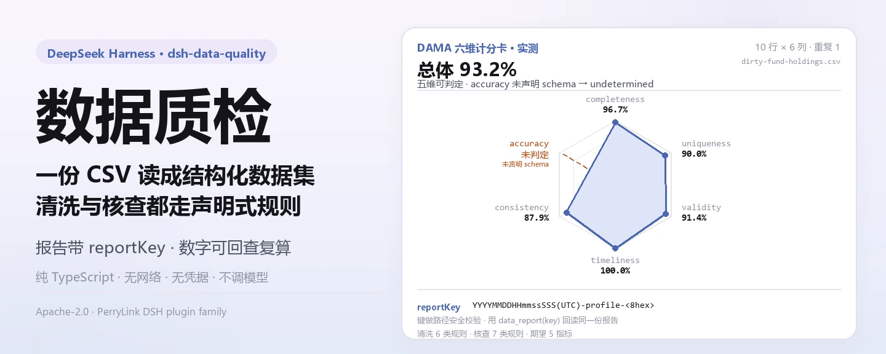
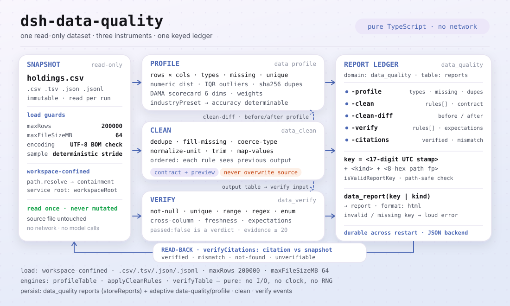
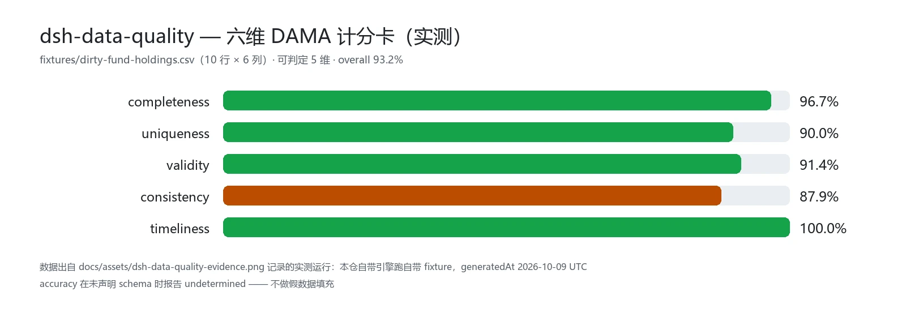

<div align="center">

<picture>
  <source media="(prefers-color-scheme: dark)" srcset="docs/assets/dsh-data-quality-hero-zh-dark.webp">
  
</picture>

# dsh-data-quality

**让模型不再心算数据——一份 CSV 进去，拿回可回查的梳理、清洗与核查报告。**

面向 DeepSeek Harness 的确定性数据质量插件：行列数、缺失率、重复行、类型推断、六维计分卡与七类核查规则全部在 harness 进程内用纯 TypeScript 计算，报告落进 `data_quality` 存储域。

[安装](#三步上手) · [配置](#配置) · [FAQ](#faq) · [简体中文](README.md) · [English](README.en.md) · [Español](README.es.md) · [Português](README.pt.md) · [हिन्दी](README.hi.md)

[](LICENSE)
[](#兼容性)
[](https://www.npmjs.com/package/dsh-data-quality)
[](https://github.com/PerryLink/dsh-data-quality/actions/workflows/ci.yml)
[](#兼容性)

[](https://github.com/PerryLink/dsh-data-quality/stargazers)
[](https://www.npmjs.com/package/dsh-data-quality)
[](https://dshfind.com/plugins/PerryLink/dsh-data-quality?ref=badge)
[](https://securityscorecards.dev/viewer/?uri=github.com/PerryLink/dsh-data-quality)
[](https://dsh.market/)
[](https://gitee.com/perrylink/dsh-data-quality)

```sh
dsh plugin --profile <name> add dsh-data-quality
```

</div>

<sub>社区插件，与 DeepSeek 官方无关。唯一仓库：<https://github.com/PerryLink/dsh-data-quality>（Gitee 为镜像）。</sub>

## 它是什么

给模型一份 CSV，`dsh-data-quality` 先把它读成结构化数据集，再用纯函数算出你应该知道的一切：多少行多少列、哪些列是混合类型、缺了多少、重复了多少、数值分布和离群点长什么样，最后给出一张 DAMA 六维计分卡。清洗和核查都用声明式规则表达，跑完把报告写进 `data_quality` 存储域并返回一个 `reportKey`——模型看到的每个数字都能凭这个键回查，而不是由模型自己"感觉"出来。所有计算都是 harness 进程内的 TypeScript：无网络、无凭据、无外部进程、无模型调用。

<picture>
  <source media="(prefers-color-scheme: dark)" srcset="docs/assets/dsh-data-quality-flow-v5-dark.svg">
  
</picture>

## 三步上手

1. **安装**（三选一）：

   ```sh
   # git 通道（最新 main；等价于 git+https://github.com/PerryLink/dsh-data-quality.git）
   dsh plugin --profile web add github:PerryLink/dsh-data-quality
   # npm 通道（已发布版本）
   dsh plugin --profile web add dsh-data-quality
   # tarball 通道：本仓库 pnpm pack 后
   dsh plugin --profile web add ./dsh-data-quality-<version>.tgz
   ```

   git 通道第一次 `add` 会失败——pnpm 默认阻止该包的 `prepare` 构建。把 pnpm 打印的键复制到 profile 的 `pnpm-workspace.yaml` 后重试：

   ```yaml
   allowBuilds:
     'dsh-data-quality': true
   ```

   安装后重启 profile 生效（bundle 以重启方式激活）。

2. **最小配置**（默认即可跑；按需抬保险丝）：

   ```yaml
   - insert:
       - id: dsh-data-quality
         name: dsh-data-quality
         config:
           maxRows: 200000
           maxFileSizeMB: 64
   ```

3. **验证已生效**：

   ```sh
   dsh --profile web --dump-config | grep -A2 'id: dsh-data-quality'
   ```

   然后在含 CSV 的工作区里对 agent 说：

   > 先梳理 `holdings.csv`，再按规则清洗：去空白、按 `fund_code` 去重、把 `holding_value` 列的 万/亿 单位归一；最后核查 `fund_code` 唯一且非空。

**卸载**：`dsh plugin --profile web remove dsh-data-quality`（或从 profile patch 删掉该行）。

## 核心能力

- **`ctx.dataQuality` 服务** —— 其他插件可选消费的 Cordis 服务（`inject = ['dataQuality']`）。除支撑工具的三个数据集操作外，还实现冻结的 `verifyCitations(request)` 契约：核查文档中引用的数字/字符串是否与数据集快照一致，数值按相对容差比较，状态为 `verified` / `mismatch` / `not-found` / `unverifiable`。
- **`data_profile` 工具** —— 行/列数、推断列类型（number/date/boolean/string/empty/mixed）、缺失率、唯一值数、数值分布（min/max/mean/median/p25/p75）、IQR 离群计数、混合类型疑点提示，以及全表 sha256 内容哈希的重复行检测（重复率 + 有界重复行索引样本）。附带确定性 DAMA 六维计分卡（`completeness` / `uniqueness` / `validity` / `consistency` / `timeliness` / `accuracy`——未声明 schema 时 accuracy 报告 undetermined，绝不编造）。大文件可选确定性系统采样。
- **`data_clean` 工具** —— 有序声明式清洗规则：`dedupe`（按列组）、`fill-missing`（常量/均值/中位数/前向填充）、`coerce-type`（number/date/boolean，失败计数并置缺失）、`normalize-unit`（万/亿 等单位后缀归一）、`trim`、`map-values`（枚举映射）。返回逐规则审计日志、交付前契约校验摘要（去重前后行数、唯一性、非空与类型回退）与有界预览；仅在给出 `outputPath` 时落盘，且绝不覆盖源文件。
- **`data_verify` 工具** —— 声明式核查规则：`not-null`、`unique`、`range`、`regex`、`enum`、`cross-column`（如 `startDate < endDate`）、`freshness`（日期列距参考日期不超过 N 天）。逐规则 pass/fail 并附有界失败行证据；整体失败是正常结果 `passed: false`，不是工具错误。
- **`data_report` 工具** —— 从 `data_quality` 存储域读回已持久化的报告：按精确 `reportKey`（路径安全校验，缺失即响亮失败）或按 `kind` 时间序列出。`format: html` 把单份梳理/清洗报告渲染成自包含离线 HTML 文档（内联 CSS/JS、无外部请求），含 DAMA 六维计分卡与画像/清洗汇总表。
- **持久化报告** —— 每次梳理/清洗/核查/引用检查都写入 `data_quality` 存储域（JSON 后端），键为运行时间戳加数据集路径指纹，工具结果以 `reportKey` 返回。清洗报告同时持久化有界预览与契约摘要，因此任何模型可见结果都能仅凭 `reportKey` 重建；每次清洗还会额外持久化一份 `clean-diff` 前后对比画像报告。
- **会话事件** —— 在能安全承载的宿主上，运行会追加 `data-quality/profile` / `data-quality/clean` / `data-quality/verify` 事件（支持处带 `ignorable` 标记）。在已发布的 `0.1.7-rc.2` 线上（与更早的 rc 线一样）按设计跳过 append——storage domain 报告始终是持久副本（见「已知限制」）。

```text
holdings.csv ──data_profile──▶ 报告 ──data_clean──▶ outputPath
                    │                                    │
                    └────── data_quality 域 · reportKey ──┴──data_verify──▶ passed / 证据行
```

### 工具与表面

#### `data_profile({ path, sample?, industryPreset? })`

梳理工作区数据集。`path` 为工作区相对路径（`.csv`/`.tsv`/`.json`/`.jsonl`；JSON 必须是扁平对象数组）。`sample` 按每 `ceil(N/sample)` 行取样计算列卡片（确定性；行数仍精确）。`industryPreset`（`retail`/`saas`/`fund`/`real-estate`/`e-commerce`/`healthcare`/`logistics`/`manufacturing`/`energy`）注入该行业预期列，使计分卡 `accuracy` 维度可判定；未知 id 响亮失败。返回结构化报告——重复率、有界重复行索引、数值 `count`/`distinct` 分布、文件 `encoding`（UTF-8 BOM 与合法性）、加权六维 DAMA 计分卡——并渲染人类可读的逐列摘要与计分卡。

#### `data_clean({ path, rules, outputPath?, dryRun? })`

按数组顺序应用 `rules`，每条规则看到上一条的输出。规则参考：

| 规则 | 额外字段 | 语义 |
|---|---|---|
| `dedupe` | `columns?` | 删除键列组合与前行重复的行（保留首次；省略时为全部列）。 |
| `fill-missing` | `column`, `strategy`, `value?` | 填充缺失：`constant`（需 `value`）、`mean`/`median`（数值列）、`forward`（前一个非缺失值）。 |
| `coerce-type` | `column`, `to` | 转换为 `number`/`date`（ISO）/`boolean`；失败置缺失并计数入日志。 |
| `normalize-unit` | `column`, `factors` | 剥离单位后缀并乘系数（`{"万": 10000, "亿": 100000000}`）；纯数值也转换。 |
| `trim` | `columns?` | 去除字符串单元格首尾空白（省略时为全部列）。 |
| `map-values` | `column`, `map`, `else?` | 精确匹配映射；未映射值保留（`keep`，默认）或置缺失（`missing`）。 |

源文件**绝不**被覆盖。给出 `outputPath` 时清洗结果写入该路径（限定工作区内，按扩展名定格式）；否则仅预览。`dryRun: true` 时不写任何文件、不持久化任何内容——结果返回逐列清洗计划与预期的 `contract`/`diffPreview`。结果还携带交付前 `contract` 摘要（去重前后行数、按去重键或整行的唯一性、`fill-missing` 列的非空回退、`coerce-type` 列的类型回退，以及逐列决策轨迹），并持久化一份 `clean-diff` 前后对比画像报告。

#### `data_report({ key?, kind?, format? })`

从存储域读回已持久化的报告。传 `key`（此前运行返回的精确 `reportKey`）取单份报告，或传 `kind`（`profile`/`clean`/`clean-diff`/`verify`/`citations`）按时间顺序列出该类全部报告；`key`/`kind` 恰需一个。格式错误或缺失的键响亮失败。`format: html`（需 `key`）把报告渲染为自包含离线 HTML 文档——内联 CSS/JS、无外部请求、DAMA 六维计分卡与画像/清洗汇总表（仅 profile/clean 报告）。

#### `data_verify({ path, rules, expectations? })`

评估核查规则。规则参考：

| 规则 | 额外字段 | 语义 |
|---|---|---|
| `not-null` | `column` | 缺失（null/空/纯空白）即失败。 |
| `unique` | `columns` | 键组合重复的每一行都失败（缺失值参与判重）。 |
| `range` | `column`, `min?`, `max?` | 缺失/不可解析或超出闭区间即失败（至少需一个界）。 |
| `regex` | `column`, `pattern`, `flags?` | 缺失或不匹配即失败（完整 JS 正则）。 |
| `enum` | `column`, `values` | 去空白后的文本不在枚举内即失败。 |
| `cross-column` | `left`, `op`, `rightColumn?`, `value?` | 逐行比较：两侧可数值解析按数值，可日期解析按纪元毫秒，否则字符串仅支持 `==`/`!=`（`rightColumn`/`value` 恰给一个）。 |
| `freshness` | `column`, `maxAgeDays`, `asOf?` | 日期早于 `asOf` 前 `maxAgeDays` 天即失败（`asOf` 默认当前）；不可解析/缺失即失败。 |

`expectations` 用确定性指标对照期望值：`rowCount`、`columnSum`、`columnMean`、`uniqueCount`、`nullCount`（除 `rowCount` 外各带 `column`，加 `expected` 与可选相对 `tolerance`∈[0, 1]）。每项期望产出 `passed` 加 `actual`/`expected`/`tolerance`；不符是正常的 `passed: false` 判定，绝非工具错误。非法指标、缺失列、超范围 tolerance 响亮失败。

任何被读取的单元格缺失都会使该规则该行失败。每条规则的失败行证据上限为 `evidenceRowLimit`。

#### `ctx.dataQuality`（供其他插件）

```ts
const result = await ctx.dataQuality.verifyCitations({
  dataset: 'holdings.csv',          // 相对 workspaceRoot 解析
  citations: [
    { id: 'c1', path: 'rows[3].nav', value: 1.234, tolerance: 0.01 },
    { id: 'c2', path: 'summary.annualReturn', value: '12.34%' },
  ],
})
// result.results[i] = { id, status: 'verified' | 'mismatch' | 'not-found' | 'unverifiable', actual?, note? }
```

定位符在数据集文档上行走：CSV/TSV 加载为 `{ columns, rows }`（故 `rows[3].nav` 可解析），JSON 为解析值本身，JSONL 为逐行解析值数组。数值按相对容差比较（`|a-b| <= tolerance * max(|a|, |b|)`）；可数值解析的 CSV 字符串单元格按数值比较；字符串精确比较；类型不可比为 `unverifiable`。服务另暴露 `profileDataset` / `cleanDataset` / `verifyDataset`（即工具调用的同一实现）。

### 示例

以下为插件真实入口；安装后调用一个即可。

**详细示例** — 命令 `data_profile`，输入：

```sh
data_profile({ path: "dirty-fund-holdings.csv" })
```

输出：

```text
Profile of dirty-fund-holdings.csv: 10 rows x 6 columns
Duplicate rows: 1 (10.0%); sample row indexes: 8
- nav: mixed; missing 1 (10.0%); unique 7; note: mixed types among 9 present values: 8 numeric, 1 string
Scorecard (overall 93.2%, weighted 93.2%):
```

*来源 `README.md:147-149; test/profile.spec.ts:130-132; test/loader.spec.ts:98-99; src/profile.ts:311-315`*

**失败分支** — 输入：

```text
{"path":"dirty-fund-holdings.csv","rules":[{"rule":"dedupe","columns":["nope"]}]}
```

输出：

```text
isError=true; error.message=rule 0: unknown column "nope" (columns: fund_code, fund_name, nav, nav_date, holding_value, currency)
```

*来源 `plugins/dsh-data-quality/src/clean.ts:66-68; plugins/dsh-data-quality/fixtures/dirty-fund-holdings.csv; exercised through plugins/dsh-data-quality/test/harness.ts`*

**简短示例**：`data_clean` · `data_verify`

## 实测数据

<picture>
  <source media="(prefers-color-scheme: dark)" srcset="docs/assets/dsh-data-quality-evidence-zh-dark.webp">
  
</picture>

在自带 fixture `fixtures/dirty-fund-holdings.csv`（10 行 × 6 列）上跑出的实测读数：completeness 96.7% · uniqueness 90.0% · validity 91.4% · consistency 87.9% · timeliness 100.0%，加权总分 93.2%；第六维 accuracy 在未声明 schema 时报告 undetermined（用 `industryPreset` 注入预期列才会可判定）。这不是准确率基准，而是同一份脏数据上可复算的确定性读数——数据出自 `docs/assets/dsh-data-quality-evidence.png` 记录的实测运行（本仓自带引擎跑自带 fixture，generatedAt 2026-10-09 UTC），可用 `node scripts/loader-runner.mjs` 复现（无需 API key）。

## 配置

所有键均可选（所示为默认值）；非法值在加载期响亮失败。每个键都可从 `cordis.yml` 修改（bundle 自带的 `cordis.patch.yml` 写有相同默认值）。按 id 覆盖会替换整行——请重述所有需要的键。

最常用键：

| 键 | 默认值 | 含义 |
|---|---|---|
| `enabled` | `true` | 总开关；`false` 时完全不挂载。 |
| `maxRows` | `200000` | 单次加载的硬行数上限；超限响亮拒绝（可用工具的 `sample` 参数）。 |
| `maxFileSizeMB` | `64` | 单次加载的硬文件大小上限（MiB）。 |
| `evidenceRowLimit` | `20` | 单结果中失败行证据（核查）与预览行（清洗）的上限。 |
| `allowedExtensions` | `['.csv', '.tsv', '.json', '.jsonl']` | 可作为数据集的扩展名。 |
| `workspaceRoot` | `""` | 服务级调用（如 `verifyCitations`）无会话工作区时使用的绝对根；空 = harness 进程启动目录。工具调用始终使用会话工作区 cwd。 |
| `storeReports` | `true` | 把运行报告写入 `data_quality` 存储域并返回 `reportKey`。 |

<details>
<summary>完整配置表（9 个键）</summary>

| 键 | 默认值 | 含义 |
|---|---|---|
| `enabled` | `true` | 总开关；`false` 时完全不挂载。 |
| `maxRows` | `200000` | 单次加载的硬行数上限；超限响亮拒绝（可用工具的 `sample` 参数）。 |
| `maxFileSizeMB` | `64` | 单次加载的硬文件大小上限（MiB）。 |
| `defaultTolerance` | `1e-9` | 引用未给 `tolerance` 时数值比较的默认相对容差。 |
| `evidenceRowLimit` | `20` | 单结果中失败行证据（核查）与预览行（清洗）的上限。 |
| `allowedExtensions` | `['.csv', '.tsv', '.json', '.jsonl']` | 可作为数据集的扩展名。 |
| `workspaceRoot` | `""` | 服务级调用（如 `verifyCitations`）无会话工作区时使用的绝对根；空 = harness 进程启动目录。工具调用始终使用会话工作区 cwd。 |
| `storeReports` | `true` | 把运行报告写入 `data_quality` 存储域并返回 `reportKey`。 |
| `scorecardWeights` | 全为 1（等权） | 六维加权总分的各维度权重（`completeness` / `uniqueness` / `validity` / `consistency` / `timeliness` / `accuracy`）；每个权重必须是非负数。 |

</details>

profile patch 覆盖示例：

```yaml
- insert:
    - id: dsh-data-quality
      name: dsh-data-quality
      config:
        maxRows: 50000
        evidenceRowLimit: 10
        scorecardWeights:
          completeness: 2
          uniqueness: 1
```

## FAQ

<details>
<summary>数据存在哪？会不会被发出去？</summary>

只读工作区数据集文件（白名单扩展名）；只写两类东西——`data_clean` 显式给出 `outputPath` 时的输出文件（限定工作区内、绝不覆盖输入），以及 harness 数据目录下 `data_quality` 存储域里的报告。**无网络、无凭据、无外部进程**，全部解析与统计都是进程内 TypeScript。报告可能包含数据集的样本单元格值（受 `evidenceRowLimit` 与展示截断约束）；会话日志照常记录工具参数与结果。

</details>

<details>
<summary>裸 profile 或宿主不支持会话事件时会怎样？</summary>

插件硬注入 `tools` 与 `storageDomain`：官方随附 profile（web/headless/sdk/acp）通过 `dsh-base` 已组合存储栈（`dsh-storage` + `dsh-storage-json` + `dsh-storage-domain`），裸 profile 需自行组合，否则不会挂载。会话事件是自适应的——宿主不认识 `data-quality/*` 词汇且 `Session.append` 无法打 `ignorable` 标记时，append 被跳过（不会破坏会话日志），`data_quality` 存储域报告始终是持久副本。

</details>

<details>
<summary>会和其他插件抢服务键、工具名或 slot 吗？</summary>

不会。本插件不注册任何 waterfall 监听器，只发布一个命名空间化服务键 `dataQuality`，四个工具名全部带 `data_` 前缀，不注册客户端 slot、不注册 `webServer` 前缀、不改全局对象；bundle patch 只 `insert` 自己那一行。逐条论证见「与其他 DSH 插件的互操作性」。

</details>

<details>
<summary>性能开销多大？大文件怎么办？</summary>

解析与统计是零依赖进程内 TypeScript，不推理、不联网、不调模型：典型 CSV 的开销就是读文件加一次线性扫描。保险丝是硬的——`maxRows`（默认 200000）与 `maxFileSizeMB`（默认 64）对超限输入响亮拒绝，`data_profile` 的 `sample` 参数提供确定性系统采样，abort 信号可中断长加载。

</details>

<details>
<summary>模型会不会自己算数算错？</summary>

不会——模型不参与算术。行数、缺失率、分位数、IQR 离群、重复率、计分卡与核查结论全部由确定性函数产出；同一输入同一输出，唯一的时钟是为 `freshness` 默认值与报告时间戳注入的时钟。模型只负责选择工具与规则，以及把结果讲给人听。

</details>

## 安全边界

- **路径限定** —— 数据集与输出路径必须解析在会话工作区内（`verifyCitations` 用 `workspaceRoot`）；拒绝 `..` 逃逸与根外绝对路径，比较前双侧归一化（Windows 斜杠安全）。
- **有界工作量** —— `maxRows` / `maxFileSizeMB` 守卫对超限输入响亮拒绝；abort 信号可中断长加载。
- **不覆盖** —— `data_clean` 拒绝与输入相同的 `outputPath`。
- **确定性计算** —— 相同输入相同输出；唯一的时钟是为 `freshness` 默认值与报告时间戳注入的时钟。
- **注册即 effect** —— 工具注册与存储域关闭都是 Cordis effect，停止/热重载即可撤销。

## 权限与数据

- **读取**工作区数据集文件（仅白名单扩展名）。
- **写入**仅有：`data_clean` 的输出文件（显式 `outputPath`、限定工作区内、绝不覆盖输入）与 harness 数据目录下 `data_quality` 存储域中的报告。
- **无网络、无凭据、无外部进程** —— 全部解析与统计都是进程内 TypeScript。
- 报告可能包含数据集的样本单元格值（受 `evidenceRowLimit` 与展示截断约束）；会话日志照常记录工具参数与结果。

## 已知限制

- **会话事件是自适应的。** 已发布的 `0.1.7-rc.2` 线（与更早的 rc 线一样）没有插件会话事件注册面，`Session.append` 也无法打 `ignorable` 标记；追加未知 `data-quality/*` 类型会让会话日志在恢复时被拒读。因此插件仅在宿主认识该词汇或支持 `ignorable` append 时才追加；在已发布线上 storage domain 报告即持久记录。
- **CSV 方言** —— 逗号/制表符分隔、RFC-4180 引号、首行必须是表头、跳过空白行；无分隔符自动探测、无注释行。
- **类型解析是严格的** —— 数字不带千分位；日期为 `YYYY-MM-DD` / `YYYY/MM/DD` / ISO 风格时间（UTC）；布尔为 `true/false/yes/no/1/0`。其余一律按 `string`/`mixed` 梳理——如有意图请用 `coerce-type` 清洗。
- **JSON 对工具必须是表格**（扁平对象数组）；`verifyCitations` 可行走任意 JSON 文档。
- **不做 ML 异常检测、不做 PII 脱敏、不连数据库、不做 SQL** —— 仅规则式疑点提示。

## 与其他 DSH 插件的互操作性

已对照本仓声明的宿主走廊（`>=0.2.1-0 <0.3.0`）与 `dsh-plugin-guide` 的插件契约验证。

本插件**不干扰**其他插件：

- **无监听器抢占。** 本插件不注册任何 waterfall 监听器（`agent/pre-step` / `tools/post-execute` 一概不碰），因此不可能饿死或短路其他插件的监听链。
- **服务键命名空间化。** 只发布一个服务键 `dataQuality`，不占用任何内置或其他插件的键；消费方以 `inject = ['dataQuality']` 显式声明依赖。
- **无工具名冲突。** 四个工具名 `data_profile` / `data_clean` / `data_verify` / `data_report` 全部带 `data_` 前缀，不占用内置工具或其他插件的裸名。
- **无 slot / HTTP 路由冲突。** 纯 host 插件（无浏览器半），不注册客户端 slot key，也不注册任何 `webServer` 前缀。
- **无 patch 层冲突。** bundle patch 只 `insert` 自己那一行，从不覆写内置行的 `config`。
- **存储域隔离。** 只写自己的 `data_quality` 域（JSON 后端），不触碰其他插件的存储域。
- **无全局改写。** 不改原型、不改写 `process.env`、不替换全局 fetch dispatcher；无网络请求、无外部进程。

静态证据：本仓历史 `dsh-plugin-doctor` 验证徽章（[报告](https://github.com/PerryLink/dsh-plugin-doctor#verified-徽章)）。

## 兼容性

| 维度 | 状态 |
|---|---|
| Harness | DeepSeek Harness `dsh-v0.2.1-alpha.1`（2026-10-04 已适配）：peer 区间已接纳 alpha.2 线；该线上 `Session.append` 的第三参仅对表面事件类型存在且为 `SurfaceIntent`，因此审计门控仍为跳过、storage-domain 报告仍是持久副本。已于 2026-09-24 核验（三把 typecheck 尺子 + 全量测试绿）。 |
| Node | `^22.19.0 \|\| >=24.9.0` |
| 包管理器 | `pnpm@11.7.0` |
| 平台 | Windows / macOS / Linux（纯宿主插件） |
| 模型 | 文本模型完全支持；无需额外模型能力 |

## 生态与质量

- [Gitee 镜像](https://gitee.com/perrylink/dsh-data-quality)（同步镜像，以 GitHub 为准）
- [dshfind 插件页](https://dshfind.com/plugins/PerryLink/dsh-data-quality)（安装量与排名）
- [OpenSSF Scorecard 报告](https://securityscorecards.dev/viewer/?uri=github.com/PerryLink/dsh-data-quality)（由 [.github/workflows/scorecard.yml](.github/workflows/scorecard.yml) 驱动）
- [dsh-plugin-doctor 验证徽章](https://github.com/PerryLink/dsh-plugin-doctor#verified-徽章)（历史记录）
- [DSH Market](https://dsh.market/)（已上架）
- **1024 商店渠道**：先 `npm i -g dsh1024`，再 `dsh1024 plugin --profile web add dsh-data-quality`（计入 [deepseek1024.com](https://deepseek1024.com) 安装排行）
- [生态实测知识库](https://perrylink.github.io/dsh-plugin-guide/)：插件开发指南 · 选型实测数据 · 维护取舍判据

## 开发

```sh
pnpm install                                                     # node ^22.19 || >=24.9
pnpm run typecheck && pnpm run typecheck:ci && pnpm run typecheck:checkout
pnpm test                                                        # vitest
pnpm run build                                                   # tsdown 产物 + d.ts 收尾
pnpm run verify:self-contained && pnpm run verify:artifacts     # 依赖 spec + 发布文件
node scripts/check-readme-sync.mjs                               # 五语 README 一致性
pnpm pack
```

- 测试用 vitest 跑真实 `Context`/`Session`/`ToolRuntime`/storage domain（不手写服务 mock）加纯引擎用例；每类清洗/核查规则都有正反用例，`verifyCitations` 覆盖四种状态。
- `scripts/loader-runner.mjs` 以真实 Loader 组合启动，并在无 API key 下对 `fixtures/` 执行 梳理 → 清洗 → 核查 链路。
- 发布：`node scripts/release.mjs <x.y.z>`（绝不 push；tag 触发 `release.yml`）。
- 配图由 [`scripts/gen-readme-assets.py`](scripts/gen-readme-assets.py) 程序化生成（Python + Pillow）：hero 为深浅双版 webp（六维 DAMA 雷达），结构图为手写双版 SVG，实测图为深浅双版 webp，可重复执行。

Topics：`dsh`, `dsh-plugin`, `deepseek-harness`, `cordis`, `data-quality`, `data-cleaning`, `data-profiling`, `data-verification`

## 家族与致谢

本项目是 [PerryLink](https://github.com/PerryLink) 维护的 DeepSeek Harness 插件家族成员（全部 Apache-2.0）。如果这个插件帮到了你，**给个 star**——它不解锁任何功能，但会让下一个人更容易找到它。

- [@PerryLink](https://github.com/PerryLink) —— 维护与发布（`0.1.2`/`0.1.3`）、peer 依赖升级、npm 版本/下载量/CI 徽章，以及近期修复。
- **dsh-data-quality contributors** —— 初始脚手架、`ctx.dataQuality` 能力缝与冻结的 `verifyCitations` 契约、确定性数据集层与纯引擎、`data_quality` 存储域报告、真实服务 vitest 套件、CI/compat/release 工作流，以及五语 README。

<details>
<summary>展开全部插件</summary>

| 插件 | 状态 |
|---|---|
| **[dsh-aqua-input-check](https://github.com/PerryLink/dsh-aqua-input-check)** |  |
| **[dsh-archive-check](https://github.com/PerryLink/dsh-archive-check)** |  |
| **[dsh-auto-review](https://github.com/PerryLink/dsh-auto-review)** |  |
| **[dsh-autotier](https://github.com/PerryLink/dsh-autotier)** | 🧊 已冻结 — 见仓库 README |
| **[dsh-bid-ca-precheck](https://github.com/PerryLink/dsh-bid-ca-precheck)** |  |
| **[dsh-bid-qual-check](https://github.com/PerryLink/dsh-bid-qual-check)** |  |
| **[dsh-cert-mcp](https://github.com/PerryLink/dsh-cert-mcp)** | 🧊 已冻结 — 见仓库 README |
| **[dsh-checkpoint-rewind](https://github.com/PerryLink/dsh-checkpoint-rewind)** |  |
| **[dsh-click](https://github.com/PerryLink/dsh-click)** |  |
| **[dsh-composer-history](https://github.com/PerryLink/dsh-composer-history)** |  |
| **[dsh-contract-stance](https://github.com/PerryLink/dsh-contract-stance)** |  |
| **[dsh-customs-doc-check](https://github.com/PerryLink/dsh-customs-doc-check)** |  |
| **[dsh-data-quality](https://github.com/PerryLink/dsh-data-quality)** | 🧊 已冻结 — 见仓库 README |
| **[dsh-demurrage-ledger](https://github.com/PerryLink/dsh-demurrage-ledger)** |  |
| **[dsh-doublecheck](https://github.com/PerryLink/dsh-doublecheck)** |  |
| **[dsh-drill-script-check](https://github.com/PerryLink/dsh-drill-script-check)** |  |
| **[dsh-eia-guide-check](https://github.com/PerryLink/dsh-eia-guide-check)** |  |
| **[dsh-emergency-plan](https://github.com/PerryLink/dsh-emergency-plan)** |  |
| **[dsh-essay-rubric-check](https://github.com/PerryLink/dsh-essay-rubric-check)** |  |
| **[dsh-evidence-check](https://github.com/PerryLink/dsh-evidence-check)** |  |
| **[dsh-export-ctl-check](https://github.com/PerryLink/dsh-export-ctl-check)** |  |
| **[dsh-fast](https://github.com/PerryLink/dsh-fast)** |  |
| **[dsh-fmea-table-check](https://github.com/PerryLink/dsh-fmea-table-check)** |  |
| **[dsh-forecast-penalty](https://github.com/PerryLink/dsh-forecast-penalty)** |  |
| **[dsh-fund-research](https://github.com/PerryLink/dsh-fund-research)** |  |
| **[dsh-github](https://github.com/PerryLink/dsh-github)** |  |
| **[dsh-gongwen-flow-check](https://github.com/PerryLink/dsh-gongwen-flow-check)** |  |
| **[dsh-gongwen-word-check](https://github.com/PerryLink/dsh-gongwen-word-check)** |  |
| **[dsh-guard-plan-qc](https://github.com/PerryLink/dsh-guard-plan-qc)** |  |
| **[dsh-hazchem-check](https://github.com/PerryLink/dsh-hazchem-check)** |  |
| **[dsh-hazplan-check](https://github.com/PerryLink/dsh-hazplan-check)** |  |
| **[dsh-hidden-risk-map](https://github.com/PerryLink/dsh-hidden-risk-map)** |  |
| **[dsh-hs-classify](https://github.com/PerryLink/dsh-hs-classify)** |  |
| **[dsh-icd-rule-check](https://github.com/PerryLink/dsh-icd-rule-check)** |  |
| **[dsh-industry-research](https://github.com/PerryLink/dsh-industry-research)** |  |
| **[dsh-lawcite-adapter](https://github.com/PerryLink/dsh-lawcite-adapter)** |  |
| **[dsh-laya](https://github.com/PerryLink/dsh-laya)** |  |
| **[dsh-lc-doc-check](https://github.com/PerryLink/dsh-lc-doc-check)** |  |
| **[dsh-learning-gap-check](https://github.com/PerryLink/dsh-learning-gap-check)** |  |
| **[dsh-library](https://github.com/PerryLink/dsh-library)** |  |
| **[dsh-local-ai](https://github.com/PerryLink/dsh-local-ai)** |  |
| **[dsh-lsp-actions](https://github.com/PerryLink/dsh-lsp-actions)** |  |
| **[dsh-mask](https://github.com/PerryLink/dsh-mask)** |  |
| **[dsh-mcp-panel](https://github.com/PerryLink/dsh-mcp-panel)** |  |
| **[dsh-medrec-qc](https://github.com/PerryLink/dsh-medrec-qc)** |  |
| **[dsh-memento](https://github.com/PerryLink/dsh-memento)** | 🧊 已冻结 — 见仓库 README |
| **[dsh-nsfc-form-check](https://github.com/PerryLink/dsh-nsfc-form-check)** |  |
| **[dsh-nurse-record-check](https://github.com/PerryLink/dsh-nurse-record-check)** |  |
| **[dsh-observe](https://github.com/PerryLink/dsh-observe)** |  |
| **[dsh-origin-rvc-check](https://github.com/PerryLink/dsh-origin-rvc-check)** |  |
| **[dsh-ota-review-check](https://github.com/PerryLink/dsh-ota-review-check)** |  |
| **[dsh-output-styles](https://github.com/PerryLink/dsh-output-styles)** |  |
| **[dsh-paper-doc-adapter](https://github.com/PerryLink/dsh-paper-doc-adapter)** |  |
| **[dsh-permission-rules](https://github.com/PerryLink/dsh-permission-rules)** |  |
| **[dsh-permit-report-check](https://github.com/PerryLink/dsh-permit-report-check)** |  |
| **[dsh-pipeline-check](https://github.com/PerryLink/dsh-pipeline-check)** |  |
| **[dsh-pleading-draft](https://github.com/PerryLink/dsh-pleading-draft)** |  |
| **[dsh-plugin-doctor](https://github.com/PerryLink/dsh-plugin-doctor)** | 🚫 已退役（仓库已归档） |
| **[dsh-plugin-guide](https://github.com/PerryLink/dsh-plugin-guide)** |  |
| **[dsh-plugin-kit](https://github.com/PerryLink/dsh-plugin-kit)** | 🚫 已退役（仓库已归档） |
| **[dsh-plugin-upgrade](https://github.com/PerryLink/dsh-plugin-upgrade)** | 🚫 已退役（仓库已归档） |
| **[dsh-policy-brief-draft](https://github.com/PerryLink/dsh-policy-brief-draft)** |  |
| **[dsh-power-loss-split](https://github.com/PerryLink/dsh-power-loss-split)** |  |
| **[dsh-power-ticket-check](https://github.com/PerryLink/dsh-power-ticket-check)** |  |
| **[dsh-ppap-check](https://github.com/PerryLink/dsh-ppap-check)** |  |
| **[dsh-protest-deadline](https://github.com/PerryLink/dsh-protest-deadline)** |  |
| **[dsh-railway-window](https://github.com/PerryLink/dsh-railway-window)** |  |
| **[dsh-repair-order-qc](https://github.com/PerryLink/dsh-repair-order-qc)** |  |
| **[dsh-research-report](https://github.com/PerryLink/dsh-research-report)** |  |
| **[dsh-review-reply-check](https://github.com/PerryLink/dsh-review-reply-check)** |  |
| **[dsh-rulefile-check](https://github.com/PerryLink/dsh-rulefile-check)** |  |
| **[dsh-safety-brief-check](https://github.com/PerryLink/dsh-safety-brief-check)** |  |
| **[dsh-score](https://github.com/PerryLink/dsh-score)** | 🧊 已冻结 — 见仓库 README |
| **[dsh-session-sync](https://github.com/PerryLink/dsh-session-sync)** |  |
| **[dsh-site-log-check](https://github.com/PerryLink/dsh-site-log-check)** |  |
| **[dsh-skill-pack-security](https://github.com/PerryLink/dsh-skill-pack-security)** |  |
| **[dsh-soe-decision-check](https://github.com/PerryLink/dsh-soe-decision-check)** |  |
| **[dsh-soilwater-check](https://github.com/PerryLink/dsh-soilwater-check)** |  |
| **[dsh-sop-sync-check](https://github.com/PerryLink/dsh-sop-sync-check)** |  |
| **[dsh-spc-gbt-adapter](https://github.com/PerryLink/dsh-spc-gbt-adapter)** |  |
| **[dsh-talk](https://github.com/PerryLink/dsh-talk)** |  |
| **[dsh-tender-extract](https://github.com/PerryLink/dsh-tender-extract)** |  |
| **[dsh-tender-matrix](https://github.com/PerryLink/dsh-tender-matrix)** |  |
| **[dsh-test-drive](https://github.com/PerryLink/dsh-test-drive)** |  |
| **[dsh-ticktick](https://github.com/PerryLink/dsh-ticktick)** | 🚫 已退役（仓库已归档） |
| **[dsh-translate](https://github.com/PerryLink/dsh-translate)** |  |
| **[dsh-warranty-calc](https://github.com/PerryLink/dsh-warranty-calc)** |  |
| **[dsh-budget](https://github.com/PerryLink/dsh-budget)** | 🧊 已冻结 — 见仓库 README |
| **[dsh-claude-move](https://github.com/PerryLink/dsh-claude-move)** | 🧊 已冻结 — 见仓库 README |
| **[dsh-defend](https://github.com/PerryLink/dsh-defend)** | 🧊 已冻结 — 见仓库 README |
| **[dsh-draw](https://github.com/PerryLink/dsh-draw)** | 🧊 已冻结 — 见仓库 README |
| **[dsh-reach](https://github.com/PerryLink/dsh-reach)** | 🧊 已冻结 — 见仓库 README |
| **[dsh-background-agents](https://github.com/PerryLink/dsh-background-agents)** | 🚫 已退役（仓库已归档） |
| **[dsh-session-pin](https://github.com/PerryLink/dsh-session-pin)** | 🚫 已退役（仓库已归档） |
| **[dsh-team-rooms](https://github.com/PerryLink/dsh-team-rooms)** | 🚫 已退役（仓库已归档） |

</details>

## License

[LICENSE](LICENSE)（Apache License 2.0）© 2026 dsh-data-quality contributors

<p align="center"><sub>Apache-2.0 · 社区插件，与 DeepSeek 无关。</sub></p>
