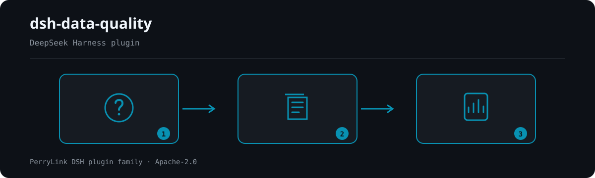

# dsh-data-quality

Deterministic data profiling, cleaning, and verification for DeepSeek Harness.

- **1024 store channel**: `npm i -g dsh1024` once, then `dsh1024 plugin --profile web add dsh-data-quality` (counts toward the [deepseek1024.com](https://deepseek1024.com) install ranking).
[](https://gitee.com/perrylink/dsh-data-quality)
[](https://dshfind.com/plugins/PerryLink/dsh-data-quality?ref=badge)
[](https://api.securityscorecards.dev/projects/github.com/PerryLink/dsh-data-quality)
[](https://github.com/PerryLink/dsh-plugin-doctor#verified-徽章)
[](https://dsh.market/)

[](https://www.npmjs.com/package/dsh-data-quality)
[](https://www.npmjs.com/package/dsh-data-quality)
[](https://github.com/PerryLink/dsh-data-quality/actions)


**Deterministic data profiling, cleaning, and verification for DeepSeek Harness.**

All computation is plain TypeScript in the harness process — the model never does the math. A `ctx.dataQuality` capability seam (Service Definition / local Provider / tool Consumers) exposes three model tools plus a frozen cross-plugin citation-checking contract.

[English](README.md) · [简体中文](README-zh.md) · [Español](README-es.md) · [Português](README-pt.md) · [हिन्दी](README-hi.md)

```sh
dsh plugin --profile <name> add dsh-data-quality
```


**📖 Ecosystem knowledge base** — measured data, not marketing: [plugin development guide · plugin-selection data · maintenance criteria](https://perrylink.github.io/dsh-plugin-guide/).

<!-- star-cta -->
## Install & uninstall

```sh
dsh plugin --profile web add dsh-data-quality      # install (npm) — or the forms above
dsh plugin --profile web remove dsh-data-quality   # uninstall
```

## ⭐ 如果它帮到了你

这个插件是 [DSH 插件家族](https://github.com/PerryLink)的一员（95 个，全部 Apache-2.0）。如果你在用，**给个 star** —— 它不会解锁任何功能，但会让下一个人在搜索里更容易找到它。

*English:* part of a 95 plugin family for DeepSeek Harness. If it is useful, **a star helps the next person find it** — nothing is gated behind it.


## What is dsh-data-quality?

Deterministic data profiling, cleaning, and verification for DeepSeek Harness.



*Workflow overview: question → sealed sources → report. The examples below use the real command surface.*


## Comparison


fixtures/dirty-fund-holdings.csv (10 rows x 6 columns) · 5 determinable dimensions · run locally

## Compatibility

| Component | Version |
|---|---|
| DeepSeek Harness | `dsh-v0.2.1-alpha.1` (adapted 2026-10-04): the peer range now admits the alpha.2 line; there `Session.append`'s third parameter exists only for surface-eligible types and is a `SurfaceIntent`, so the audit gate still skips and the storage-domain report stays the durable copy. Verified 2026-09-24 (dual typecheck rulers + full test suite green). |
| Node.js | `^22.19.0 \|\| >=24.0.0` |
| Package manager | `pnpm@11.7.0` |
| Platform | Windows / macOS / Linux (host-only plugin) |

## What you get

- **`ctx.dataQuality` service** — a Cordis service other plugins may optionally consume (`inject = ['dataQuality']`). Besides the three dataset operations behind the tools, it implements the frozen `verifyCitations(request)` contract: verify that numbers/strings cited in a document match a dataset snapshot, with relative-tolerance numeric comparison and `verified` / `mismatch` / `not-found` / `unverifiable` statuses.
- **`data_profile` tool** — dataset profiling: row/column counts, inferred column types (number/date/boolean/string/empty/mixed), missing rates, unique counts, numeric distributions (min/max/mean/median/p25/p75), IQR outlier counts, mixed-type suspicion notes, and full-table sha256 content-hash duplicate detection with the duplicate rate and a bounded sample of duplicate row indexes. Adds a deterministic DAMA six-dimension scorecard (completeness, uniqueness, validity, consistency, timeliness, accuracy — accuracy is reported undetermined without a declared schema, never fabricated). Optional deterministic systematic sampling for large files.
- **`data_clean` tool** — ordered declarative cleaning rules: `dedupe` (by column group), `fill-missing` (constant/mean/median/forward), `coerce-type` (number/date/boolean; failures counted and set to missing), `normalize-unit` (e.g. 万/亿 suffixes to base units), `trim`, `map-values` (enum mapping). Returns a per-rule audit log, a pre-delivery contract validation summary (dedupe before/after, uniqueness, non-null and type regressions), and a bounded preview; writes the cleaned dataset only when `outputPath` is given, and never overwrites the source.
- **`data_verify` tool** — declarative verification rules: `not-null`, `unique`, `range`, `regex`, `enum`, `cross-column` (e.g. `startDate < endDate`), `freshness` (date column within N days of a reference date). Per-rule pass/fail with capped failing-row evidence; an overall failure is a normal `passed: false` result, not a tool error.
- **`data_report` tool** — read persisted reports back from the `data_quality` storage domain: by exact `reportKey` (path-safe validation, missing keys fail loud) or by `kind` (chronological listing). Returns the report envelope(s) — kind, dataset, timestamp, and the full stored report. `format: html` renders one profile/clean report as a self-contained offline HTML document (inline CSS/JS, no external requests) with the DAMA six-dimension scorecard and the profile/cleaning summary tables.
- **Durable reports** — every profile/clean/verify/citation run persists to the `data_quality` storage domain (JSON backend), keyed by run timestamp plus a dataset-path fingerprint; the key is returned as `reportKey` in tool results. Clean reports also persist the bounded preview and the contract summary, so every model-visible result is reconstructable from its `reportKey`; each clean run additionally persists a `clean-diff` before/after profile report.
- **Session events** — on hosts that can carry them safely, runs append `data-quality/profile` / `data-quality/clean` / `data-quality/verify` events (with the `ignorable` marker where supported). On the published `0.1.7-rc.2` line (as on earlier rc lines) the append is skipped by design — the storage-domain report is always the durable copy (see "Known limitations").

## Quick start

```sh
dsh plugin --profile web add github:PerryLink/dsh-data-quality
```

### npm channel

```sh
dsh plugin --profile web add dsh-data-quality
```

### Tarball channel (no build permission needed)

```sh
pnpm pack                                  # produces dsh-data-quality-<version>.tgz
dsh plugin --profile web add ./dsh-data-quality-<version>.tgz
```

### Git channel

```sh
dsh plugin --profile web add github:YOUR_ORG/dsh-data-quality#<commit-sha>
```

The first `add` fails because pnpm blocks the package's `prepare` build; copy the exact key pnpm printed into the profile's `pnpm-workspace.yaml` and re-run:

```yaml
allowBuilds:
  'dsh-data-quality': true
```

Restart the profile after installing (bundles activate on restart). Then ask the agent, in a workspace containing a CSV:

> Profile `holdings.csv`, then clean it by trimming whitespace, deduplicating on `fund_code`, and normalizing the `holding_value` column's 万/亿 units; finally verify `fund_code` is unique and not null.

### Examples

These are the plugin's real entry points; install once, then call one.

#### Detailed example

**Command**

~~~sh
data_profile({ path: "dirty-fund-holdings.csv" })
~~~

**Output**

~~~text
Profile of dirty-fund-holdings.csv: 10 rows x 6 columns
Duplicate rows: 1 (10.0%); sample row indexes: 8
- nav: mixed; missing 1 (10.0%); unique 7; note: mixed types among 9 present values: 8 numeric, 1 string
Scorecard (overall 93.2%, weighted 93.2%):
~~~

*Observed from `README.md:147-149; test/profile.spec.ts:130-132; test/loader.spec.ts:98-99; src/profile.ts:311-315`*

#### Failure branch

**Input**

~~~text
{"path":"dirty-fund-holdings.csv","rules":[{"rule":"dedupe","columns":["nope"]}]}
~~~

**Output**

~~~text
isError=true; error.message=rule 0: unknown column "nope" (columns: fund_code, fund_name, nav, nav_date, holding_value, currency)
~~~

*Observed from `plugins/dsh-data-quality/src/clean.ts:66-68; plugins/dsh-data-quality/fixtures/dirty-fund-holdings.csv; exercised through plugins/dsh-data-quality/test/harness.ts`*

#### Brief examples

- `data_clean`
- `data_verify`

## Configuration

All keys are optional (defaults shown); invalid values fail loudly at load. Every key is settable from `cordis.yml` (the bundle ships `cordis.patch.yml` with the same defaults).

| Key | Default | Description |
|---|---|---|
| `enabled` | `true` | Master switch; `false` mounts nothing at all. |
| `maxRows` | `200000` | Hard row cap per dataset load; larger inputs reject loudly (use the tool's `sample` parameter). |
| `maxFileSizeMB` | `64` | Hard file-size cap in MiB per dataset load. |
| `defaultTolerance` | `1e-9` | Default relative tolerance for numeric citation comparison when a citation omits `tolerance`. |
| `evidenceRowLimit` | `20` | Cap on failing-row evidence (verify) and preview rows (clean) in one result. |
| `allowedExtensions` | `['.csv', '.tsv', '.json', '.jsonl']` | Extensions accepted as datasets. |
| `workspaceRoot` | `""` | Absolute root for SERVICE-level calls (e.g. `verifyCitations`) that carry no session workspace; empty = the harness process launch directory. Tool calls always use the session's workspace cwd. |
| `storeReports` | `true` | Persist run reports to the `data_quality` storage domain and return `reportKey`. |
| `scorecardWeights` | all 1 (equal) | Per-dimension weights (completeness/uniqueness/validity/consistency/timeliness/accuracy) for the scorecard's weighted overall total; each weight must be a non-negative number. |

## Tools & surfaces

### `data_profile({ path, sample?, industryPreset? })`

Profiles a workspace dataset. `path` is workspace-relative (`.csv`/`.tsv`/`.json`/`.jsonl`; JSON must be an array of flat objects). `sample` takes every `ceil(N/sample)`-th row for the column cards (deterministic; row counts stay exact). `industryPreset` (`retail`/`saas`/`fund`/`real-estate`/`e-commerce`/`healthcare`/`logistics`/`manufacturing`/`energy`) injects that industry's expected columns so the scorecard `accuracy` dimension becomes determinable; unknown ids fail loud. Returns the structured report — the duplicate rate, bounded duplicate-row indexes, numeric `count`/`distinct` distributions, file `encoding` (UTF-8 BOM + validity), and the weighted six-dimension DAMA scorecard — and renders a human-readable per-column summary plus scorecard.

### `data_clean({ path, rules, outputPath?, dryRun? })`

Applies `rules` in array order, each seeing the previous rule's output. Rule reference:

| Rule | Extra fields | Semantics |
|---|---|---|
| `dedupe` | `columns?` | Remove rows whose key-column values duplicate an earlier row (first kept; all columns when omitted). |
| `fill-missing` | `column`, `strategy`, `value?` | Fill missing cells: `constant` (needs `value`), `mean`/`median` (numeric columns), `forward` (previous non-missing). |
| `coerce-type` | `column`, `to` | Coerce to `number`/`date` (ISO)/`boolean`; failures become missing and are counted in the log. |
| `normalize-unit` | `column`, `factors` | Strip a unit suffix and multiply (`{"万": 10000, "亿": 100000000}`); plain numerics convert too. |
| `trim` | `columns?` | Trim whitespace of string cells (all columns when omitted). |
| `map-values` | `column`, `map`, `else?` | Exact-match mapping; unmapped values stay (`keep`, default) or become `missing`. |

The source file is **never** overwritten. With `outputPath` the cleaned dataset is written there (workspace-confined, format by extension); without it the run is preview-only. With `dryRun: true` no file is written and nothing is persisted — the result returns the per-column cleaning plan and the expected `contract`/`diffPreview`. The result also carries a pre-delivery `contract` summary (dedupe before/after rows, uniqueness over the dedupe key or full rows, non-null regression for `fill-missing` columns, type regression for `coerce-type` columns, and the per-column decision trace), and a `clean-diff` before/after profile report is persisted to the storage domain.

### `data_report({ key?, kind?, format? })`

Reads persisted reports back from the storage domain. Pass `key` (the exact `reportKey` a prior run returned) to fetch one report, or `kind` (`profile`/`clean`/`clean-diff`/`verify`/`citations`) to list every report of that kind chronologically; exactly one of `key`/`kind` is required. Malformed or missing keys fail loud. `format: html` (with `key`) renders the report as a self-contained offline HTML document — inline CSS/JS, no external requests, the DAMA six-dimension scorecard, and the profile/cleaning summary tables (profile/clean reports only).

### `data_verify({ path, rules, expectations? })`

Evaluates verification rules. Rule reference:

| Rule | Extra fields | Semantics |
|---|---|---|
| `not-null` | `column` | Fail missing cells (null/empty/whitespace). |
| `unique` | `columns` | Fail every row whose key combination repeats (missing participates). |
| `range` | `column`, `min?`, `max?` | Fail missing/unparseable cells and values outside the inclusive bounds (at least one bound required). |
| `regex` | `column`, `pattern`, `flags?` | Fail missing or non-matching cells (full JS regex). |
| `enum` | `column`, `values` | Fail cells whose trimmed text is not listed. |
| `cross-column` | `left`, `op`, `rightColumn?`, `value?` | Compare per row: numeric when both sides parse, dates compare as epochs, strings only for `==`/`!=` (exactly one of `rightColumn`/`value`). |
| `freshness` | `column`, `maxAgeDays`, `asOf?` | Fail dates older than `maxAgeDays` before `asOf` (default: now); unparseable/missing fails. |

`expectations` reconciles deterministic metrics against expected values: `rowCount`, `columnSum`, `columnMean`, `uniqueCount`, `nullCount` (each with `column` except `rowCount`, plus `expected` and an optional relative `tolerance` in [0, 1]). Each expectation yields `passed` plus `actual`/`expected`/`tolerance`; a mismatch is a normal `passed: false` verdict, never a tool error. Invalid metrics, missing columns, and out-of-range tolerances fail loud.

A missing cell fails every rule that reads it. Evidence is capped at `evidenceRowLimit` failing rows per rule.

### `ctx.dataQuality` (for other plugins)

```ts
const result = await ctx.dataQuality.verifyCitations({
  dataset: 'holdings.csv',          // resolved against workspaceRoot
  citations: [
    { id: 'c1', path: 'rows[3].nav', value: 1.234, tolerance: 0.01 },
    { id: 'c2', path: 'summary.annualReturn', value: '12.34%' },
  ],
})
// result.results[i] = { id, status: 'verified' | 'mismatch' | 'not-found' | 'unverifiable', actual?, note? }
```

Locators walk the dataset document: CSV/TSV load as `{ columns, rows }` (so `rows[3].nav` resolves), JSON is the parsed value, JSONL the array of parsed lines. Numbers compare with relative tolerance (`|a-b| <= tolerance * max(|a|, |b|)`); a CSV string cell that parses numerically compares as a number; strings compare exactly; incomparable type pairs are `unverifiable`. The service also exposes `profileDataset` / `cleanDataset` / `verifyDataset` (the same operations the tools call).

## Permissions & data

- **Reads** workspace dataset files (allowlisted extensions only).
- **Writes** only: the `data_clean` output file (explicit `outputPath`, workspace-confined, never the input) and reports in the `data_quality` storage domain under the harness data directory.
- **No network, no credentials, no external processes** — all parsing and statistics are in-process TypeScript.
- Reports may contain sample cell values from your datasets (bounded by `evidenceRowLimit` and display truncation); the session log records tool arguments and results as usual.

## Security boundaries

- **Path confinement** — dataset and output paths must resolve inside the session workspace (`verifyCitations` uses `workspaceRoot`); `..` escapes and outside absolute paths reject, and both sides are normalized before comparison (Windows slash-safe).
- **Bounded work** — `maxRows` / `maxFileSizeMB` guards reject oversized inputs loudly; abort signals cancel long loads mid-stream.
- **No overwrite** — `data_clean` refuses an `outputPath` equal to the input path.
- **Deterministic computation** — same input, same output; the only clock is the one injected for `freshness` defaults and report timestamps.

## Known limitations

- **Session events are adaptive.** The published `0.1.7-rc.2` line (like the earlier rc lines) has no plugin session-event registration surface and its `Session.append` cannot stamp the `ignorable` marker, so appending an unknown `data-quality/*` type would make the session log unreadable on restore. The plugin therefore appends only when the host knows the vocabulary or supports the `ignorable` append flag; on the published line the storage-domain report is the durable record.
- **CSV dialect** — comma/tab with RFC-4180 quoting, header row required, blank lines skipped, no delimiter auto-detection or comment lines.
- **Type parsing is strict** — numbers have no thousands separators; dates are `YYYY-MM-DD` / `YYYY/MM/DD` / ISO-like datetimes (UTC); booleans are `true/false/yes/no/1/0`. Everything else profiles as `string`/`mixed` — clean it with `coerce-type` when intended.
- **JSON must be tabular for the tools** (array of flat objects); `verifyCitations` walks arbitrary JSON documents.
- **No ML anomaly detection, no PII masking, no databases, no SQL** — rule-based suspicion notes only.

## Development

```sh
pnpm install
pnpm run typecheck && pnpm run typecheck:ci && pnpm run typecheck:checkout && pnpm test && pnpm run build
pnpm run verify:self-contained && pnpm run verify:artifacts && pnpm run verify:readme-sync && pnpm pack
```

- Tests run vitest against the REAL `Context`/`Session`/`ToolRuntime`/storage domain from the 0.1.7-rc.2 peers (no hand-written service mocks) plus pure engine specs; every clean/verify rule has positive and negative cases, and `verifyCitations` covers all four statuses.
- `scripts/loader-runner.mjs` boots the real Loader composition and executes the profile → clean → verify chain against `fixtures/` without an API key.
- Release: `node scripts/release.mjs <x.y.z>` (never pushes; the tag triggers `release.yml`).

## Topics

`dsh` · `dsh-plugin` · `deepseek-harness` · `cordis` · `data-quality` · `data-cleaning` · `data-profiling` · `data-verification`

## Contributors

Thanks to everyone who has shaped this plugin.

- **PerryLink** — maintenance and releases (`0.1.2`/`0.1.3`), peer-dependency upgrades, the npm version/downloads/CI badges, and recent fixes.
- **dsh-data-quality contributors** — the initial scaffold, the `ctx.dataQuality` seam and frozen `verifyCitations` contract, the deterministic dataset layer and pure engines, the `data_quality` storage-domain reports, the real-service vitest suite, the CI/compat/release workflows, and the five-language READMEs.

This repository has no public issue or pull request history yet; individual PR/issue numbers will be credited here as they arrive.

## PerryLink DSH Plugin Family

This project is part of the DeepSeek Harness plugin family from [PerryLink](https://github.com/PerryLink). The roster stays collapsed below so every README keeps a short first screen; expand it to see every row and its status.

<details>
<summary>Expand all plugins</summary>

| Plugin | Status |
|---|---|
| **[dsh-aqua-input-check](https://github.com/PerryLink/dsh-aqua-input-check)** |  |
| **[dsh-archive-check](https://github.com/PerryLink/dsh-archive-check)** |  |
| **[dsh-auto-review](https://github.com/PerryLink/dsh-auto-review)** |  |
| **[dsh-autotier](https://github.com/PerryLink/dsh-autotier)** |  |
| **[dsh-bid-ca-precheck](https://github.com/PerryLink/dsh-bid-ca-precheck)** |  |
| **[dsh-bid-qual-check](https://github.com/PerryLink/dsh-bid-qual-check)** |  |
| **[dsh-cert-mcp](https://github.com/PerryLink/dsh-cert-mcp)** |  |
| **[dsh-checkpoint-rewind](https://github.com/PerryLink/dsh-checkpoint-rewind)** |  |
| **[dsh-click](https://github.com/PerryLink/dsh-click)** |  |
| **[dsh-composer-history](https://github.com/PerryLink/dsh-composer-history)** |  |
| **[dsh-contract-stance](https://github.com/PerryLink/dsh-contract-stance)** |  |
| **[dsh-customs-doc-check](https://github.com/PerryLink/dsh-customs-doc-check)** |  |
| **[dsh-data-quality](https://github.com/PerryLink/dsh-data-quality)** |  |
| **[dsh-demurrage-ledger](https://github.com/PerryLink/dsh-demurrage-ledger)** |  |
| **[dsh-doublecheck](https://github.com/PerryLink/dsh-doublecheck)** |  |
| **[dsh-drill-script-check](https://github.com/PerryLink/dsh-drill-script-check)** |  |
| **[dsh-eia-guide-check](https://github.com/PerryLink/dsh-eia-guide-check)** |  |
| **[dsh-emergency-plan](https://github.com/PerryLink/dsh-emergency-plan)** |  |
| **[dsh-essay-rubric-check](https://github.com/PerryLink/dsh-essay-rubric-check)** |  |
| **[dsh-evidence-check](https://github.com/PerryLink/dsh-evidence-check)** |  |
| **[dsh-export-ctl-check](https://github.com/PerryLink/dsh-export-ctl-check)** |  |
| **[dsh-fast](https://github.com/PerryLink/dsh-fast)** |  |
| **[dsh-fmea-table-check](https://github.com/PerryLink/dsh-fmea-table-check)** |  |
| **[dsh-forecast-penalty](https://github.com/PerryLink/dsh-forecast-penalty)** |  |
| **[dsh-fund-research](https://github.com/PerryLink/dsh-fund-research)** |  |
| **[dsh-github](https://github.com/PerryLink/dsh-github)** |  |
| **[dsh-gongwen-flow-check](https://github.com/PerryLink/dsh-gongwen-flow-check)** |  |
| **[dsh-gongwen-word-check](https://github.com/PerryLink/dsh-gongwen-word-check)** |  |
| **[dsh-guard-plan-qc](https://github.com/PerryLink/dsh-guard-plan-qc)** |  |
| **[dsh-hazchem-check](https://github.com/PerryLink/dsh-hazchem-check)** |  |
| **[dsh-hazplan-check](https://github.com/PerryLink/dsh-hazplan-check)** |  |
| **[dsh-hidden-risk-map](https://github.com/PerryLink/dsh-hidden-risk-map)** |  |
| **[dsh-hs-classify](https://github.com/PerryLink/dsh-hs-classify)** |  |
| **[dsh-icd-rule-check](https://github.com/PerryLink/dsh-icd-rule-check)** |  |
| **[dsh-industry-research](https://github.com/PerryLink/dsh-industry-research)** |  |
| **[dsh-lawcite-adapter](https://github.com/PerryLink/dsh-lawcite-adapter)** |  |
| **[dsh-laya](https://github.com/PerryLink/dsh-laya)** |  |
| **[dsh-lc-doc-check](https://github.com/PerryLink/dsh-lc-doc-check)** |  |
| **[dsh-learning-gap-check](https://github.com/PerryLink/dsh-learning-gap-check)** |  |
| **[dsh-library](https://github.com/PerryLink/dsh-library)** |  |
| **[dsh-local-ai](https://github.com/PerryLink/dsh-local-ai)** |  |
| **[dsh-lsp-actions](https://github.com/PerryLink/dsh-lsp-actions)** |  |
| **[dsh-mask](https://github.com/PerryLink/dsh-mask)** |  |
| **[dsh-mcp-panel](https://github.com/PerryLink/dsh-mcp-panel)** |  |
| **[dsh-medrec-qc](https://github.com/PerryLink/dsh-medrec-qc)** |  |
| **[dsh-memento](https://github.com/PerryLink/dsh-memento)** |  |
| **[dsh-nsfc-form-check](https://github.com/PerryLink/dsh-nsfc-form-check)** |  |
| **[dsh-nurse-record-check](https://github.com/PerryLink/dsh-nurse-record-check)** |  |
| **[dsh-observe](https://github.com/PerryLink/dsh-observe)** |  |
| **[dsh-origin-rvc-check](https://github.com/PerryLink/dsh-origin-rvc-check)** |  |
| **[dsh-ota-review-check](https://github.com/PerryLink/dsh-ota-review-check)** |  |
| **[dsh-output-styles](https://github.com/PerryLink/dsh-output-styles)** |  |
| **[dsh-paper-doc-adapter](https://github.com/PerryLink/dsh-paper-doc-adapter)** |  |
| **[dsh-permission-rules](https://github.com/PerryLink/dsh-permission-rules)** |  |
| **[dsh-permit-report-check](https://github.com/PerryLink/dsh-permit-report-check)** |  |
| **[dsh-pipeline-check](https://github.com/PerryLink/dsh-pipeline-check)** |  |
| **[dsh-pleading-draft](https://github.com/PerryLink/dsh-pleading-draft)** |  |
| **[dsh-plugin-doctor](https://github.com/PerryLink/dsh-plugin-doctor)** |  |
| **[dsh-plugin-guide](https://github.com/PerryLink/dsh-plugin-guide)** |  |
| **[dsh-plugin-kit](https://github.com/PerryLink/dsh-plugin-kit)** |  |
| **[dsh-plugin-upgrade](https://github.com/PerryLink/dsh-plugin-upgrade)** |  |
| **[dsh-policy-brief-draft](https://github.com/PerryLink/dsh-policy-brief-draft)** |  |
| **[dsh-power-loss-split](https://github.com/PerryLink/dsh-power-loss-split)** |  |
| **[dsh-power-ticket-check](https://github.com/PerryLink/dsh-power-ticket-check)** |  |
| **[dsh-ppap-check](https://github.com/PerryLink/dsh-ppap-check)** |  |
| **[dsh-protest-deadline](https://github.com/PerryLink/dsh-protest-deadline)** |  |
| **[dsh-railway-window](https://github.com/PerryLink/dsh-railway-window)** |  |
| **[dsh-repair-order-qc](https://github.com/PerryLink/dsh-repair-order-qc)** |  |
| **[dsh-research-report](https://github.com/PerryLink/dsh-research-report)** |  |
| **[dsh-review-reply-check](https://github.com/PerryLink/dsh-review-reply-check)** |  |
| **[dsh-rulefile-check](https://github.com/PerryLink/dsh-rulefile-check)** |  |
| **[dsh-safety-brief-check](https://github.com/PerryLink/dsh-safety-brief-check)** |  |
| **[dsh-score](https://github.com/PerryLink/dsh-score)** |  |
| **[dsh-session-sync](https://github.com/PerryLink/dsh-session-sync)** |  |
| **[dsh-site-log-check](https://github.com/PerryLink/dsh-site-log-check)** |  |
| **[dsh-skill-pack-security](https://github.com/PerryLink/dsh-skill-pack-security)** |  |
| **[dsh-soe-decision-check](https://github.com/PerryLink/dsh-soe-decision-check)** |  |
| **[dsh-soilwater-check](https://github.com/PerryLink/dsh-soilwater-check)** |  |
| **[dsh-sop-sync-check](https://github.com/PerryLink/dsh-sop-sync-check)** |  |
| **[dsh-spc-gbt-adapter](https://github.com/PerryLink/dsh-spc-gbt-adapter)** |  |
| **[dsh-talk](https://github.com/PerryLink/dsh-talk)** |  |
| **[dsh-tender-extract](https://github.com/PerryLink/dsh-tender-extract)** |  |
| **[dsh-tender-matrix](https://github.com/PerryLink/dsh-tender-matrix)** |  |
| **[dsh-test-drive](https://github.com/PerryLink/dsh-test-drive)** |  |
| **[dsh-ticktick](https://github.com/PerryLink/dsh-ticktick)** |  |
| **[dsh-translate](https://github.com/PerryLink/dsh-translate)** |  |
| **[dsh-warranty-calc](https://github.com/PerryLink/dsh-warranty-calc)** |  |
| **[dsh-budget](https://github.com/PerryLink/dsh-budget)** | 🧊 FROZEN — see the repo README |
| **[dsh-claude-move](https://github.com/PerryLink/dsh-claude-move)** | 🧊 FROZEN — see the repo README |
| **[dsh-defend](https://github.com/PerryLink/dsh-defend)** | 🧊 FROZEN — see the repo README |
| **[dsh-draw](https://github.com/PerryLink/dsh-draw)** | 🧊 FROZEN — see the repo README |
| **[dsh-reach](https://github.com/PerryLink/dsh-reach)** | 🧊 FROZEN — see the repo README |
| **[dsh-background-agents](https://github.com/PerryLink/dsh-background-agents)** | 🚫 RETIRED — see the repo README |
| **[dsh-session-pin](https://github.com/PerryLink/dsh-session-pin)** | 🚫 RETIRED — see the repo README |
| **[dsh-team-rooms](https://github.com/PerryLink/dsh-team-rooms)** | 🚫 RETIRED — see the repo README |

</details>
