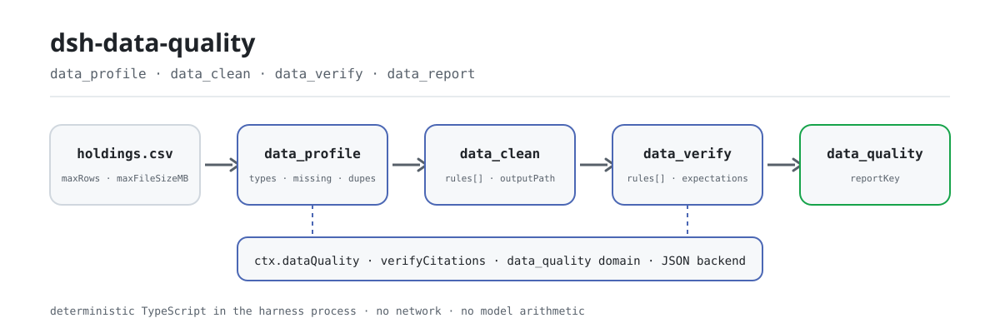
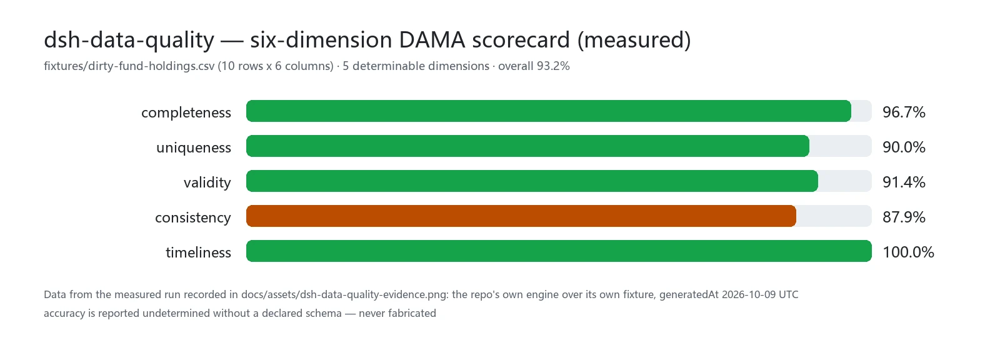

<div align="center">

<picture>
  <source media="(prefers-color-scheme: dark)" srcset="docs/assets/dsh-data-quality-flow-dark.svg">
  
</picture>

# dsh-data-quality

**Pare de fazer o modelo calcular: entregue um CSV e receba um perfil, um dataset limpo e um relatório que você pode reabrir.**

Um plugin determinista de qualidade de dados para o DeepSeek Harness: contagens de linhas e colunas, taxas de ausentes, linhas duplicadas, tipos inferidos, um scorecard DAMA de seis dimensões e sete tipos de regras de verificação — tudo calculado em TypeScript puro dentro do processo do harness, com relatórios persistidos no domínio de armazenamento `data_quality`.

[Instalar](#instalação-em-três-passos) · [Configuração](#configuração) · [FAQ](#faq) · [简体中文](README.md) · [English](README.en.md) · [Español](README.es.md) · [Português](README.pt.md) · [हिन्दी](README.hi.md)

[](LICENSE)
[](#compatibilidade)
[](https://www.npmjs.com/package/dsh-data-quality)
[](https://github.com/PerryLink/dsh-data-quality/actions/workflows/ci.yml)
[](#compatibilidade)

[](https://github.com/PerryLink/dsh-data-quality/stargazers)
[](https://www.npmjs.com/package/dsh-data-quality)
[](https://dshfind.com/plugins/PerryLink/dsh-data-quality?ref=badge)
[](https://securityscorecards.dev/viewer/?uri=github.com/PerryLink/dsh-data-quality)
[](https://dsh.market/)
[](https://gitee.com/perrylink/dsh-data-quality)

```sh
dsh plugin --profile <name> add dsh-data-quality
```

</div>

<sub>Plugin comunitário, sem vínculo com a DeepSeek. Repositório canônico: <https://github.com/PerryLink/dsh-data-quality> (o Gitee é um espelho).</sub>

## O que é

Entregue um CSV ao modelo e o `dsh-data-quality` o lê como um dataset estruturado e calcula com funções puras tudo o que você deveria saber: linhas e colunas, quais colunas são de tipo misto, quanto falta, quanto está duplicado, como são as distribuições numéricas e os outliers IQR — e no fim um scorecard DAMA de seis dimensões. Limpeza e verificação são expressas como regras declarativas; cada execução persiste o relatório no domínio de armazenamento `data_quality` e devolve um `reportKey`, então cada número que o modelo mostra pode ser reaberto em vez de "sentido". Todo o cálculo é TypeScript dentro do processo do harness: sem rede, sem credenciais, sem processos externos, sem chamadas ao modelo.

## Instalação em três passos

1. **Instalar** (escolha um canal):

   ```sh
   # canal git (main mais recente; equivale a git+https://github.com/PerryLink/dsh-data-quality.git)
   dsh plugin --profile web add github:PerryLink/dsh-data-quality
   # canal npm (versões publicadas)
   dsh plugin --profile web add dsh-data-quality
   # canal tarball: pnpm pack neste repo e depois
   dsh plugin --profile web add ./dsh-data-quality-<version>.tgz
   ```

   O primeiro `add` pelo canal git falha porque o pnpm bloqueia o build `prepare` do pacote. Copie a chave exata que o pnpm imprime para o `pnpm-workspace.yaml` do perfil e execute de novo:

   ```yaml
   allowBuilds:
     'dsh-data-quality': true
   ```

   Reinicie o perfil após instalar (os bundles ativam no reinício).

2. **Configuração mínima** (os padrões já funcionam; suba as proteções se precisar):

   ```yaml
   - insert:
       - id: dsh-data-quality
         name: dsh-data-quality
         config:
           maxRows: 200000
           maxFileSizeMB: 64
   ```

3. **Verificar que está montado**:

   ```sh
   dsh --profile web --dump-config | grep -A2 'id: dsh-data-quality'
   ```

   Depois, num workspace com um CSV, peça ao agente:

   > Faça o perfil de `holdings.csv`, limpe aparando espaços, deduplicando por `fund_code` e normalizando as unidades 万/亿 da coluna `holding_value`; por fim verifique que `fund_code` é único e não nulo.

**Desinstalar**: `dsh plugin --profile web remove dsh-data-quality` (ou remova a linha do patch do perfil).

## Capacidades principais

- **Serviço `ctx.dataQuality`** — um serviço Cordis que outros plugins podem consumir opcionalmente (`inject = ['dataQuality']`). Além das três operações sobre datasets por trás das ferramentas, implementa o contrato congelado `verifyCitations(request)`: verifica se números/strings citados num documento batem com um snapshot do dataset, com comparação numérica por tolerância relativa e estados `verified` / `mismatch` / `not-found` / `unverifiable`.
- **Ferramenta `data_profile`** — contagens de linhas/colunas, tipos de coluna inferidos (number/date/boolean/string/empty/mixed), taxas de ausentes, contagens de únicos, distribuições numéricas (min/max/mean/median/p25/p75), contagem de outliers IQR, notas de suspeita por tipos mistos e deteção de linhas duplicadas por hash sha256 do conteúdo da tabela inteira (taxa de duplicados mais uma amostra limitada de índices de linhas duplicadas). Acrescenta um scorecard DAMA determinista de seis dimensões (completeness, uniqueness, validity, consistency, timeliness, accuracy — accuracy é reportada como undetermined sem schema declarado, nunca inventada). Amostragem sistemática determinista opcional para arquivos grandes.
- **Ferramenta `data_clean`** — regras declarativas de limpeza em ordem: `dedupe` (por grupo de colunas), `fill-missing` (constant/mean/median/forward), `coerce-type` (number/date/boolean; as falhas são contadas e viram ausentes), `normalize-unit` (p. ex. sufixos 万/亿 para unidades base), `trim`, `map-values` (mapeamento de enums). Devolve um log de auditoria por regra, um resumo de validação de contrato antes da entrega (dedupe antes/depois, unicidade, regressões de não nulos e de tipos) e uma prévia limitada; só grava o dataset limpo quando `outputPath` é dado, e nunca sobrescreve a origem.
- **Ferramenta `data_verify`** — regras declarativas de verificação: `not-null`, `unique`, `range`, `regex`, `enum`, `cross-column` (p. ex. `startDate < endDate`), `freshness` (coluna de data dentro de N dias de uma data de referência). pass/fail por regra com evidência limitada de linhas falhas; uma falha global é um resultado normal `passed: false`, não um erro de ferramenta.
- **Ferramenta `data_report`** — lê relatórios persistidos do domínio de armazenamento `data_quality`: pela `reportKey` exata (validação segura de caminho; chaves ausentes falham alto) ou por `kind` (listagem cronológica). `format: html` renderiza um relatório de perfil/limpeza como documento HTML offline autocontido (CSS/JS inline, sem pedidos externos) com o scorecard DAMA de seis dimensões e as tabelas de resumo.
- **Relatórios duráveis** — cada execução de perfil/limpeza/verificação/citações persiste no domínio de armazenamento `data_quality` (backend JSON), com chave de timestamp mais impressão digital do caminho do dataset; a chave volta como `reportKey` nos resultados. Relatórios de limpeza também persistem a prévia limitada e o resumo de contrato, então todo resultado visível ao modelo é reconstruível a partir da sua `reportKey`; cada limpeza persiste ainda um relatório de perfil `clean-diff` antes/depois.
- **Eventos de sessão** — em hosts que os suportam com segurança, as execuções acrescentam eventos `data-quality/profile` / `data-quality/clean` / `data-quality/verify` (com a marca `ignorable` onde é admitida). Na linha publicada `0.1.7-rc.2` (como nas linhas rc anteriores) o append é omitido por design — o relatório do domínio de armazenamento é sempre a cópia durável (ver «Limitações conhecidas»).

```text
holdings.csv ──data_profile──▶ relatório ──data_clean──▶ outputPath
                   │                                       │
                   └──── domínio data_quality · reportKey ──┴──data_verify──▶ passed / linhas de evidência
```

### Ferramentas e superfícies

#### `data_profile({ path, sample?, industryPreset? })`

Faz o perfil de um dataset do workspace. `path` é relativo ao workspace (`.csv`/`.tsv`/`.json`/`.jsonl`; JSON deve ser um array de objetos planos). `sample` toma cada `ceil(N/sample)`-ésima linha para os cartões de coluna (determinista; as contagens de linhas continuam exatas). `industryPreset` (`retail`/`saas`/`fund`/`real-estate`/`e-commerce`/`healthcare`/`logistics`/`manufacturing`/`energy`) injeta as colunas esperadas dessa indústria para que a dimensão `accuracy` do scorecard fique determinável; ids desconhecidos falham alto. Devolve o relatório estruturado — taxa de duplicados, índices limitados de linhas duplicadas, distribuições numéricas `count`/`distinct`, `encoding` do arquivo (BOM UTF-8 + validade) e o scorecard DAMA ponderado de seis dimensões — e renderiza um resumo legível por coluna mais o scorecard.

#### `data_clean({ path, rules, outputPath?, dryRun? })`

Aplica `rules` na ordem do array; cada regra vê a saída da anterior. Referência de regras:

| Regra | Campos extra | Semântica |
|---|---|---|
| `dedupe` | `columns?` | Remove linhas cuja combinação de colunas-chave duplica uma linha anterior (a primeira é mantida; todas as colunas se omitido). |
| `fill-missing` | `column`, `strategy`, `value?` | Preenche ausentes: `constant` (exige `value`), `mean`/`median` (colunas numéricas), `forward` (valor anterior não ausente). |
| `coerce-type` | `column`, `to` | Converte para `number`/`date` (ISO)/`boolean`; falhas viram ausentes e são contadas no log. |
| `normalize-unit` | `column`, `factors` | Remove o sufixo de unidade e multiplica (`{"万": 10000, "亿": 100000000}`); numéricos simples também convertem. |
| `trim` | `columns?` | Apara espaços de células de texto (todas as colunas se omitido). |
| `map-values` | `column`, `map`, `else?` | Mapeamento por correspondência exata; valores não mapeados ficam (`keep`, padrão) ou viram `missing`. |

O arquivo de origem **nunca** é sobrescrito. Com `outputPath` o dataset limpo é gravado ali (confinado ao workspace, formato pela extensão); sem ele a execução é só prévia. Com `dryRun: true` nenhum arquivo é gravado e nada é persistido — o resultado devolve o plano de limpeza por coluna e o `contract`/`diffPreview` esperados. O resultado também carrega um resumo de `contract` antes da entrega (linhas antes/depois do dedupe, unicidade sobre a chave de dedupe ou as linhas completas, regressão de não nulos nas colunas `fill-missing`, regressão de tipos nas colunas `coerce-type`, e o traço de decisão por coluna), e um relatório de perfil `clean-diff` antes/depois é persistido no domínio de armazenamento.

#### `data_report({ key?, kind?, format? })`

Lê relatórios persistidos do domínio de armazenamento. Passe `key` (a `reportKey` exata devolvida por uma execução anterior) para obter um relatório, ou `kind` (`profile`/`clean`/`clean-diff`/`verify`/`citations`) para listar cronologicamente todos os relatórios desse tipo; exige-se exatamente um de `key`/`kind`. Chaves malformadas ou ausentes falham alto. `format: html` (com `key`) renderiza o relatório como documento HTML offline autocontido: CSS/JS inline, sem pedidos externos, o scorecard DAMA de seis dimensões e as tabelas de resumo de perfil/limpeza (apenas relatórios profile/clean).

#### `data_verify({ path, rules, expectations? })`

Avalia regras de verificação. Referência de regras:

| Regra | Campos extra | Semântica |
|---|---|---|
| `not-null` | `column` | Falham células ausentes (null/vazio/só espaços). |
| `unique` | `columns` | Falha cada linha cuja combinação-chave se repete (ausentes participam). |
| `range` | `column`, `min?`, `max?` | Falham células ausentes/não parseáveis e valores fora dos limites inclusivos (pelo menos um limite é obrigatório). |
| `regex` | `column`, `pattern`, `flags?` | Falham células ausentes ou que não correspondem (regex JS completa). |
| `enum` | `column`, `values` | Falham células cujo texto aparado não está na lista. |
| `cross-column` | `left`, `op`, `rightColumn?`, `value?` | Compara por linha: numérico se ambos os lados parseiam, datas como épocas, strings só para `==`/`!=` (exatamente um de `rightColumn`/`value`). |
| `freshness` | `column`, `maxAgeDays`, `asOf?` | Falham datas mais antigas que `maxAgeDays` antes de `asOf` (padrão: agora); não parseável/ausente falha. |

`expectations` reconcilia métricas deterministas com valores esperados: `rowCount`, `columnSum`, `columnMean`, `uniqueCount`, `nullCount` (cada um com `column` exceto `rowCount`, mais `expected` e uma `tolerance` relativa opcional em [0, 1]). Cada expectativa produz `passed` mais `actual`/`expected`/`tolerance`; uma discrepância é um veredicto normal `passed: false`, nunca um erro de ferramenta. Métricas inválidas, colunas ausentes e tolerâncias fora de faixa falham alto.

Uma célula ausente faz falhar toda regra que a lê. A evidência é limitada a `evidenceRowLimit` linhas falhas por regra.

#### `ctx.dataQuality` (para outros plugins)

```ts
const result = await ctx.dataQuality.verifyCitations({
  dataset: 'holdings.csv',          // resolvido contra workspaceRoot
  citations: [
    { id: 'c1', path: 'rows[3].nav', value: 1.234, tolerance: 0.01 },
    { id: 'c2', path: 'summary.annualReturn', value: '12.34%' },
  ],
})
// result.results[i] = { id, status: 'verified' | 'mismatch' | 'not-found' | 'unverifiable', actual?, note? }
```

Os localizadores percorrem o documento do dataset: CSV/TSV carregam como `{ columns, rows }` (por isso `rows[3].nav` resolve), JSON é o valor parseado, JSONL o array de linhas parseadas. Números comparam com tolerância relativa (`|a-b| <= tolerance * max(|a|, |b|)`); uma célula de texto CSV que parseia numericamente compara como número; strings comparam exatas; pares de tipos incomparáveis são `unverifiable`. O serviço também expõe `profileDataset` / `cleanDataset` / `verifyDataset` (as mesmas operações que as ferramentas chamam).

### Exemplos

São os pontos de entrada reais; instale e chame um.

**Exemplo detalhado** — comando `data_profile`, entrada:

```sh
data_profile({ path: "dirty-fund-holdings.csv" })
```

Saída:

```text
Profile of dirty-fund-holdings.csv: 10 rows x 6 columns
Duplicate rows: 1 (10.0%); sample row indexes: 8
- nav: mixed; missing 1 (10.0%); unique 7; note: mixed types among 9 present values: 8 numeric, 1 string
Scorecard (overall 93.2%, weighted 93.2%):
```

*Observado em `README.md:147-149; test/profile.spec.ts:130-132; test/loader.spec.ts:98-99; src/profile.ts:311-315`*

**Ramo de falha** — entrada:

```text
{"path":"dirty-fund-holdings.csv","rules":[{"rule":"dedupe","columns":["nope"]}]}
```

Saída:

```text
isError=true; error.message=rule 0: unknown column "nope" (columns: fund_code, fund_name, nav, nav_date, holding_value, currency)
```

*Observado em `plugins/dsh-data-quality/src/clean.ts:66-68; plugins/dsh-data-quality/fixtures/dirty-fund-holdings.csv; exercised through plugins/dsh-data-quality/test/harness.ts`*

**Exemplos breves**: `data_clean` · `data_verify`

## Dados medidos

<picture>
  <source media="(prefers-color-scheme: dark)" srcset="docs/assets/dsh-data-quality-evidence-en-dark.webp">
  
</picture>

Medido sobre o fixture do próprio repo, `fixtures/dirty-fund-holdings.csv` (10 linhas x 6 colunas): completeness 96.7% · uniqueness 90.0% · validity 91.4% · consistency 87.9% · timeliness 100.0%, total ponderado 93.2%; a sexta dimensão, accuracy, é reportada como undetermined sem schema declarado (só fica determinável com um `industryPreset`). Não é um benchmark de exatidão: é uma leitura determinista e recalculável sobre os mesmos dados sujos. Os dados vêm da execução medida registrada em `docs/assets/dsh-data-quality-evidence.png` (o motor do próprio repo sobre o seu próprio fixture, generatedAt 2026-10-09 UTC) e podem ser reproduzidos com `node scripts/loader-runner.mjs` (sem chave de API).

## Configuração

Todas as chaves são opcionais (mostram-se os padrões); valores inválidos falham ruidosamente ao carregar. Cada chave pode ser alterada no `cordis.yml` (o bundle traz `cordis.patch.yml` com os mesmos padrões). Uma sobreposição por id substitui a linha inteira — repita todas as chaves de que precisa.

Chaves mais usadas:

| Chave | Padrão | Descrição |
|---|---|---|
| `enabled` | `true` | Interruptor mestre; `false` não monta nada. |
| `maxRows` | `200000` | Teto rígido de linhas por carga; entradas maiores são rejeitadas ruidosamente (use o parâmetro `sample` da ferramenta). |
| `maxFileSizeMB` | `64` | Teto rígido de tamanho de arquivo em MiB por carga. |
| `evidenceRowLimit` | `20` | Teto de linhas de evidência (verify) e de prévia (clean) num resultado. |
| `allowedExtensions` | `['.csv', '.tsv', '.json', '.jsonl']` | Extensões aceitas como datasets. |
| `workspaceRoot` | `""` | Raiz absoluta para chamadas de nível de SERVIÇO (p. ex. `verifyCitations`) sem workspace de sessão; vazio = diretório de arranque do processo do harness. As ferramentas usam sempre o cwd do workspace da sessão. |
| `storeReports` | `true` | Persistir os relatórios no domínio de armazenamento `data_quality` e devolver `reportKey`. |

<details>
<summary>Tabela de configuração completa (9 chaves)</summary>

| Chave | Padrão | Descrição |
|---|---|---|
| `enabled` | `true` | Interruptor mestre; `false` não monta nada. |
| `maxRows` | `200000` | Teto rígido de linhas por carga; entradas maiores são rejeitadas ruidosamente (use o parâmetro `sample` da ferramenta). |
| `maxFileSizeMB` | `64` | Teto rígido de tamanho de arquivo em MiB por carga. |
| `defaultTolerance` | `1e-9` | Tolerância relativa padrão para comparação numérica de citações quando a citação omite `tolerance`. |
| `evidenceRowLimit` | `20` | Teto de linhas de evidência (verify) e de prévia (clean) num resultado. |
| `allowedExtensions` | `['.csv', '.tsv', '.json', '.jsonl']` | Extensões aceitas como datasets. |
| `workspaceRoot` | `""` | Raiz absoluta para chamadas de nível de SERVIÇO (p. ex. `verifyCitations`) sem workspace de sessão; vazio = diretório de arranque do processo do harness. As ferramentas usam sempre o cwd do workspace da sessão. |
| `storeReports` | `true` | Persistir os relatórios no domínio de armazenamento `data_quality` e devolver `reportKey`. |
| `scorecardWeights` | tudo 1 (igual) | Pesos por dimensão (completeness/uniqueness/validity/consistency/timeliness/accuracy) para o total ponderado do scorecard; cada peso deve ser um número não negativo. |

</details>

Exemplo de sobreposição no patch do perfil:

```yaml
- insert:
    - id: dsh-data-quality
      name: dsh-data-quality
      config:
        maxRows: 50000
        evidenceRowLimit: 10
        scorecardWeights:
          completeness: 2
          uniqueness: 1
```

## FAQ

<details>
<summary>Onde ficam os dados? Podem sair da máquina?</summary>

Lê arquivos de dataset do workspace (apenas extensões permitidas) e grava exatamente duas coisas: o arquivo de saída do `data_clean` quando um `outputPath` explícito é dado (confinado ao workspace, nunca a entrada) e relatórios no domínio de armazenamento `data_quality` sob o diretório de dados do harness. **Sem rede, sem credenciais, sem processos externos** — todo o parsing e a estatística são TypeScript em processo. Os relatórios podem conter valores de célula de amostra dos seus datasets (limitados por `evidenceRowLimit` e pelo truncamento de exibição); o log de sessão registra argumentos e resultados de ferramentas como de costume.

</details>

<details>
<summary>O que acontece num perfil nu ou num host sem eventos de sessão?</summary>

O plugin injeta de forma dura `tools` e `storageDomain`: os perfis oficiais (web/headless/sdk/acp) compõem a pilha de armazenamento (`dsh-storage` + `dsh-storage-json` + `dsh-storage-domain`) via `dsh-base`, então um perfil nu precisa compô-la por conta própria ou o plugin não monta. Os eventos de sessão são adaptativos: quando o host não conhece o vocabulário `data-quality/*` e o `Session.append` não consegue marcar `ignorable`, o append é omitido (nunca corrompe o log de sessão) e o relatório do domínio `data_quality` continua a ser a cópia durável.

</details>

<details>
<summary>Concorre com outros plugins por chaves de serviço, nomes de ferramenta ou slots?</summary>

Não. Não registra nenhum listener waterfall, publica uma única chave de serviço com espaço de nomes (`dataQuality`), nomeia as quatro ferramentas com o prefixo `data_`, não registra slots de cliente nem prefixos `webServer`, e não muta globais; o patch do bundle apenas faz `insert` da sua própria linha. A argumentação ponto a ponto está em «Interoperabilidade com outros plugins DSH».

</details>

<details>
<summary>Qual é o custo de desempenho? E com arquivos grandes?</summary>

Parsing e estatística são TypeScript em processo sem dependências: sem inferência, sem rede, sem chamadas ao modelo, então um CSV típico custa uma leitura de arquivo mais uma varredura linear. As proteções são rígidas: `maxRows` (200000 por padrão) e `maxFileSizeMB` (64 por padrão) rejeitam entradas sobredimensionadas ruidosamente, o parâmetro `sample` do `data_profile` dá amostragem sistemática determinista, e os sinais de aborto cancelam cargas longas a meio caminho.

</details>

<details>
<summary>O modelo pode errar as contas?</summary>

Não — o modelo não faz aritmética aqui. Contagens de linhas, taxas de ausentes, quantis, outliers IQR, taxas de duplicados, o scorecard e os veredictos de verificação são produzidos por funções deterministas; mesma entrada, mesma saída, e o único relógio é o injetado para os padrões de `freshness` e os timestamps de relatório. O modelo escolhe a ferramenta e as regras, e narra o resultado.

</details>

## Limites de segurança

- **Confinamento de caminho** — caminhos de dataset e de saída devem resolver dentro do workspace da sessão (`verifyCitations` usa `workspaceRoot`); escapes `..` e caminhos absolutos fora da raiz são rejeitados, e ambos os lados são normalizados antes da comparação (seguro com barras do Windows).
- **Trabalho limitado** — as guardas `maxRows` / `maxFileSizeMB` rejeitam entradas sobredimensionadas ruidosamente; sinais de aborto cancelam cargas longas a meio caminho.
- **Sem sobrescrita** — o `data_clean` recusa um `outputPath` igual ao caminho de entrada.
- **Cálculo determinista** — mesma entrada, mesma saída; o único relógio é o injetado para os padrões de `freshness` e os timestamps de relatório.
- **Registar é um effect** — o registo de ferramentas e o fecho do domínio de armazenamento são effects do Cordis, removidos ao parar/recarregar a quente.

## Permissões e dados

- **Lê** arquivos de dataset do workspace (apenas extensões permitidas).
- **Grava** apenas: o arquivo de saída do `data_clean` (`outputPath` explícito, confinado ao workspace, nunca a entrada) e relatórios no domínio de armazenamento `data_quality` sob o diretório de dados do harness.
- **Sem rede, sem credenciais, sem processos externos** — todo o parsing e a estatística são TypeScript em processo.
- Os relatórios podem conter valores de célula de amostra dos seus datasets (limitados por `evidenceRowLimit` e pelo truncamento de exibição); o log de sessão registra argumentos e resultados de ferramentas como de costume.

## Limitações conhecidas

- **Os eventos de sessão são adaptativos.** A linha publicada `0.1.7-rc.2` (como as linhas rc anteriores) não tem superfície de registo de eventos de sessão para plugins e o seu `Session.append` não consegue marcar `ignorable`, então acrescentar um tipo `data-quality/*` desconhecido tornaria o log de sessão ilegível ao restaurar. Por isso o plugin só acrescenta quando o host conhece o vocabulário ou suporta a flag `ignorable`; na linha publicada o relatório do domínio de armazenamento é o registo durável.
- **Dialeto CSV** — vírgula/tab com aspas RFC-4180, linha de cabeçalho obrigatória, linhas em branco ignoradas; sem autodeteção de delimitador nem linhas de comentário.
- **O parsing de tipos é estrito** — números sem separadores de milhares; datas são `YYYY-MM-DD` / `YYYY/MM/DD` / datetimes estilo ISO (UTC); booleanos são `true/false/yes/no/1/0`. Tudo o resto faz perfil como `string`/`mixed` — limpe com `coerce-type` se for intencional.
- **JSON tem de ser tabular para as ferramentas** (array de objetos planos); `verifyCitations` percorre documentos JSON arbitrários.
- **Sem deteção de anomalias por ML, sem mascaramento de PII, sem bases de dados, sem SQL** — apenas notas de suspeita baseadas em regras.

## Interoperabilidade com outros plugins DSH

Verificado contra o corredor de host que este repositório declara (`>=0.2.1-0 <0.3.0`) e o contrato de plugins do `dsh-plugin-guide`.

Este plugin **não interfere** com outros plugins:

- **Sem contenção de listeners.** Não registra nenhum listener waterfall (nem `agent/pre-step` nem `tools/post-execute`), por isso não pode esfomear nem curto-circuitar a cadeia de outro plugin.
- **Chave de serviço com espaço de nomes.** Publica exatamente uma chave de serviço, `dataQuality`, e não ocupa nenhuma chave embutida ou de terceiros; os consumidores declaram a dependência com `inject = ['dataQuality']`.
- **Sem colisão de nomes de ferramenta.** Os quatro nomes `data_profile` / `data_clean` / `data_verify` / `data_report` levam o prefixo `data_` e não tomam nenhum nome nu de ferramenta embutida ou de outro plugin.
- **Sem colisão de slot nem de rota HTTP.** É um plugin só de host (sem metade de navegador): não registra slots de cliente nem prefixos `webServer`.
- **Sem colisão de camada de patch.** O patch do bundle apenas faz `insert` da sua própria linha; nunca sobrescreve o `config` de uma linha embutida.
- **Isolamento do domínio de armazenamento.** Grava apenas o seu próprio domínio `data_quality` (backend JSON) e não toca no de outros plugins.
- **Sem mutação global.** Não altera protótipos, não reescreve `process.env`, não substitui o dispatcher global de fetch; sem pedidos de rede, sem processos externos.

Evidência estática: o emblema histórico de verificação do `dsh-plugin-doctor` neste repositório ([relatório](https://github.com/PerryLink/dsh-plugin-doctor#verified-徽章)).

## Compatibilidade

| Superfície | Estado |
|---|---|
| Harness | DeepSeek Harness `dsh-v0.2.1-alpha.1` (adaptado em 2026-10-04): o intervalo de peers admite a linha alpha.2; aí o terceiro parâmetro de `Session.append` existe apenas para tipos de superfície e é um `SurfaceIntent`, por isso a porta de auditoria continua a omitir e o relatório do domínio de armazenamento continua a ser a cópia durável. Verificado em 2026-09-24 (três réguas de typecheck + suite completa verde). |
| Node | `^22.19.0 \|\| >=24.9.0` |
| Gestor de pacotes | `pnpm@11.7.0` |
| Plataforma | Windows / macOS / Linux (plugin só de host) |
| Modelo | Modelos de texto totalmente suportados; sem capacidade extra de modelo |

## Ecossistema e qualidade

- [Espelho no Gitee](https://gitee.com/perrylink/dsh-data-quality) (espelho sincronizado; o GitHub é canónico)
- [Página no dshfind](https://dshfind.com/plugins/PerryLink/dsh-data-quality) (instalações e ranking)
- [Relatório OpenSSF Scorecard](https://securityscorecards.dev/viewer/?uri=github.com/PerryLink/dsh-data-quality) (movido por [.github/workflows/scorecard.yml](.github/workflows/scorecard.yml))
- [Emblema de verificação do dsh-plugin-doctor](https://github.com/PerryLink/dsh-plugin-doctor#verified-徽章) (histórico)
- [DSH Market](https://dsh.market/) (listado)
- **Canal da loja 1024**: `npm i -g dsh1024` uma vez e depois `dsh1024 plugin --profile web add dsh-data-quality` (conta para o ranking de instalações de [deepseek1024.com](https://deepseek1024.com))
- [Base de conhecimento do ecossistema](https://perrylink.github.io/dsh-plugin-guide/): dados medidos, não marketing — guia de desenvolvimento · dados de seleção · critérios de manutenção

## Desenvolvimento

```sh
pnpm install                                                     # node ^22.19 || >=24.9
pnpm run typecheck && pnpm run typecheck:ci && pnpm run typecheck:checkout
pnpm test                                                        # vitest
pnpm run build                                                   # saída do tsdown + ajustes de d.ts
pnpm run verify:self-contained && pnpm run verify:artifacts     # specs de dependências + arquivos publicados
node scripts/check-readme-sync.mjs                               # consistência dos README em cinco idiomas
pnpm pack
```

- Os testes correm vitest contra os `Context`/`Session`/`ToolRuntime`/domínio de armazenamento REAIS (sem mocks de serviços escritos à mão) mais specs de motor puros; cada regra de limpeza/verificação tem casos positivos e negativos, e `verifyCitations` cobre os quatro estados.
- `scripts/loader-runner.mjs` arranca a composição real do Loader e executa a cadeia perfil → limpeza → verificação contra `fixtures/` sem chave de API.
- Release: `node scripts/release.mjs <x.y.z>` (nunca faz push; a tag dispara `release.yml`).
- As imagens do README são geradas programaticamente por [`scripts/gen-readme-assets.py`](scripts/gen-readme-assets.py) (Python + Pillow): um SVG de pipeline escrito à mão em duas peles para o hero e webp claro/escuro para o gráfico medido; pode ser reexecutado.

Topics: `dsh`, `dsh-plugin`, `deepseek-harness`, `cordis`, `data-quality`, `data-cleaning`, `data-profiling`, `data-verification`

## Família e agradecimentos

Este projeto faz parte da família de plugins DeepSeek Harness do [PerryLink](https://github.com/PerryLink) (todos Apache-2.0). Se for útil, **uma estrela ajuda a próxima pessoa a encontrá-lo** — nada fica bloqueado por trás disso.

- [@PerryLink](https://github.com/PerryLink) — manutenção e releases (`0.1.2`/`0.1.3`), atualizações de peer-dependencies, os emblemas npm version/downloads/CI e correções recentes.
- **dsh-data-quality contributors** — o scaffold inicial, o seam `ctx.dataQuality` e o contrato congelado `verifyCitations`, a camada de datasets determinista e os motores puros, os relatórios do domínio `data_quality`, a suite vitest com serviços reais, os fluxos CI/compat/release e os README em cinco idiomas.

<details>
<summary>Expandir todos os plugins</summary>

| Plugin | Status |
|---|---|
| **[dsh-aqua-input-check](https://github.com/PerryLink/dsh-aqua-input-check)** |  |
| **[dsh-archive-check](https://github.com/PerryLink/dsh-archive-check)** |  |
| **[dsh-auto-review](https://github.com/PerryLink/dsh-auto-review)** |  |
| **[dsh-autotier](https://github.com/PerryLink/dsh-autotier)** | 🧊 CONGELADO — ver o README do repo |
| **[dsh-bid-ca-precheck](https://github.com/PerryLink/dsh-bid-ca-precheck)** |  |
| **[dsh-bid-qual-check](https://github.com/PerryLink/dsh-bid-qual-check)** |  |
| **[dsh-cert-mcp](https://github.com/PerryLink/dsh-cert-mcp)** | 🧊 CONGELADO — ver o README do repo |
| **[dsh-checkpoint-rewind](https://github.com/PerryLink/dsh-checkpoint-rewind)** |  |
| **[dsh-click](https://github.com/PerryLink/dsh-click)** |  |
| **[dsh-composer-history](https://github.com/PerryLink/dsh-composer-history)** |  |
| **[dsh-contract-stance](https://github.com/PerryLink/dsh-contract-stance)** |  |
| **[dsh-customs-doc-check](https://github.com/PerryLink/dsh-customs-doc-check)** |  |
| **[dsh-data-quality](https://github.com/PerryLink/dsh-data-quality)** | 🧊 CONGELADO — ver o README do repo |
| **[dsh-demurrage-ledger](https://github.com/PerryLink/dsh-demurrage-ledger)** |  |
| **[dsh-doublecheck](https://github.com/PerryLink/dsh-doublecheck)** |  |
| **[dsh-drill-script-check](https://github.com/PerryLink/dsh-drill-script-check)** |  |
| **[dsh-eia-guide-check](https://github.com/PerryLink/dsh-eia-guide-check)** |  |
| **[dsh-emergency-plan](https://github.com/PerryLink/dsh-emergency-plan)** |  |
| **[dsh-essay-rubric-check](https://github.com/PerryLink/dsh-essay-rubric-check)** |  |
| **[dsh-evidence-check](https://github.com/PerryLink/dsh-evidence-check)** |  |
| **[dsh-export-ctl-check](https://github.com/PerryLink/dsh-export-ctl-check)** |  |
| **[dsh-fast](https://github.com/PerryLink/dsh-fast)** |  |
| **[dsh-fmea-table-check](https://github.com/PerryLink/dsh-fmea-table-check)** |  |
| **[dsh-forecast-penalty](https://github.com/PerryLink/dsh-forecast-penalty)** |  |
| **[dsh-fund-research](https://github.com/PerryLink/dsh-fund-research)** |  |
| **[dsh-github](https://github.com/PerryLink/dsh-github)** |  |
| **[dsh-gongwen-flow-check](https://github.com/PerryLink/dsh-gongwen-flow-check)** |  |
| **[dsh-gongwen-word-check](https://github.com/PerryLink/dsh-gongwen-word-check)** |  |
| **[dsh-guard-plan-qc](https://github.com/PerryLink/dsh-guard-plan-qc)** |  |
| **[dsh-hazchem-check](https://github.com/PerryLink/dsh-hazchem-check)** |  |
| **[dsh-hazplan-check](https://github.com/PerryLink/dsh-hazplan-check)** |  |
| **[dsh-hidden-risk-map](https://github.com/PerryLink/dsh-hidden-risk-map)** |  |
| **[dsh-hs-classify](https://github.com/PerryLink/dsh-hs-classify)** |  |
| **[dsh-icd-rule-check](https://github.com/PerryLink/dsh-icd-rule-check)** |  |
| **[dsh-industry-research](https://github.com/PerryLink/dsh-industry-research)** |  |
| **[dsh-lawcite-adapter](https://github.com/PerryLink/dsh-lawcite-adapter)** |  |
| **[dsh-laya](https://github.com/PerryLink/dsh-laya)** |  |
| **[dsh-lc-doc-check](https://github.com/PerryLink/dsh-lc-doc-check)** |  |
| **[dsh-learning-gap-check](https://github.com/PerryLink/dsh-learning-gap-check)** |  |
| **[dsh-library](https://github.com/PerryLink/dsh-library)** |  |
| **[dsh-local-ai](https://github.com/PerryLink/dsh-local-ai)** |  |
| **[dsh-lsp-actions](https://github.com/PerryLink/dsh-lsp-actions)** |  |
| **[dsh-mask](https://github.com/PerryLink/dsh-mask)** |  |
| **[dsh-mcp-panel](https://github.com/PerryLink/dsh-mcp-panel)** |  |
| **[dsh-medrec-qc](https://github.com/PerryLink/dsh-medrec-qc)** |  |
| **[dsh-memento](https://github.com/PerryLink/dsh-memento)** | 🧊 CONGELADO — ver o README do repo |
| **[dsh-nsfc-form-check](https://github.com/PerryLink/dsh-nsfc-form-check)** |  |
| **[dsh-nurse-record-check](https://github.com/PerryLink/dsh-nurse-record-check)** |  |
| **[dsh-observe](https://github.com/PerryLink/dsh-observe)** |  |
| **[dsh-origin-rvc-check](https://github.com/PerryLink/dsh-origin-rvc-check)** |  |
| **[dsh-ota-review-check](https://github.com/PerryLink/dsh-ota-review-check)** |  |
| **[dsh-output-styles](https://github.com/PerryLink/dsh-output-styles)** |  |
| **[dsh-paper-doc-adapter](https://github.com/PerryLink/dsh-paper-doc-adapter)** |  |
| **[dsh-permission-rules](https://github.com/PerryLink/dsh-permission-rules)** |  |
| **[dsh-permit-report-check](https://github.com/PerryLink/dsh-permit-report-check)** |  |
| **[dsh-pipeline-check](https://github.com/PerryLink/dsh-pipeline-check)** |  |
| **[dsh-pleading-draft](https://github.com/PerryLink/dsh-pleading-draft)** |  |
| **[dsh-plugin-doctor](https://github.com/PerryLink/dsh-plugin-doctor)** | 🚫 APOSENTADO (repo arquivado) |
| **[dsh-plugin-guide](https://github.com/PerryLink/dsh-plugin-guide)** |  |
| **[dsh-plugin-kit](https://github.com/PerryLink/dsh-plugin-kit)** | 🚫 APOSENTADO (repo arquivado) |
| **[dsh-plugin-upgrade](https://github.com/PerryLink/dsh-plugin-upgrade)** | 🚫 APOSENTADO (repo arquivado) |
| **[dsh-policy-brief-draft](https://github.com/PerryLink/dsh-policy-brief-draft)** |  |
| **[dsh-power-loss-split](https://github.com/PerryLink/dsh-power-loss-split)** |  |
| **[dsh-power-ticket-check](https://github.com/PerryLink/dsh-power-ticket-check)** |  |
| **[dsh-ppap-check](https://github.com/PerryLink/dsh-ppap-check)** |  |
| **[dsh-protest-deadline](https://github.com/PerryLink/dsh-protest-deadline)** |  |
| **[dsh-railway-window](https://github.com/PerryLink/dsh-railway-window)** |  |
| **[dsh-repair-order-qc](https://github.com/PerryLink/dsh-repair-order-qc)** |  |
| **[dsh-research-report](https://github.com/PerryLink/dsh-research-report)** |  |
| **[dsh-review-reply-check](https://github.com/PerryLink/dsh-review-reply-check)** |  |
| **[dsh-rulefile-check](https://github.com/PerryLink/dsh-rulefile-check)** |  |
| **[dsh-safety-brief-check](https://github.com/PerryLink/dsh-safety-brief-check)** |  |
| **[dsh-score](https://github.com/PerryLink/dsh-score)** | 🧊 CONGELADO — ver o README do repo |
| **[dsh-session-sync](https://github.com/PerryLink/dsh-session-sync)** |  |
| **[dsh-site-log-check](https://github.com/PerryLink/dsh-site-log-check)** |  |
| **[dsh-skill-pack-security](https://github.com/PerryLink/dsh-skill-pack-security)** |  |
| **[dsh-soe-decision-check](https://github.com/PerryLink/dsh-soe-decision-check)** |  |
| **[dsh-soilwater-check](https://github.com/PerryLink/dsh-soilwater-check)** |  |
| **[dsh-sop-sync-check](https://github.com/PerryLink/dsh-sop-sync-check)** |  |
| **[dsh-spc-gbt-adapter](https://github.com/PerryLink/dsh-spc-gbt-adapter)** |  |
| **[dsh-talk](https://github.com/PerryLink/dsh-talk)** |  |
| **[dsh-tender-extract](https://github.com/PerryLink/dsh-tender-extract)** |  |
| **[dsh-tender-matrix](https://github.com/PerryLink/dsh-tender-matrix)** |  |
| **[dsh-test-drive](https://github.com/PerryLink/dsh-test-drive)** |  |
| **[dsh-ticktick](https://github.com/PerryLink/dsh-ticktick)** | 🚫 APOSENTADO (repo arquivado) |
| **[dsh-translate](https://github.com/PerryLink/dsh-translate)** |  |
| **[dsh-warranty-calc](https://github.com/PerryLink/dsh-warranty-calc)** |  |
| **[dsh-budget](https://github.com/PerryLink/dsh-budget)** | 🧊 CONGELADO — ver o README do repo |
| **[dsh-claude-move](https://github.com/PerryLink/dsh-claude-move)** | 🧊 CONGELADO — ver o README do repo |
| **[dsh-defend](https://github.com/PerryLink/dsh-defend)** | 🧊 CONGELADO — ver o README do repo |
| **[dsh-draw](https://github.com/PerryLink/dsh-draw)** | 🧊 CONGELADO — ver o README do repo |
| **[dsh-reach](https://github.com/PerryLink/dsh-reach)** | 🧊 CONGELADO — ver o README do repo |
| **[dsh-background-agents](https://github.com/PerryLink/dsh-background-agents)** | 🚫 APOSENTADO (repo arquivado) |
| **[dsh-session-pin](https://github.com/PerryLink/dsh-session-pin)** | 🚫 APOSENTADO (repo arquivado) |
| **[dsh-team-rooms](https://github.com/PerryLink/dsh-team-rooms)** | 🚫 APOSENTADO (repo arquivado) |

</details>

## Licença

[LICENSE](LICENSE) (Apache License 2.0) © 2026 dsh-data-quality contributors

<p align="center"><sub>Apache-2.0 · Plugin comunitário, sem vínculo com a DeepSeek.</sub></p>
